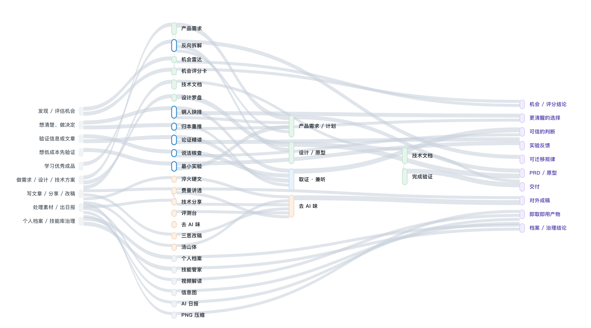

# Job Yang AI Skills

AI Agent Skills by Job Yang.

This is a long-term Skill repository: a place to turn repeated judgment, workflow, scripts, and boundaries from real work into reusable Agent Skills.

In the AI era, the most valuable things are not always one-off answers. They are the working patterns that survive repetition. A writing decision, a way to inspect a video, a habit of separating observation from guesswork: if they stay inside one chat, they disappear quickly. A Skill turns that experience into something installable, callable, and open to further refinement.

This repository is not a prompt cheat sheet. Each Skill should be a compact piece of practice: it knows when to trigger, what material to inspect, where its limits are, and when it should stop and let a human decide.

[简体中文](./README.md)

## Skills (30 Skills · 6 Logical Groups)

### 1. Engineering Lifecycle (`engineering`)

| Skill | What it does |
| --- | --- |
| [engineering-docs](./skills/engineering-docs/README.en.md) | Unified engineering-document entry point for context gathering, co-authoring, technical decisions, diagrams, and implementation validation. |
| [implement-spec](./skills/implement-spec/) | Executable implementation spec: compiles confirmed requirements, RFCs, or refactors into deep-module interfaces, test seams, compatible migrations, and 1-commit steps. |
| [spec-battle](./skills/spec-battle/) | Adversarial doc review before implementation: runs a clean read-only prosecutor against PRDs, RFCs, or specs with four-part objections and structured user rulings. |
| [go-work](./skills/go-work/) | Low-context step-by-step execution: orchestrates isolated step contexts, parallel detached worktrees, lossless cross-session resume, and spec archiving. |
| [diff-review](./skills/diff-review/) | Read-only deep code review: scales review depth by size and risk, filters false positives with Skeptic verification, tests in isolation, and drafts PR feedback. |
| [code-bugfix](./skills/code-bugfix/) | Red-loop root-cause debugging: builds a fast deterministic repro first, falsifies ranked hypotheses, pins the fix with a red-to-green regression test, and sweeps siblings. |
| [pr-prep](./skills/pr-prep/) | PR packaging & pre-merge check: flags workspace leaks, advises on splitting oversized diffs, drafts reviewer-ready notes, and builds offline visual HTML walkthroughs in `$TMPDIR`. |
| [vdd](./skills/vdd/) | Verification-driven development: enforces empirical completion gates and anti-drift contracts before claiming "done" or "no problem". |

### 2. Product Incubation & Prototyping (`product-opc`)

| Skill | What it does |
| --- | --- |
| [opportunity-radar](./skills/opportunity-radar/) | Finds product leads in public sources or supplied material, retaining evidence and signal strength. |
| [opportunity-scorecard](./skills/opportunity-scorecard/) | Evaluates product ideas across ten dimensions, with deterministic scoring and verdicts. |
| [product-brief](./skills/product-brief/) | Turns direct requirements or research into a PRD, testable acceptance conditions, milestones, or lightweight feature cards for existing codebases. |
| [style-compass](./skills/style-compass/) | Style Compass: UI/UX aesthetic and motion engine with 9 high-craft visual packs, composable 5-axis craft genome, interactive gallery picking, and full 4-stage review. |
| [minimum-experiment](./skills/minimum-experiment/) | Minimum experiment: pick the most decisive, uncertain assumption and get real feedback via a cheap reversible experiment with preset continue/stop signals. |
| [reverse-teardown](./skills/reverse-teardown/README.en.md) | Reverse-tear down a strong artifact into its structure and key choices, separate transferable rules from context-only details, and output an action checklist plus a minimum experiment. |

### 3. Decision & Critical Thinking (`thinking`)

| Skill | What it does |
| --- | --- |
| [steelman-choice](./skills/steelman-choice/) | Steelman choice: when two options both sound right, build each side at its strongest (Principle of Charity), surface the real disagreement and one decision-flip question before choosing. |
| [claim-check](./skills/claim-check/) | Claim check: split a discrete claim into fact/inference/value, verify facts on a five-level credibility scale, then audit the reasoning chain. |
| [argument-reading](./skills/argument-reading/) | Argument reading: rebuild a whole article into an argument map—charitable reconstruction first, then evaluate evidence, hidden premises, and failure conditions. |
| [root-rethink](./skills/root-rethink/) | Root rethink: first-principles rethinking plus cross-domain mechanism borrowing—split facts/assumptions/goals/constraints to escape patch-on-patch solutions. |
| [outside-view](./skills/outside-view/) | Retrieves evidence only when it can change a decision, resolves conflicts, and stops unproductive research. |

### 4. Writing, Research & Infographics (`writing`)

| Skill | What it does |
| --- | --- |
| [writing-craft](./skills/writing-craft/) | Writing Craft: unified article entry that locks one active branch (`sharing` for practical engineering shares/retros/talks/slides, `opinion` for plain conversational hard-opinion essays & ≤120-char notes, `tangshan` for incentive/cycle analytical essays). |
| [haohao-shuohua](./skills/haohao-shuohua/) | Cleans Chinese writing so it sounds like a person wrote it: keeps facts, removes AI flavor, restores Chinese rhythm, and blocks fake profundity. |
| [haohao-eval](./skills/haohao-eval/) | Evaluates Chinese rewrites with blind judging, daily failure recall, candidate gates, release monitoring, and automatic rollback. |
| [feynman-explainer](./skills/feynman-explainer/) | Uses the Feynman technique to truly explain hard things: one reasoning chain, derived step by step, so non-experts actually get it. |
| [sansi-erhouxing](./skills/sansi-erhouxing/) | Think before you edit: read the whole skeleton of an existing document before changing it, instead of patching one paragraph at a time. |
| [content-infographic](./skills/content-infographic/) | Content Infographic: turns key article concepts into clear visual infographics and covers anchored tightly to the prose. |

### 5. Personal Intelligence, Context & Media (`personal-tools`)

| Skill | What it does |
| --- | --- |
| [ai-briefing](./skills/ai-briefing/) | Daily AI Briefing: a 5-minute daily AI/tech digest with facts, judgment, and opportunity scores, plus Friday GitHub Trending recaps. |
| [me-context](./skills/me-context/README.en.md) | Portable personal AI context: stores facts, preferences, and health notes in tiered local Markdown; AI drafts, humans confirm. |
| [png-compress](./skills/png-compress/) | Batch-compresses PNG assets locally with incremental caching, quality gates, and automatic fallback, without an online API. |
| [video-reader](./skills/video-reader/) | Turns video into timestamped keyframes and a motion timeline, so an image-only LLM can reason about what happened at which second. |

### 6. Library Governance (`governance`)

| Skill | What it does |
| --- | --- |
| [skill-library-keeper](./skills/skill-library-keeper/) | Skill library keeper: library-level governance—five-question admission gate, health checks (collisions, orphans, hard platform coupling), and use/distill/rebuild decisions for external skills; auto-discovers the library path, zero hard platform coupling. |

Logical groups are declared in `tools/skills-manifest.json` (`python3 tools/sync_skills.py --group engineering --apply`), and shared engineering contracts in `shared/` stay consistent via `--sync-shared`. To enable deterministic coding guardrails in Antigravity (`agy`) without modifying your existing `hooks.json`, run `python3 tools/sync_skills.py --apply --sync-agy-plugin` to register `plugins/engineering-flow/` in `~/.gemini/config/plugins.json`.

Each README explains capabilities, usage, design rationale, evaluation evidence, and boundaries. `SKILL.md` is the execution entry read by the agent. Complex Skills add references, scripts, templates, or runtime assets as needed.

## The skill system at a glance

The skills are not isolated tricks; they form reusable chains: task → skill → shared hub → output. Wider bands carry more tasks; several bands merging marks a shared hub (e.g. "outside-view · evidence", "product brief/design").

[](./docs/skill-map.html)

▸ Click the image for the **interactive version**: hover a node to highlight its upstream/downstream path, click for positioning and good/bad signals, filter by product/thinking/writing/tool line, with a per-line walkthrough in the side panel.

- [SKILL-MAP.en.md](./docs/SKILL-MAP.en.md): positioning, standalone value, and boundaries
- [SKILL-ARCHITECTURE.md](./docs/SKILL-ARCHITECTURE.md): single-ownership matrix, L1–L4 layering, and dual-model acceptance gates
- [SKILL-QUALITY-CARD.md](./docs/SKILL-QUALITY-CARD.md): how to tell whether a thinking skill fired and worked well
- [SKILL-GAP-AUDIT.md](./docs/SKILL-GAP-AUDIT.md): what is actually missing, derived from the map rather than impulse

Before adding or changing a Skill, run the map and gap audit to confirm unique positioning, non-overlapping triggers, and zero environment coupling.

## Why This Repo Exists

Many AI capabilities look like one-off conversational tricks. Underneath them, there is often a structure worth preserving.

Writing is not just "polish this." It is a set of decisions about facts, tone, rhythm, and editing boundaries. Reading a video is not just "look at this clip." It is a way to break motion into keyframes, timelines, and inspectable observations. When patterns like these repeat, they should leave the chat and become standalone Skills.

The Skills in this repository should follow a few rules:

- **Concrete**: solve a real problem, not a vague promise to improve productivity.
- **Bounded**: know what it should do, and what it must not decide for the user.
- **Reusable**: be more than a spark of inspiration; it should work again next time.
- **Tool-friendly**: if text rules are not enough, include scripts, references, and workflow.
- **Compounding**: new experience should make the Skill thicker over time.

## Install

Clone the repository and copy the complete Skill directory into your agent's Skills directory. These are first-install examples; compare local changes before updating an existing installation.

```bash
git clone https://github.com/Job-Yang/jobyang-ai-skills.git
mkdir -p ~/.trae/skills
cp -R jobyang-ai-skills/skills/opportunity-radar ~/.trae/skills/opportunity-radar
cp -R jobyang-ai-skills/skills/style-compass ~/.trae/skills/style-compass
```

TRAE uses `~/.trae/skills/` for user-level skills. Replace the directory name to install another skill; start a new session if it has not appeared in the skill list. Claude Code uses `~/.claude/skills/`:

```bash
mkdir -p ~/.claude/skills
cp -R jobyang-ai-skills/skills/haohao-shuohua ~/.claude/skills/haohao-shuohua
cp -R jobyang-ai-skills/skills/video-reader ~/.claude/skills/video-reader
```

Keep each Skill directory intact. Do not copy only `SKILL.md`, because some Skills read files under `references/`, `scripts/`, or `assets/`.

## Repository Layout

```text
.
├── README.md
├── README.en.md
├── plugins/
│   └── engineering-flow/
├── shared/
└── skills/
    ├── ai-briefing/
    ├── argument-reading/
    ├── claim-check/
    ├── code-bugfix/
    ├── content-infographic/
    ├── diff-review/
    ├── engineering-docs/
    ├── feynman-explainer/
    ├── go-work/
    ├── haohao-eval/
    ├── haohao-shuohua/
    ├── implement-spec/
    ├── me-context/
    ├── minimum-experiment/
    ├── opportunity-radar/
    ├── opportunity-scorecard/
    ├── outside-view/
    ├── png-compress/
    ├── pr-prep/
    ├── product-brief/
    ├── reverse-teardown/
    ├── root-rethink/
    ├── sansi-erhouxing/
    ├── skill-library-keeper/
    ├── spec-battle/
    ├── steelman-choice/
    ├── style-compass/
    ├── vdd/
    ├── video-reader/
    └── writing-craft/
```

Each Skill directory uses `SKILL.md` as its entry point; some also ship `references/`, `scripts/`, or `assets/`.

## License

MIT
