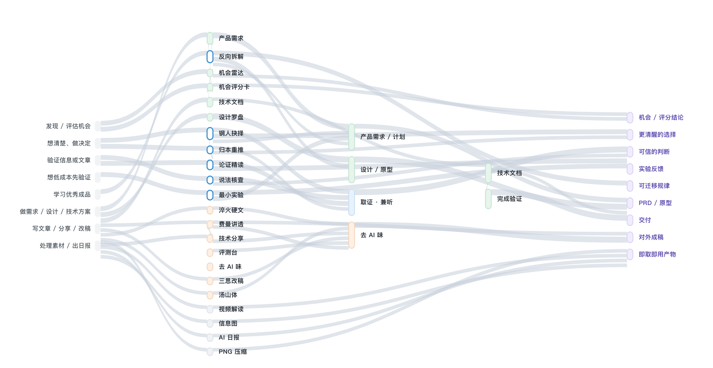

# Job Yang AI Skills

Job Yang 的 AI Agent Skills 技能表。

我把这里当成一个长期的技能仓库：把真实工作里反复用到的判断、流程、脚本和边界，一点点沉淀成 Agent 能复用的 Skill。

AI 时代最容易被低估的，是那些能反复起作用的工作方式。一次写作里的取舍，一次视频排查里的观察顺序，一次复杂任务里的证据意识，如果只停留在某次对话里，很快就会散掉。Skill 的价值，就是把这些经验压缩成可安装、可调用、可继续演化的工作单元。

这个仓库收的不是 prompt 小抄，也不是一次性技巧。每个 Skill 都应该是一段已经被真实任务磨过的能力：知道什么时候触发，知道该看什么材料，知道边界在哪里，也知道什么时候该停下来让人判断。

[English](./README.en.md)

## 技能列表

| Skill | 用来做什么 |
| --- | --- |
| [vdd](./skills/vdd/) | 面向验证的开发：在说“做完了/没问题”之前先走一遍验证，不乱报喜、不硬挤问题、敢说没问题。 |
| [haohao-shuohua](./skills/haohao-shuohua/) | 把中文写得更像人说的：保事实、去 AI 味、加中文味、不许造词充深刻。 |
| [haohao-eval](./skills/haohao-eval/) | 好好说话评测台：盲评中文改稿，按真实 BadCase 做每日召回、候选门禁、发布监控与自动回滚。 |
| [cuihuo](./skills/cuihuo/) | 观点淬硬引擎：把一个技术观点写成平实克制、一节一观点的对外硬文，或提炼成短思考手记。 |
| [tangshan-style](./skills/tangshan-style/) | 汤山体：把面向未来的想象与推演写成有历史纵深、每句耐嚼的畅想文。 |
| [feynman-explainer](./skills/feynman-explainer/) | 用费曼技巧把复杂的东西讲透：一条逻辑链层层推导，让外行也能真正理解。 |
| [opportunity-radar](./skills/opportunity-radar/) | 机会雷达：从公开信息或用户材料中筛出产品线索，逐条保留来源、证据和信号强度。 |
| [opportunity-scorecard](./skills/opportunity-scorecard/) | 机会评分卡：为想法取证、按十维评估潜力，由脚本计算综合分和结论。 |
| [product-brief](./skills/product-brief/) | 产品需求与计划：把直接需求或研究材料整理成 PRD、可验证验收和里程碑安排。 |
| [style-compass](./skills/style-compass/) | 设计罗盘：用固定评审工作台完成 UI/UX，保留高保真候选、区域评论、定稿原型和设计规格。 |
| [engineering-docs](./skills/engineering-docs/) | 研发技术文档统一入口：读取上下文、协作成文、形成工程决定，按需生成图示并验证可实施性。 |
| [outside-view](./skills/outside-view/) | 兼听：只补会改变决定的外部证据，判断来源与冲突，并及时停止无效检索。 |
| [sansi-erhouxing](./skills/sansi-erhouxing/) | 三思而后行：改任何成形文档前先通读全文骨架，别只盯一段、别补丁摞补丁。 |
| [reverse-teardown](./skills/reverse-teardown/) | 反向拆解：从优秀成品里还原结构与关键选择，分清可迁移规律和仅适用本案的细节，落成操作清单与最小练习。 |
| [steelman-choice](./skills/steelman-choice/) | 钢人抉择：两个方案都讲得通时，先把两边各立到最强（善意原则/钢人论证），逼出真正分歧与一个翻盘问题再决定。 |
| [claim-check](./skills/claim-check/) | 说法核查：把一条说法拆成事实/结论/价值，对事实验真给五级可信度，再审计推理链有没有漏洞。 |
| [argument-reading](./skills/argument-reading/) | 论证精读：把整篇文章重建为论证地图，先善意重建再评价证据、隐藏前提与失效条件。 |
| [skill-library-keeper](./skills/skill-library-keeper/) | 技能管家：库级治理——准入五问决定要不要建、健康体检查撞车/孤儿/硬绑定、外部技能直接用/炼化/重造决策；库位置自动发现，零平台强绑定。 |
| [root-rethink](./skills/root-rethink/) | 归本重推：第一性原理向内重推＋跨领域借解向外，把问题拆回基本事实/假设/目标/约束，跳出补丁循环。 |
| [minimum-experiment](./skills/minimum-experiment/) | 最小实验：锁定最致命、最不确定的假设，用低成本可逆实验和预先定好的继续/停止信号拿到真实反馈。 |
| [video-reader](./skills/video-reader/) | 把视频转成带时间戳的关键帧和运动时间线，让只能看图的大模型也能判断第几秒发生了什么。 |
| [png-compress](./skills/png-compress/) | 在本地批量压缩 App 工程里的 PNG：增量缓存、质量门禁、失败回退，不依赖在线 API。 |

可以把这些 Skill 看成几组能力：

- **判断与验证**：VDD、兼听、好好说话评测台、钢人抉择、说法核查、论证精读。
- **产品形成**：机会雷达、机会评分卡、产品需求与计划、设计罗盘、反向拆解（成品学习）。
- **工程交付**：研发技术文档、PNG 压缩、视频读取。
- **写作表达**：好好说话、淬火、汤山体、费曼讲解、三思而后行。

每个 Skill 的 README 负责讲清功能、用法、设计理由、实测结果和边界；`SKILL.md` 是 Agent 真正执行时读取的入口。复杂 Skill 还会附带 references、脚本、模板或运行资产，按任务需要加载。

## 技能体系（一张图看清怎么配合）

这些技能不是孤立的技巧，而是串成几条可复用链路：任务 → 技能 → 共用枢纽 → 产出；带子越宽表示承接的任务越多，多股流合进同一处就是共用枢纽（如「取证·兼听」「产品需求/设计」）。

[](./docs/skill-map.html)

▸ 点图打开**可交互版**：悬停节点高亮整条上下游、点击查看每个技能的定位与好坏信号、按产品线/思维线/写作线/工具线筛选，右侧还有逐链路导览。

- [SKILL-MAP.md](./docs/SKILL-MAP.md)：定位、独立收益与配合边界的详表
- [SKILL-QUALITY-CARD.md](./docs/SKILL-QUALITY-CARD.md)：怎么判断每个思维技能触发没有、做得好不好
- [SKILL-GAP-AUDIT.md](./docs/SKILL-GAP-AUDIT.md)：从全局图反推还缺什么——缺口从图里长出来，不预造技能

新增或修改 Skill 前，先过一遍上面的图和缺口体检，确认定位唯一、触发不撞车、零环境依赖。

## 为什么要有这个仓库

很多 AI 能力看起来像一次性的对话技巧，其实背后都有可以沉淀的结构。

写作涉及事实、语气、节奏和删改边界的一连串判断。模型要看懂视频，先得把动态过程拆成关键帧、时间线和可复核的观察。类似的东西积累多了，就应该从聊天记录里拿出来，变成独立的 Skill。

我希望这里的技能都满足几个要求：

- **足够具体**：解决一个真实问题，不做泛泛的“提升效率”。
- **有边界感**：知道自己该做什么，也知道哪些判断不能替人做。
- **能被复用**：一段经验到了下次还能装上、还能跑起来。
- **允许带工具**：纯文字规则不够时，就把脚本、资料和流程一起放进来。
- **持续变厚**：新的经验会继续沉淀进去，Skill 应该越用越像一套手艺。

## 安装

克隆仓库后，把需要的完整技能目录复制到 Agent Skills 目录。下面是首次安装示例；更新已有技能前先比对本地修改，避免直接覆盖。

```bash
git clone https://github.com/Job-Yang/jobyang-ai-skills.git
mkdir -p ~/.trae/skills
cp -R jobyang-ai-skills/skills/opportunity-radar ~/.trae/skills/opportunity-radar
cp -R jobyang-ai-skills/skills/style-compass ~/.trae/skills/style-compass
```

TRAE 用户级目录为 `~/.trae/skills/`。安装其他技能时替换目录名即可；若当前会话尚未显示新技能，新建会话检查技能列表。Claude Code 使用 `~/.claude/skills/`：

```bash
mkdir -p ~/.claude/skills
cp -R jobyang-ai-skills/skills/haohao-shuohua ~/.claude/skills/haohao-shuohua
cp -R jobyang-ai-skills/skills/video-reader ~/.claude/skills/video-reader
```

安装时要保留完整技能目录，不要只复制 `SKILL.md`。有些技能会读取 `references/`、`scripts/` 或 `assets/`。

## 目录结构

```text
.
├── README.md
├── README.en.md
└── skills/
    ├── vdd/
    ├── haohao-shuohua/
    ├── haohao-eval/
    ├── cuihuo/
    ├── tangshan-style/
    ├── feynman-explainer/
    ├── opportunity-radar/
    ├── opportunity-scorecard/
    ├── product-brief/
    ├── style-compass/
    ├── engineering-docs/
    ├── outside-view/
    ├── sansi-erhouxing/
    ├── reverse-teardown/
    ├── steelman-choice/
    ├── claim-check/
    ├── argument-reading/
    ├── root-rethink/
    ├── minimum-experiment/
    ├── video-reader/
    └── png-compress/
```

每个技能目录都以 `SKILL.md` 为入口，部分带 `references/`、`scripts/` 或 `assets/`。

## License

MIT
