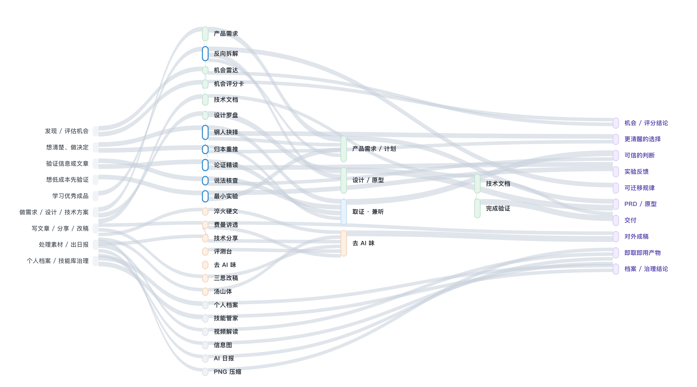

# Job Yang AI Skills

Job Yang 的 AI Agent Skills 技能表。

我把这里当成一个长期的技能仓库：把真实工作里反复用到的判断、流程、脚本和边界，一点点沉淀成 Agent 能复用的 Skill。

AI 时代最容易被低估的，是那些能反复起作用的工作方式。一次写作里的取舍，一次视频排查里的观察顺序，一次复杂任务里的证据意识，如果只停留在某次对话里，很快就会散掉。Skill 的价值，就是把这些经验压缩成可安装、可调用、可继续演化的工作单元。

这个仓库收的不是 prompt 小抄，也不是一次性技巧。每个 Skill 都应该是一段已经被真实任务磨过的能力：知道什么时候触发，知道该看什么材料，知道边界在哪里，也知道什么时候该停下来让人判断。

[English](./README.en.md)

## 技能列表（共 30 个 · 6 大逻辑分组）

### 1. 研发全周期（`engineering`）

| Skill | 用来做什么 |
| --- | --- |
| [engineering-docs](./skills/engineering-docs/) | 研发技术文档统一入口：读取上下文、协作成文、形成工程决定，按需生成图示并验证可实施性。 |
| [implement-spec](./skills/implement-spec/) | 可执行实现规格：把需求、RFC 或重构目标编译为深模块接口、接缝替身、兼容迁移与 1-commit 步骤。 |
| [spec-battle](./skills/spec-battle/) | 方案与规格对抗盲审：开工前由独立只读检察逐行核对源码并提出四件套异议，辩方四分法回应后交人裁决。 |
| [go-work](./skills/go-work/) | 低上下文分步编码执行：轻量协调每步独立上下文落地与安全并行 worktree，断点无损续跑，完工归档。 |
| [diff-review](./skills/diff-review/) | 只读深度 Code Review：按规模与高危路径分级审查，经 Skeptic 证伪去误报与隔离验测，输出报告或评审评论。 |
| [code-bugfix](./skills/code-bugfix/) | 红灯驱动根因修复：先建秒级确定性复现回路、证伪排序假设锁定唯一根因后再改代码，并锁入回归测试。 |
| [pr-prep](./skills/pr-prep/) | 变更打包与发布前检：拦截隐私/工作区泄漏、给大 PR 拆分建议、生成说明骨架与 `$TMPDIR` 离线视觉导览 HTML。 |
| [vdd](./skills/vdd/) | 面向验证的开发：在宣称“做完了/没问题”之前跑完实证门禁与多轮重构防漂移，敢明确说“符合设计，不用改”。 |

### 2. 产品孵化与原型（`product-opc`）

| Skill | 用来做什么 |
| --- | --- |
| [opportunity-radar](./skills/opportunity-radar/) | 机会雷达：从公开信息或用户材料中筛出产品线索，逐条保留来源、证据和信号强度。 |
| [opportunity-scorecard](./skills/opportunity-scorecard/) | 机会评分卡：为想法取证、按十维评估潜力，由脚本计算综合分和结论。 |
| [product-brief](./skills/product-brief/) | 产品需求与计划：把直接需求或研究材料整理成 PRD、可验证验收、里程碑或存量单特性轻卡片。 |
| [style-compass](./skills/style-compass/) | 设计罗盘：内置 9 套高定视觉与原生物理动效工艺包及五轴基因混搭引擎，支持单页直出、画廊盲选与四关评审。 |
| [minimum-experiment](./skills/minimum-experiment/) | 最小实验：锁定最致命、最不确定的假设，用低成本可逆实验和预先定好的继续/停止信号拿到真实反馈。 |
| [reverse-teardown](./skills/reverse-teardown/) | 反向拆解：从优秀成品里还原结构与关键选择，分清可迁移规律和仅适用本案的细节，落成操作清单与最小练习。 |

### 3. 决策与批判思考（`thinking`）

| Skill | 用来做什么 |
| --- | --- |
| [steelman-choice](./skills/steelman-choice/) | 钢人抉择：两个方案都讲得通时，先把两边各立到最强（善意原则/钢人论证），逼出真正分歧与一个翻盘问题再决定。 |
| [claim-check](./skills/claim-check/) | 说法核查：把一条说法拆成事实/结论/价值，对事实验真给五级可信度，再审计推理链有没有漏洞。 |
| [argument-reading](./skills/argument-reading/) | 论证精读：把整篇文章重建为论证地图，先善意重建再评价证据、隐藏前提与失效条件。 |
| [root-rethink](./skills/root-rethink/) | 归本重推：第一性原理向内重推＋跨领域借解向外，把问题拆回基本事实/假设/目标/约束，跳出补丁循环。 |
| [outside-view](./skills/outside-view/) | 兼听：只补会改变决定的外部证据，判断来源与冲突，并及时停止无效检索。 |

### 4. 写作、调研与信息图（`writing`）

| Skill | 用来做什么 |
| --- | --- |
| [writing-craft](./skills/writing-craft/) | 写作工坊：统一文章写作入口，先立唯一主帅，按分支单读写作技术分享/复盘/演讲/slides（`sharing`）、口语直球观点与 `≤120` 字手记（`opinion`）或汤山专栏长评（`tangshan`）。 |
| [haohao-shuohua](./skills/haohao-shuohua/) | 把中文写得更像人说的：保事实、去 AI 味、加中文味、不许造词充深刻。 |
| [haohao-eval](./skills/haohao-eval/) | 好好说话评测台：盲评中文改稿，按真实 BadCase 做每日召回、候选门禁、发布监控与自动回滚。 |
| [feynman-explainer](./skills/feynman-explainer/) | 用费曼技巧把复杂的东西讲透：一条逻辑链层层推导，让外行也能真正理解。 |
| [sansi-erhouxing](./skills/sansi-erhouxing/) | 三思而后行：改任何成形文档前先通读全文骨架，别只盯一段、别补丁摞补丁。 |
| [content-infographic](./skills/content-infographic/) | 内容信息图：用零依赖渲染器或文生图把文章关键机制画成直观且与正文咬合的信息图与封面。 |

### 5. 个人情报、档案与媒体工具（`personal-tools`）

| Skill | 用来做什么 |
| --- | --- |
| [ai-briefing](./skills/ai-briefing/) | AI 每日早报：一份 5 分钟读完的每日 AI/科技简报，含事实、判断与机会分，周五复盘本周 GitHub Trending。 |
| [me-context](./skills/me-context/) | 可移植个人档案：将个人事实、偏好与健康关系存为带敏感分层的本地 Markdown，AI 起草、人确认。 |
| [png-compress](./skills/png-compress/) | 在本地批量压缩 App 工程里的 PNG：增量缓存、质量门禁、失败回退，不依赖在线 API。 |
| [video-reader](./skills/video-reader/) | 把视频转成带时间戳的关键帧和运动时间线，让只能看图的大模型也能判断第几秒发生了什么。 |

### 6. 库级治理（`governance`）

| Skill | 用来做什么 |
| --- | --- |
| [skill-library-keeper](./skills/skill-library-keeper/) | 技能管家：库级治理——准入五问决定要不要建、健康体检查撞车/孤儿/硬绑定、外部技能直接用/炼化/重造决策；库位置自动发现，零平台强绑定。 |

逻辑分组配置在 `tools/skills-manifest.json`，支持按 `python3 tools/sync_skills.py --group engineering --apply` 分组同步；全局公共交接规范保存在 `shared/` 并通过 `--sync-shared` 单源分发防漂移。若需在 Antigravity (`agy`) 上为日常 coding 开启可迁移工作流门禁，可运行 `python3 tools/sync_skills.py --apply --sync-agy-plugin` 将 `plugins/engineering-flow/` 注册到 `~/.gemini/config/plugins.json`（不改动用户既有 `hooks.json`）。

每个 Skill 的 README 负责讲清功能、用法、设计理由、实测结果和边界；`SKILL.md` 是 Agent 真正执行时读取的入口。复杂 Skill 还会附带 references、脚本、模板或运行资产，按任务需要加载。

## 技能体系（一张图看清怎么配合）

这些技能不是孤立的技巧，而是串成几条可复用链路：任务 → 技能 → 共用枢纽 → 产出；带子越宽表示承接的任务越多，多股流合进同一处就是共用枢纽（如「取证·兼听」「产品需求/设计」）。

[](./docs/skill-map.html)

▸ 点图打开**可交互版**：悬停节点高亮整条上下游、点击查看每个技能的定位与好坏信号、按产品线/思维线/写作线/工具线筛选，右侧还有逐链路导览。

- [SKILL-MAP.md](./docs/SKILL-MAP.md)：定位、独立收益与配合边界的详表
- [SKILL-ARCHITECTURE.md](./docs/SKILL-ARCHITECTURE.md)：单一所有权矩阵、L1–L4 分层与双模验收规范
- [SKILL-QUALITY-CARD.md](./docs/SKILL-QUALITY-CARD.md)：怎么判断每个思维技能触发没有、做得好不好
- [SKILL-GAP-AUDIT.md](./docs/SKILL-GAP-AUDIT.md)：从全局图反推还缺什么——缺口从图里长出来，不预造技能

新增或修改 Skill 前，先过一遍上面的图和缺口体检，确认定位唯一、触发不撞车、零环境依赖。

## 为什么要有这个仓库

很多 AI 能力看起来像一次性的对话技巧，其实背后都有可以沉淀的结构。

写作涉及事实、语气、节奏和删改边界的一连串判断。模型要看懂视频，先得把动态过程拆成关键帧、时间线和可复核的观察。类似的东西积累多了，就应该从聊天记录里拿出来，变成独立的 Skill。

我希望这里的技能都满足几个要求：

- **足够具体**：解决一个真实问题，不做泛泛的“提升效率”。
- **有边界感**：知道自己该做什么，也知道哪些判断不能替人做。
- **能被复用**：一段经验到了下次还能装上、还能跑起来。
- **允许带工具**：纯文字规则不够时，就把脚本、资料和流程一起放进来。
- **持续变厚**：新的经验会继续沉淀进去，Skill 应该越用越像一套手艺。

## 安装

克隆仓库后，把需要的完整技能目录复制到 Agent Skills 目录。下面是首次安装示例；更新已有技能前先比对本地修改，避免直接覆盖。

```bash
git clone https://github.com/Job-Yang/jobyang-ai-skills.git
mkdir -p ~/.trae/skills
cp -R jobyang-ai-skills/skills/opportunity-radar ~/.trae/skills/opportunity-radar
cp -R jobyang-ai-skills/skills/style-compass ~/.trae/skills/style-compass
```

TRAE 用户级目录为 `~/.trae/skills/`。安装其他技能时替换目录名即可；若当前会话尚未显示新技能，新建会话检查技能列表。Claude Code 使用 `~/.claude/skills/`：

```bash
mkdir -p ~/.claude/skills
cp -R jobyang-ai-skills/skills/haohao-shuohua ~/.claude/skills/haohao-shuohua
cp -R jobyang-ai-skills/skills/video-reader ~/.claude/skills/video-reader
```

安装时要保留完整技能目录，不要只复制 `SKILL.md`。有些技能会读取 `references/`、`scripts/` 或 `assets/`。

## 目录结构

```text
.
├── README.md
├── README.en.md
├── shared/
└── skills/
    ├── ai-briefing/
    ├── argument-reading/
    ├── claim-check/
    ├── code-bugfix/
    ├── content-infographic/
    ├── diff-review/
    ├── engineering-docs/
    ├── feynman-explainer/
    ├── go-work/
    ├── haohao-eval/
    ├── haohao-shuohua/
    ├── implement-spec/
    ├── me-context/
    ├── minimum-experiment/
    ├── opportunity-radar/
    ├── opportunity-scorecard/
    ├── outside-view/
    ├── png-compress/
    ├── pr-prep/
    ├── product-brief/
    ├── reverse-teardown/
    ├── root-rethink/
    ├── sansi-erhouxing/
    ├── skill-library-keeper/
    ├── spec-battle/
    ├── steelman-choice/
    ├── style-compass/
    ├── vdd/
    ├── video-reader/
    └── writing-craft/
```

每个技能目录都以 `SKILL.md` 为入口，部分带 `references/`、`scripts/` 或 `assets/`。

## License

MIT
