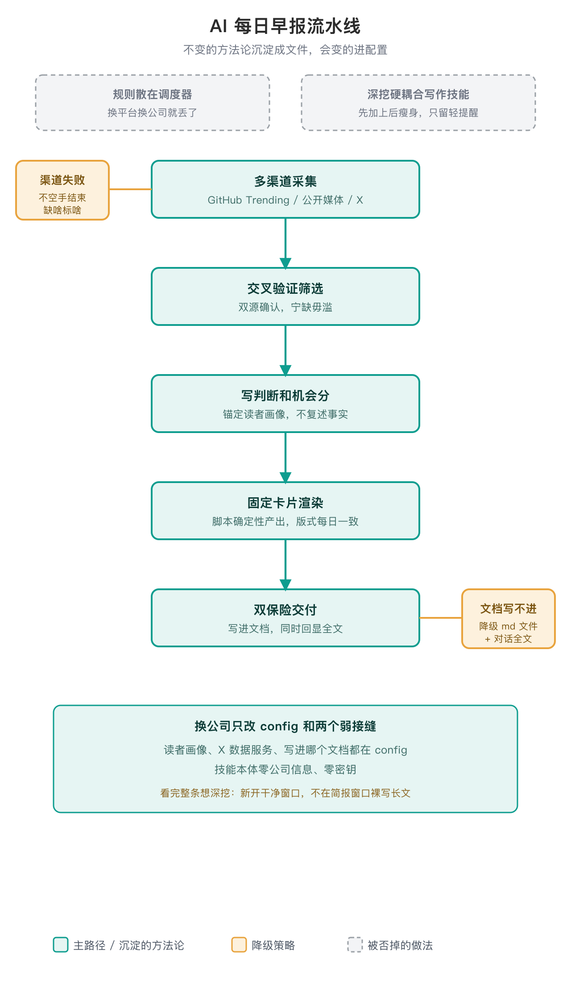

# AI Briefing

> 一份 5 分钟读完、宁缺毋滥的 AI 每日早报：每条带事实、判断和机会分，周五额外复盘整周 GitHub Trending。

## 为什么需要它

作者确认：起因很朴素——每天主动摄入 AI 领域的新东西，防止闭门造车。人很容易只在需要时才查资料，而每日早报把「保持外部输入」变成一个固定动作；情报从哪来、怎么筛、怎么判断，被固化下来之后，这个动作就不依赖每天的兴致。

## 为什么是「技能」，而不是一段定时 prompt



定时 prompt 把规则散在调度器里，换平台就丢。这个技能把**不变的东西**（覆盖范围、事实纪律、卡片结构、机会分 rubric、降级策略、X 归一化、GitHub 与渲染脚本）沉淀成文件，把**会变的东西**（读者是谁、用哪个 X 数据服务、写进哪个文档）放进 config.json。到新环境拷贝目录、改配置即可，方法论原样带走〔出处：SKILL.md·硬规则；MIGRATION.md·依赖盘点〕。

流水线本身后来又长出一段插曲：01691dd 曾把「看完一条早报想深挖」的出口硬绑到具体的写作技能上；297ce81 又把它瘦身——去掉对个人写作技能的耦合，只留一句轻提醒「深度调研新开干净窗口，不在简报窗口裸写长文」，保持技能可迁移〔出处：git 01691dd；git 297ce81〕。

## 硬规则里的几处选择

- **必须交付**：渠道失败不能让当天没有早报；拿到多少可靠信息报多少，缺的渠道文末如实标注。宁可报得少，不空着手结束。
- **宁缺毋滥**：全文控制在读者 5 分钟读完的密度（通常 8–14 条），没有料的分组写「今日无值得报的」，不许凑数。
- **判断锚定读者**：每条必须有观点，不复述事实；机会分回答「对这位读者有没有用、本周该不该动手」，不是新闻热度。
- **去个人化**：技能本体不出现任何真实姓名、公司名、内部 URL、密钥，这些只存在于读者自己的 config.json。
〔出处：SKILL.md·硬规则〕

## 可迁移是刻意设计

技能本体零硬绑定：GitHub Trending、X 归一化、卡片渲染都是纯标准库脚本；X 数据服务和云文档写入是「有更好、没有也能降级」的弱接缝。真正的最小前提只有「会读网页的 Agent + Python + 定时器」——任何 harness 都具备〔出处：MIGRATION.md·依赖盘点〕。

## 边界

- 不负责调度，定时由宿主的 cron/计划任务唤起。
- 不内置任何付费数据源或公司内网端点；缺失即降级公开渠道，不报错停工。
- 不做投顾、不做标题党流量稿、不自动外发消息。
- 早报只产卡片式简报，不在本窗口把某条拉长成深度长文。

## 用法

```bash
cp config.example.json config.json   # 填读者画像、关注账号、文档交付
python3 scripts/github_trending.py --range weekly --top 5   # 真实抓本周 Trending
python3 -m unittest discover -s tests                        # 本地假服务测试
python3 scripts/render_brief.py --input examples/brief_input.example.json  # 渲染示例
```

跑出来的一条卡片长这样（示例非真实某日）：

> **[示例模型 Flash 发布](https://example.com/model)**｜100 万上下文，输入 1 元/输出 4 元每百万 token。
> 【我的判断】竞争焦点转向 agent 单任务综合成本，缓存价是最大杠杆；值得加进模型路由做 A/B。
> 【机会分】⭐4：和读者的模型对照实验直接相关，扣一分因数据为厂商自报。
> 官方博客 · 2026-10-22

作为技能使用时直接说「出今天的 AI 早报」。完整渠道、卡片与交付规则以 `SKILL.md` 和 `references/` 为准，这里不重复抄。

## 待补

- 最早一份早报是哪天、长什么样，仓内没有留存，只有从旧位置整体导入的记录（git 7bc6f01）。
- 验证范围：`python3 -m unittest discover -s tests` 15 个本地单测全绿（真实 GitHub HTML fixture + 本地假 X 服务，纯离线，2026-10-23 复跑）；「5 分钟读完、8–14 条」是设计目标，未做读者效果盲测，不当前指标。

## 参考

- 迁移步骤：`MIGRATION.md`；运行契约：`SKILL.md`。
