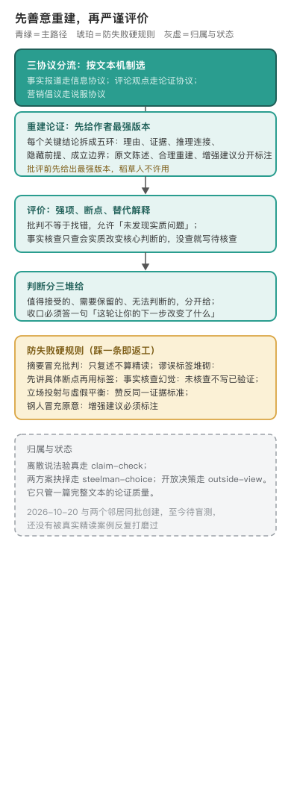

# argument-reading · 论证精读

编辑源：[assets/argument-map-narrow.svg](assets/argument-map-narrow.svg)

---

## 一篇文章读完，输出一张能回原文核对的论证地图

这个技能把一篇完整的新闻、长评、政策解读或观点长文，重建为可审查的论证地图：它可不可信、强在哪、断点在哪、藏了什么前提〔出处：SKILL.md 方法论、它解决什么〕。核心方法是善意原则加论证分析：先把作者的论证重建到它最强的合理版本，不攻击稻草人，再按统一证据标准评价。批判不是找错，也不是替用户裁定立场〔出处：SKILL.md 方法论〕。

它是 2026 年 10 月 20 日和两个邻居（steelman-choice、claim-check）同批创建的，规划文档里写明它是 claim-check 的整篇文章版本，拟从平台批判性阅读技能炼化，刻意去掉平台绑定和默认交付〔出处：git 6602e85；docs/SKILL-MAP.md 簇B 注〕。创建次日（10 月 21 日）六个思维技能统一修过一轮测试和可感知机制〔出处：git dcac278〕。这里要说明：这轮提交在本技能上只新增了可感知信号 9 行，所谓「测试」是 32 条 query 的路由触发与结构契约核对，验的是触发词命中和产物断链，仓内没有对应测试工件，不等于效果盲测〔出处：git show dcac278；全仓 grep 无 argument-reading 测试，本技能无 tests/ 目录〕。要诚实说的是：它至今标着「已建待盲测」〔出处：docs/SKILL-MAP.md 状态行〕，还没有被真实精读案例反复打磨过，下面写的流程是设计稿，不是迭代出来的成熟经验。

## 善意重建之后，才轮到评价

流程的顺序是被方法论钉死的〔出处：SKILL.md 核心流程、防失败模式〕。先按文本机制分流：事实报道走信息协议，评论观点走论证协议，营销倡议走说服协议。再重建：每个关键结论拆成五环，理由、证据、推理连接、隐藏前提、成立边界，原文陈述、合理重建、增强建议分开标注。然后才评价：最强之处、关键断点、替代解释、遗漏视角。最后核查事实，而且只查会实质改变核心判断的可验证事实，没有可靠来源就写待外部核查，不许用「已验证」措辞。判断分三堆给：值得接受的、需要保留的、无法判断的。

光列字段不好懂，拿一段现编的短文走一遍（合成演示，非真实盲测案例，审阅者构造）〔出处：本轮审阅补，非 SKILL.md 原文〕：「远程办公让公司效率更高。我们公司改成远程后，迟到少了，大家也更愿意加班，所以所有公司都该远程办公。」一张论点卡这样填：结论是「所有公司都该远程办公」；理由是「本公司远程后迟到少、更愿意加班」；证据类型是作者自家公司的个案观察，不是一手数据；推理连接是从本公司体验外推到所有公司；隐藏前提是本公司的工种、人数、办公条件和别家同质，且迟到少、愿意加班就等于产出更高；成立边界是目前只在作者这一家公司、特定工种上成立。最大的疑点就在外推这一跳，而迟到少到底算不算效率高没有外部来源，只能标未执行外部核查。每一栏都能回原文对到具体那一句，缺的环节如实写原文未提供，不替作者补齐再批评。

防失败硬规则基本是把「批判」这件事最容易犯的错列成了禁令〔出处：SKILL.md 防失败模式〕。摘要冒充批判，只复述不算精读；阅读即找错，允许「未发现实质问题」；稻草人，批评前先给最强版本；谬误标签堆砌，先讲具体断点再用标签；事实核查幻觉；立场投射与虚假平衡，赞反双方同一证据标准；钢人冒充原意，增强建议必须标注；节选代替全文，只读部分材料要显著降低结论强度。收口还有一条体感要求：读完必须能答一句「这轮让你的下一步具体改变了什么」，答不上视为失败〔出处：SKILL.md 可感知信号〕。

## 边界：它只管一篇完整文本的论证质量

一条离散说法验真，走 claim-check；两个方案怎么选，走 steelman-choice；开放决策的行业调研，走 outside-view〔出处：SKILL.md 与邻居的边界〕。不启用的场景也写死：只要摘要、翻译、润色；学术论文专业评审；要求站队或煽动情绪〔出处：SKILL.md 输入与不启用〕。它产出的每张论点卡都要求能回到原文定位，论证链缺的环节明确标注，不许替作者悄悄补齐〔出处：SKILL.md 交付门槛〕。

---

## 怎么跑（人类操作参考）

协议重点、重建方法、评价量表、事实核查规程分置在 `references/` 四个文件（protocols、argument-reconstruction、evaluation、fact-checking），快速模式只读相关小节〔出处：SKILL.md 路由〕。

## 待作者补

1. 规划文档说的「平台批判性阅读技能」原型是哪一个，炼化时丢掉了哪些平台专属环节。
2. 第一次真实盲测计划读什么类型的文章，盲测后第一批改动是什么（目前空缺）。
