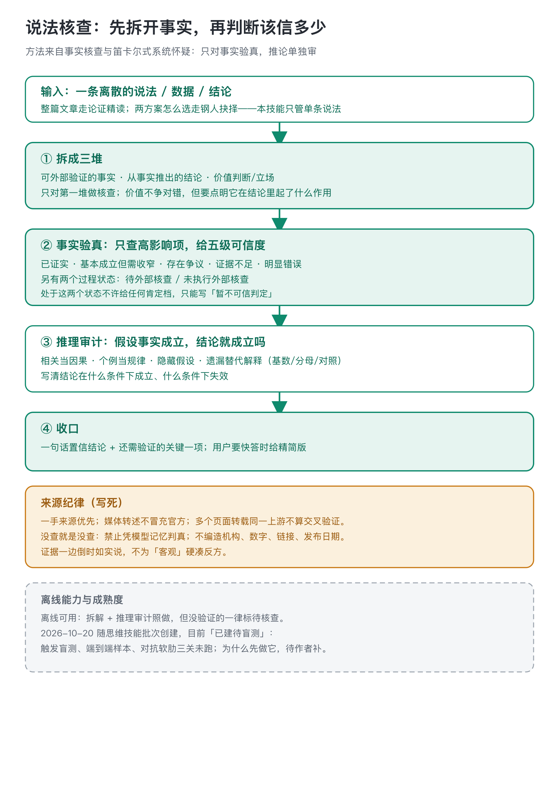
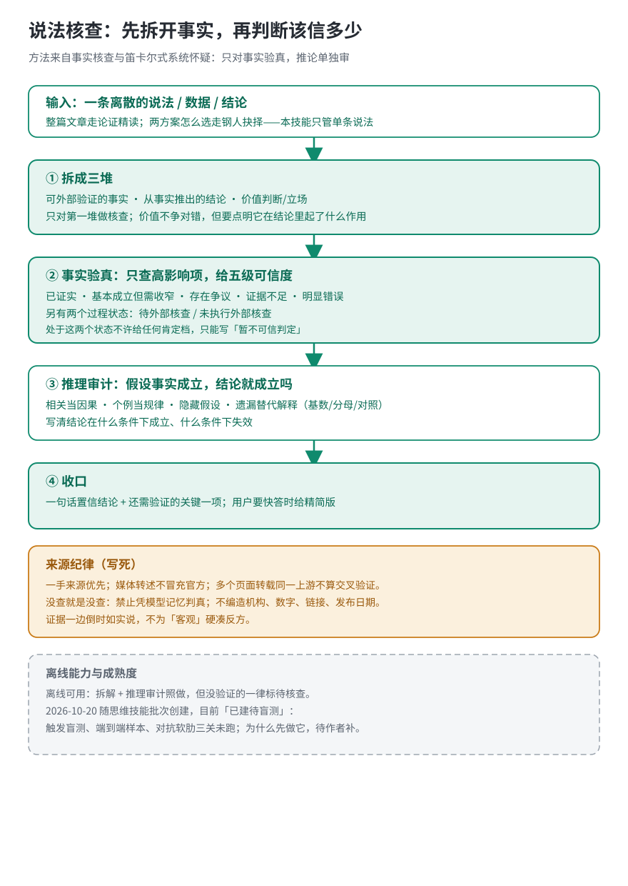

# 说法核查 · claim-check

判断一条离散的说法、数据、结论或方案可不可信。先拆三堆，只对事实验真给五级可信度，再审计推理链有没有跳跃。

## 一句话里往往混着三种东西

事实、推论、价值判断。不加区分就全盘接受或全盘否定，都会上当。这个技能的做法是把输入逐条标成三堆：可外部验证的事实、从事实推出的结论、价值判断或立场。只对第一堆做核查；价值判断不争对错，但要说明它在结论里起了什么作用。

事实验真不搞无差别覆盖，先问这条事实若不成立结论会怎样，只查高影响项，给出五级裁决：已证实、基本成立但需收窄、存在争议、证据不足、明显错误。另有两个过程状态：待外部核查、未执行外部核查。它们不算裁决，处于这两个状态时只能写「暂不可信判定」，不许给任何肯定档。五级档位的名称和口径是本仓自定的，与 argument-reading 的事实核查规程对齐，不冒充 PolitiFact、AFP 等外部量表；思想资源是事实核查与笛卡尔式系统怀疑。

## 来源纪律比五级更难守住

优先一手来源；媒体转述官方数据要写明是转述，不冒充官方；多个页面转载同一个上游说法，不算交叉验证。没查就是没查：没实际检索时只能写证据不足，禁止凭模型记忆或语言流畅度判真，也不编造机构、数字、链接和发布日期。

推理审计在「假设事实都成立」的前提下做：有没有把相关当因果、把个例当规律、藏着没验证的假设、漏掉基数分母这类替代解释，结论在什么条件下会失效。

举一个构造例子走一遍，不是对任何真实公司的核查：「某 App 三季度日活同比涨了 30%，说明它重新赢回了用户。」拆三堆——事实是「日活同比 +30%」，推论是「涨 30% 等于重新赢回用户」，立场是正面预期。事实验真没做检索，标「未执行外部核查」，不给肯定档。推理审计假设 +30% 为真：也可能是季节性、一次活动、或去年基数低，「赢回用户」需要次月留存和对照，相关不等于因果。收口：暂不可信判定，还需验证的关键一项是披露口径下的日活同比与次月留存。

## 边界与成熟度

- 不做什么：整篇文章的论证评价（走 argument-reading）、两个方案怎么选（走 steelman-choice）、为某个决定做开放外部调研（走 outside-view）、纯口味偏好。
- 归属判据：要通读一整篇新闻、长文或宣传文案，重建论证链、定位隐藏前提，归 argument-reading；A、B 两个方案都讲得通、要权衡取舍，归 steelman-choice；只有一条离散说法、数据或结论要判断可信程度，才留在本技能。
- 离线可用：不联网时完成拆解和推理审计，需要外部核查的项如实标注。
- 这个技能 2026 年 10 月 20 日随思维技能批次创建，仓库里标着「已建待盲测」：仓库提交说明（dcac278）称跑过一轮 32 条 query 的路由试测，但用例与脚本未归档，当前不作为可复核的效果证明；真实样本端到端、对抗软肋这两关完整未验。五级可信度的口径与 argument-reading 的事实核查规程对齐，两个技能交叉引用时不另立一套词汇。
- 为什么先做这个技能，没有单独的动机文档，待作者补。
