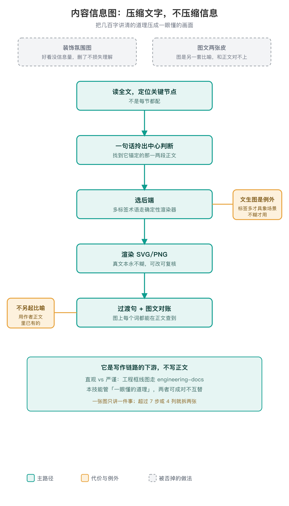

# 内容信息图

> 把文章里承载道理的关键内容，做成「图本身讲清一件事、且和正文咬在一起」的信息图。

给谁用、什么时候接手：写技术长文、分享稿的作者，或者替作者写作的 Agent。正文已经成型之后再由这个技能接手配图；它不替作者写正文，也不在提纲阶段就先画图。


## 为什么做它

长文只靠平铺段落，读者需要自己整理关系；随手配图又容易好看但没有信息，甚至与正文使用不同的词和比喻。这个技能把关键关系做成可核对的信息图，让图片解释正文，而不是另讲一套。

正文方法不绑定某篇文章、某家公司或某个图像平台。确定性渲染负责清晰文字与结构，文生图负责适合具象场景的表达，后端按实际环境选择。

## 两条主判断



这个技能只治两件事：

1. **图承载信息**：把几百字才讲清的道理（多路径、因果链、对比、分类、失衡）压成一眼懂的画面。合格判据很朴素——删掉它，读者的理解会不会变差？会才留。
2. **图文是一段**：每张正文图锚定原文那一两段、配一句把读者带进图的过渡句，图上每个词都能在正文查到。〔出处：SKILL.md·这个技能解决什么〕

## 两个后端，默认是渲染器

内容里有多个要排准的中文标签、英文原词、数字和步骤，一律走自带的零依赖渲染器（`render_infographic.py`，确定性出 SVG/PNG，真文本永不糊、可改、可复核）。文生图是例外：只有「标签很少、靠具象场景把道理演出来」的比喻图和封面才用——标签一多，文生图必糊易错。拿不准，先渲染器〔出处：SKILL.md·两个后端〕。

这条分工后来还和 engineering-docs 划清了边界：代码、API、公式、精确参数不入信息图；要精确框线、可评审、可编辑的工程图走 engineering-docs 的 diagram_kit。那边是「严谨」，这边是「直观」，两者可成对但不互替〔出处：SKILL.md·硬边界；git 7bc6f01〕。

## 风格上的几处反直觉选择

- **默认不画固定吉祥物 IP。** 实测画面空、单薄的锅不是吉祥物，而是丢了「体量悬殊 + 动作情绪 + 纵深细节」这三样。文生图叙事默认走 rich 档，把大小对比做足、让主体有动作和情绪——「无角色」不等于「极简静物」。
- **比喻用作者自己的。** 正文把三阶段类比成什么，图就画什么，不替作者换一套比喻；正文没给又确需加，先经作者确认并同步进正文。
- **图文咬合是硬要求，机械对账。** `check_linkage.py` 会检查术语出处、过渡句和「另起比喻」，exit 0 才用。
〔出处：SKILL.md·风格、图文咬合〕

## 边界

- 不写正文、不改作者结论、不替作者另起比喻；它是写作链路的下游，正文成型后才接手。
- 文生图闭环不了时不静默：明说缺什么、怎么补，同时降级——渲染器图照常出，场景图改几何版或只交付提示词，主目标不塌。
- 长文一般 3–6 张承载图 + 1 张封面封顶，一张图只讲一件事；超过 7 步或 4 列就拆两张。

## 用法

作为技能使用时直接说「把这节画出来」，并把这节正文贴给它，先判断这节该不该出图。三条命令：

```bash
python3 scripts/doctor.py                 # 进场自检：渲染器、PNG 导出、文生图后端
python3 scripts/render_infographic.py spec.json -o out.svg
python3 scripts/render_infographic.py spec.json -o out.svg --png
python3 scripts/check_linkage.py figure.json   # 图文对账，exit 0 才用
```

渲染器只用 Python 标准库，不装三方包。SVG 一定先出，不依赖外部转换器；加 `--png` 才导出位图，PNG 需要本机已有 `rsvg-convert` 或 Chrome headless 其一，两者都没有时只在命令行告警、跳过 PNG，SVG 照常可用，不能把 SVG 零依赖说成 PNG 也零依赖。

渲染器吃一份结构化 JSON。下面是 `examples/api-7steps.json` 的精简样例，选 `pipeline` 步骤链布局，字段名和取值约束都来自渲染器本身：

```json
{
  "layout": "pipeline",
  "kicker": "序章 · 一次 API 调用里发生了什么",
  "title": "一次 API 调用的 7 步",
  "subtitle": "前半段决定首字延迟，后半段决定吐字速度。",
  "data": {
    "steps": [
      {"title": "Tokenizer 分词", "desc": "字符串切成 token 子词，再映射成整数 ID"},
      {"title": "N 层 Transformer", "desc": "逐层做 Self-Attention 加 FFN"},
      {"title": "De-tokenize", "desc": "token 序列还原成人读得懂的字符串"}
    ]
  }
}
```

| 字段 | 必填 | 说明与约束 |
| --- | --- | --- |
| `title` | 必填 | 图上主标题 |
| `layout` | 必填 | `pipeline` / `columns` / `two_stage` / `metaphor` / `compare` / `radial` 之一 |
| `data` | 必填 | 当前布局对应的内容块 |
| `kicker` / `subtitle` / `footer` / `palette` | 可选 | 标题上方小标签、标题下副题、页脚文字、覆盖默认配色 |
| `data.steps` | pipeline 必填 | 2 到 9 项；每项 `title` 必填、`desc` 可选 |
| `data.icons` / `data.span_labels` | 可选 | 与步骤一一对应的图标名；阶段括号，含 `from`、`to`、`label`、`color` |

其余布局各自只多一组必填数据键：`columns` 用 `columns`，`two_stage` 用 `stages`，`metaphor` 用 `point`，`compare` 用 `columns` 加 `rows`，`radial` 用 `center` 加 `nodes`。完整选型与 schema 见 `references/`，其余样例见 `examples/`。

## 待补

- 原稿实际配图已有三处可查（序章 API 调用七步图、训练四步循环图、预训练/微调/RLHF 三阶段比喻图）；缺的是当时哪张效果最好的对照评价，以及同事那次提问的原始截图未留存。

## 参考

- 运行契约：`SKILL.md`；样例：`examples/`。

---

## 机制到底是什么

渲染器吃一份结构化 JSON：选一种布局（pipeline/columns/two_stage/compare/radial/metaphor），把标题、卡片、术语逐字填进去，出 SVG（真矢量文本，中文按字、英文按整词折行，`Tokenizer`/`De-tokenize` 不劈断），`--png` 再转位图。退出码：0 成功，1 读文件或 JSON 解析错，2 schema 不符（比如步骤数超出 2 到 9、对照表行列对不上）；PNG 没转出来不另设退出码，脚本只在命令行告警，SVG 已经在，不会因为导不出位图就整张报废。文生图是三级后端（宿主原生 → MCP → HTTP 适配器），唯一随平台变的就是这一下；核心四件事跨平台不动。对账器 `check_linkage.py` 逐字核对术语/数字出处、命名标签是否另起比喻、过渡句是否指图并点到图里的词，分必改/待确认，exit 0 才用；它只挡硬伤，不判图美不美。

## 走一遍真实用例

序章七步：原文平铺七段 → 判断"删了读者要自己排链+记分界，理解变差，留" → 填 pipeline JSON（七卡片逐字用原文词 + Prefill/Decode 两条阶段括号）→ 真渲染 `assets/readme/worked-api-7steps.png` → 过渡句"这七步分两个阶段，对延迟影响不同，如下图" → 对账 exit 0。反例（自造 `Pretraining`、换"学生→实习生→职场人"比喻）对账 exit 1。

## 验证到哪、没到哪

已验证（机械层）：`doctor.py` 核心可用；渲染/对账/适配器三套回归实跑 50 项全过（渲染 22、对账 10、适配器 18，按脚本实际 PASS 行计）。没验证（效果层）：未做图是否提升理解的盲测；"哪张最好"对照与同事提问截图作者确认缺失；文生图端到端据 `references/backends.md` 记载仅豆包原生验过，其余平台未验。
