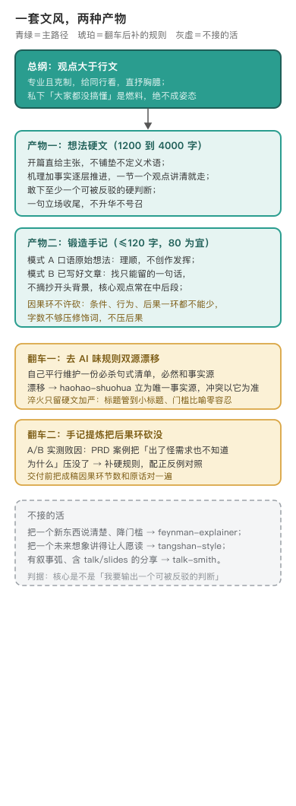

# cuihuo · 淬火

编辑源：[assets/products-narrow.svg](assets/products-narrow.svg)

---

## 让「说了什么」盖过「读起来怎么样」

对外做技术输出时的写作引擎。核心信念：靠观点、靠想法赢得同行的尊重，技术是本质，行文是载体，一句话总纲就是观点大于行文、专业且克制〔出处：SKILL.md 开篇、文风总纲；作者确认〕。它一套文风两种产物：想法硬文（参考 1200 到 4000 字，服从观点不凑字数）和锻造手记（≤120 字、80 字为宜，沉淀进个人笔记）〔出处：SKILL.md 产物表〕。

姿态是最高优先级的红线。写作者私下的「我发现大家其实都没搞懂」只是写作的燃料，绝不能成为文章的姿态：同行最反感「我懂你们不懂」的味道，飘出一丝，前面所有硬货都打折。只做呈现观察、摆机理、给证据，让读者自己得出结论〔出处：SKILL.md 姿态红线〕。

## 硬文先逼出一句可被反驳的主张

起手请求是用户那句「就这个观点给我写篇硬文」。素材进来先定类：里面有没有一个同行能站出来反对的主张，没有就交回调研或畅想，不从这里硬写；有主张就逼出全文只能留的那一句话，它是轴；再搭骨架，开篇直给这句，机理和事实逐层压上去，一节只讲一个观点，最后一句立场收尾，不升华不号召。主张靠证据和机理立住，不拿情绪撑；两边都对、面面俱到，等于没有观点。成稿后按姿态、标题含小标题、比喻、用词、反车轱辘话顺序过一遍，最后交 haohao-shuohua 去 AI 味，踩中就重写。

小对照。起手素材模糊、还没有主张：「最近 AI 写代码挺火，大家都在聊，我想写篇东西说说。」逼出的主张可被同行反驳：「AI 让写代码不要钱了，可做软件这件事，一分没便宜。」骨架走向：开篇直给主张，机理事实逐层，一句立场收尾。

## 双源规则漂移之后，立了唯一事实源

一次梳理发现，淬火自己平行维护了一份去 AI 味的必杀句式清单，跟 haohao-shuohua 的同源规则各自演化，必然漂移〔出处：CHANGELOG.md 0.2.0 P1 双源复制漂移〕。0.2.0 的修法是把 haohao-shuohua 立为去 AI 味与通用红线的唯一事实源，不再平行维护两份；淬火只保留硬文场景的加严（标题管到章节小标题、门槛型比喻零容忍），自己那份兜底清单降级为「haohao 不可用时」的临时兜底〔出处：CHANGELOG.md 0.2.0；references/redlines.md 开头声明〕。同版把 309 行的单文件瘦到约 150 行，四块硬规则和正反例下沉到 references，SKILL.md 只留灵魂和路由〔出处：CHANGELOG.md 0.2.0 P1 无渐进披露〕。

## 手记的硬规则是盲评败因喂出来的

锻造手记一开始规格很薄。A/B 盲评任务 2 的实测败因很具体：一个 PRD 案例的成稿把「出了怪需求也不知道为什么」这个负面后果压没了，剩下的只是「研发不再想为什么」，用户最在意的那个代价丢了〔出处：CHANGELOG.md 0.2.1；SKILL.md 因果环反例节〕。0.2.1 补了硬规则「因果环不许砍」：提炼只砍铺垫、举例、连接和修辞，条件、行为、后果一环都不许少；字数不够优先压修饰词；交付前把成稿的因果环节数和原话对一遍，少一环就补〔出处：SKILL.md「因果环不许砍」〕。手记的另外两条规矩也来自这个判断模式：输入分口语想法（理顺，不创作发挥）和已写好文章（找只能留的一句话，不摘抄开头背景）；最高铁律是只沉淀主题的思想内核，不记录「我是怎么得到它的」〔出处：SKILL.md 手记节〕。

## 边界是一轮一轮联动校准出来的

最早对外内容分三类：调研走费曼、观点走淬火、畅想走汤山。talk-smith 立起来之后，0.2.2 补成第四类（有叙事弧的分享走 talk-smith）；0.2.3 补齐平台分层，观点和硬文由淬火定，在线文档和公众号平台只搬运承载；0.2.4 把调研入口软加固，写观点前需要研究仓库、源码、论文时先读费曼，已有查证结果直接复用〔出处：CHANGELOG.md 0.2.2、0.2.3、0.2.4〕。判据始终一句：核心是「我要输出一个可被反驳的判断」，就归它。这条门槛后来又收紧过一次：早先按「技术观点」触发，会把普通技术文档也拉进来，真正的分界在有没有一个同行能站出来反对的主张，命中技术词不算数；已成形稿只删废话、做精简，走 sansi-erhouxing 共读 + haohao-shuohua 收尾，不从本技能从零起稿〔出处：git cab48e9 description 与定类节改写〕。

**不管什么。** 把一个新东西说清楚降门槛，走 feynman-explainer；把未来想象讲得让人愿读，走 tangshan-style；有叙事弧的分享文，走 talk-smith；纯删废话/精简已有稿，走 sansi-erhouxing 共读 + haohao-shuohua 收尾〔出处：SKILL.md「与其他写作技能的边界」；git cab48e9〕。

---

## 怎么跑（人类操作参考）

出稿前必读 `references/redlines.md`（标题、比喻、用词精准、反车轱辘话四块硬规则加正反例）；带引用或强对比数据配图读 `references/assembly-notes.md`；成稿交 haohao-shuohua 重档去 AI 味〔出处：SKILL.md references 路由表〕。

## 待作者补

1. 锻造手记最早是从哪个真实的笔记习惯长出来的（文件只留了规格，没留起点场景）。
2. 0.2.0 那次双源漂移的具体实例：哪两条规则在两边长出了不一样的说法。
