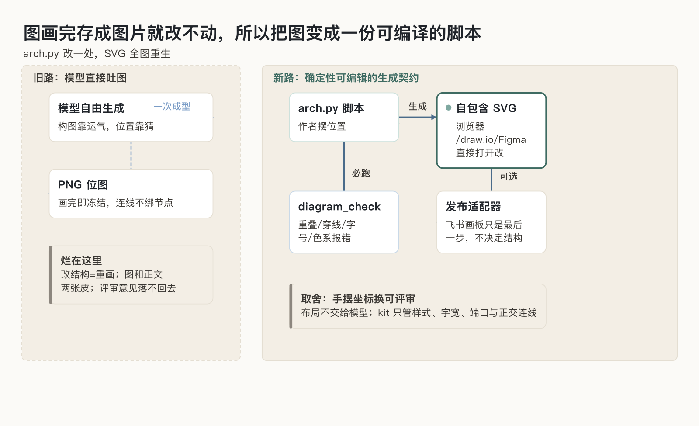
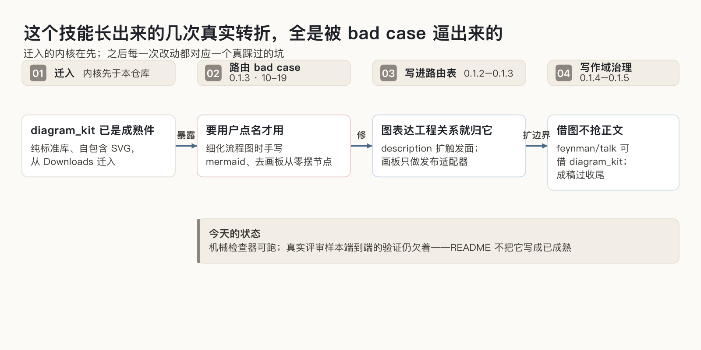

# 研发技术文档

> 写、改、评审技术方案与工程图：先把工程决定组织对，再写读者用得上的正文；图不是配图，是一份可编译的脚本。

[English](./README.en.md)

## 这个技能到底在修什么

做技术方案的人都熟悉两种烂文档。一种是 AI 写的，结构完整、语言流畅，认错了系统链路，把推测写成了事实，评审会上才被人抓出来。另一种更隐蔽：文档什么都有，问题和方案混在一起、候选只是陪跑、发布计划只有一句「充分测试」，它读完没有推动任何决定。这个技能要修的第一件事，就是让文档先组织决定，再组织文字。

其中最难伺候、也最容易烂掉的是图。作者确认：下决心做这个技能，冲的就是「稳定、可编辑的工程图」。图这件事在实际里反复翻车：画完存成一张图片，下次改结构只能重画；图和正文各说各话；评审意见落在图上，没法回流。

作者确认过这套技能的起因：当时缺一套严肃技术文档标准——方案要先把决定组织清楚再成文；图这一环尤其缺稳定、可编辑的画法，才单独把图引擎做进来。文档和图是同一个动机的两面，不是先做了图、文档后凑的。

## 从问题里抽出的技能形状

修这两件事的方式，是把技术文档拆成三个彼此约束的对象，而不是写一个更长的模板：

- **工程判断先立住**：现状事实、未验证假设、决定、待确认项分开写，不能混在一段里。
- **正文按三层写给不同读者**：首屏给结论和要拍的板，章节从总览派生，细节进附录。只读首屏加各章第一段，读者就该能说清做什么、为什么现在、代价是什么。
- **交付物互相咬合**：图、风险、验收、回退必须对得上；图是生成脚本产的，不是贴图。

失败边界也写死在开头：纯润色、教程、API 全集、没形成工程决定的调研不接；面向读者的技术分享文归 talk-smith，这个技能只接要评审、要拍板的方案。改一篇已成形文档之前先通读全文骨架的前置动作走 sansi-erhouxing；技术调研先用 feynman-explainer 取证，内部方案/RFC/ADR 成稿归本技能；定稿后的中文清洗交 haohao-shuohua，本技能不抢那一层。

**什么时候接。** 四种状态直接走这里：新建技术方案；更新已有文档（先通读全文和已有图）；评审已有方案、回评论；套团队模板适配。读者分三层：首屏给要拍板的人看结论，章节给按模块跟进的人看，细节进附录给落地的人查。

**最后交付一组互相咬合的东西，不是一篇长文：** 正文三层；新图保留结构JSON与Archify交互HTML，按需导出静态图；旧图继续保留 `.py`／SVG／draw.io。用户需要速读页面时，另可输出图表、步骤与来源联动的 Explainer，不强制替换原正文。

## 当前绘图分工

新图原生适用时优先使用随包固定版本Archify；原生没有的专用视图可以由改良旧模板兜底。`archify_bridge.py capabilities` 给出真实清单，render按输入族选择并报告后端，不把新JSON直接塞旧引擎，也不因执行失败随意换图。我们负责取证、信息取舍和语义检查，后端负责绘制。

```bash
python3 scripts/archify_bridge.py render --type lifecycle --input candidate.json --output task.html
python3 scripts/archify_bridge.py explain --input candidate.archify.md --output answer.html
```

生成与来源检查后仍须用独立 Playwright 真正看图。新旧差集见 [能力与兜底](references/diagram-capabilities.md)，具体Schema与边界见 [绘图桥接](references/archify-bridge.md)，一页式讲解、来源／代码导读、步骤定位、局部修订见 [阅读增强](references/archify-reading.md)。

## 历史图引擎：可编译的 Python 图源

两边的取舍摆在一起（图1）：



最直接的取舍在这里。让模型自由画一张图，出图很快，但产出是一张位图：连线不绑节点，改结构等于重画。这个技能选了另一条路：作者写一段 Python 生成脚本（`arch.py`），`diagram_kit` 负责样式、文字宽度、端口对齐和正交连线，产出一份自包含 SVG；可编辑的真正源头是这份 `.py` 脚本，改一处节点再跑就全图重生，这是本工具真实保存的编辑方式。SVG 本身浏览器可预览；它在各家编辑器和画板里导入后能不能自动恢复成原生节点来拖拽编辑，取决于那个软件的导入支持，本技能不做这个保证。PNG 只是预览。改图的动作是改脚本里一个节点，不是重画一张。

这条路有明确的代价，不藏着：布局要人摆，不交给模型自由发挥。作者给的是真实坐标：`card("api", 60, 140, 240, ...)` 里四个数就是画布上的 x、y、宽，单位是设计单位。换来的收益是可评审、可 diff、改一处全图重生。

坐标不是照搬到图就完事。端口是卡片四条边上的锚点，`edge(api, gw)` 声明两个节点，kit 自动在边的端口上绑定连线端点；同一条边要走多条线时端口自动均布。连线走正交折线（横平竖直），原因很实际：斜线曲线会穿字压卡，横平竖直的拐点才好避开内容。连线穿卡片、压区域标题、标签压边，`diagram_check` 都报具体位置。配套硬规矩是顺序固定：Python 出 SVG，`diagram_check` 报告重叠、字号不够、色系越界就报错，过了检查才谈发布；飞书画板只是把成品写进去的发布适配器，不决定结构。时序图、状态图、甘特图有专门形式，就交给 Mermaid，不硬画。

## 几次真实转折，全是 bad case 逼出来的

迁入之后的改动按时间排开（图2）：



这个技能的图引擎是带着成熟形态从外部迁入仓库的，迁入之后的每一次改动，对应一次真实踩坑，看 CHANGELOG 就有数：

- **路由没命中（0.1.3）是最典型的一次**。技能明明在，实际用的时候却没走它，细化一张流程图时手写 mermaid、去在线画板里从零摆节点。修法没有停在写一段更漂亮的描述：它把「图表达的是工程关系还是纯数字」写成判据，把归属优先级写进 description，让宿主在不需要点名的情况下就能命中它。一个技能再对，路由找不到它，等于不存在。
- **标题和隐私（0.1.2）是被检查器拦出来的**。标题塞进一句话结论、正文写「老板问」、夹个人邮箱，这类问题人眼会放过，所以 `doc_check` 直接报错拦截，不做提醒。
- **借图不抢正文（0.1.4）是给协作划界**。写作域的其他技能可以借这套画图引擎出严谨工程图，但正文叙事仍归它们自己；成稿统一过中文收尾检查。

## 新旧视觉分别维护

旧 `diagram_kit` 改为浅色面与轻轮廓，Group边框与连接线分开；分类和状态色可明确选择，旧接口和灰阶模式保留。它改善历史外观，不重写旧布局。

新图保持Archify原生角色色面、轻分组与路径编码，不再覆盖为旧色表；详见 [颜色规则](references/visual-design.md)。

## 怎么用

开始前先确认三件事：谁读、读完做什么决定、覆盖什么范围。新建任务先把目标和边界问清；更新任务先通读现有文档和图再动笔；材料已经充分就直接起草，只追问会改变核心决定的缺口。

```python
from diagram_kit import Diagram

d = Diagram(960, 420, title="写入只经过网关")
api = d.card("api", 60, 140, 240, "任务 API", desc="接收并校验任务")
gw = d.card("gw", 500, 140, 240, "网关", code="POST /v1/tasks", tone="accent", emphasis=True)
d.edge(api, gw, label="转发")
d.save("arch.svg")
```

上面这段真能跑：保存后接两步检查：

```bash
python3 scripts/diagram_check.py arch.svg --png arch.png
python3 scripts/doc_check.py doc.md --skim --source <材料>
```

`diagram_check` 把 SVG 渲成 PNG 预览并查重叠、穿线、字号；不通过时报出具体位置，改坐标重跑即可。两个检查器的退出码契约一致：通过返回 0，有错误返回非零，可以直接接进脚本或 CI，不必读输出猜结果。

正文这侧，`doc_check --skim` 验的是速读层：只读首屏加每章第一段，读者要答得上五问（做什么、为什么现在、主干怎么做、代价和风险、要他决定什么）；结构预算就是首屏篇幅、章节数这类上限（首屏 ≤450 字、H2 三到七个、长于 6000 字必须有附录），超了报错。正文成文后统一过中文收尾检查，去 AI 味但不动技术含义和判断强度。

**文档侧小对照例。** 材料三条：近 30 天写入接口峰值 P99 超 800ms 的监控记录；现有网关没有限流；业务方口头说「新客户上线后流量会翻倍」。起步先确认三件事：读者是网关组负责人和后端评审会；读完拍的板是「要不要上线限流改造、选哪一档阈值」；范围只覆盖写入网关，不含搜索接口和前端改动。接着归类，不把没证实的话写成事实：

| 归类 | 材料 | 处理 |
| --- | --- | --- |
| 事实 | 近 30 天写入接口峰值 P99 超 800ms（监控记录可查时间与版本） | 进现状，保留来源和时间范围 |
| 假设 | 下周峰值再涨 30% | 标注假设，写明不成立时影响什么，不写成已知 |
| 决定 | 先在网关层加令牌桶限流；责任人网关组负责人；状态待评审；代价是有误杀风险 | 进决定节，写清责任人、状态和代价 |
| 待确认 | 搜索接口是否同批改 | 写明由谁、用什么证据关闭，不带问号进首屏 |

「流量翻倍」像事实但没有数据支撑，不进事实类：要么挂假设（按它设计就写明前提），要么挂待确认（谁补什么数据后再定），正文不装成已成立的现状。成文按三层落：首屏给结论、要拍的板和范围一句话配总览图；章节按问题、候选、决定与代价、风险与回退展开，每章首段先给结论；完整参数表、监控原始数据、接口清单进附录。

作为技能直接说「帮我写个技术方案」「把这张架构图重画一下」「评审下这份 RFC」。新图的Archify需要Node.js 18+，后端随包，不自动安装或更新；旧图和正文检查仍用Python标准库。平台不可用只阻塞发布，不自动改变内容方法或使用旧图冒充新结果。

## 现在能说到哪一步

机械检查层是真的能跑：结构预算、速读层五问、图的重叠与字号都有对应检查器。但真实评审样本上的端到端验证还欠着，这个 README 不把它写成已经成熟。使用样例见下。

- 同主题文章（展示本技能在个人工作台方法层的位置，不是起源证据）：https://jobyang.cn/writing/personal-harness-workbench/
