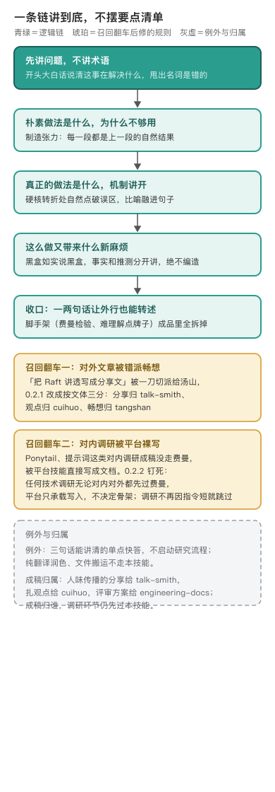

# feynman-explainer · 费曼讲透法



编辑源：[assets/logic-chain-narrow.svg](assets/logic-chain-narrow.svg)

---

## 讲到外行能转述，才算真懂

这个技能负责调研、讲透与调研成稿：拿到 GitHub 仓库、源码、论文、提示词或一个技术机制，取证之后把它讲到外行也能听懂。它的唯一目标就一句，能把一个东西讲到外行也能听懂，才算真懂。动手前先读方法和范例，再开始检索；「调研一下，写个文档」这类请求也适用，不用点名费曼。

这个技能的起点是作者自己的老习惯：调研一个陌生东西，非得用几句话讲清；讲不顺，就是还没真懂。

两条最高铁律是它和普通总结的分界线。一，逻辑链，不是要点清单：整篇是一条因果推导链，相邻两段用「于是」「但是」接得上，抽掉中间一节后面就接不上；写成「要点一、要点二」平铺就是错的。二，脚手架要拆：费曼五步、难理解点、费曼检验这些是脑子里组织思路的施工工具，成品里绝不出现「费曼比喻：」「难理解点在哪？」这类牌子，楼盖好脚手架要拆。诚实约束也写死：讲不清的地方老实说黑盒，资料没有的绝不编造，确定结论和合理推测分开讲。

## 两次召回真空，把入口和归属钉死了

这个技能真正的规则演化，大半是被两次「调研没走它」的翻车打出来的。

第一次是路由错派。早先把「对外发布的文章」一刀切派给畅想技能，结果「把 Raft 讲透写成一篇分享文」这种稿子被错派去了汤山体，人家要的是把技术讲清楚，拿到了一篇畅想。修法是把成稿归属按文体三分：有叙事弧讲给读者听的归 talk-smith，扎可反驳判断的观点归 cuihuo，面向未来的归 tangshan-style。

第二次更隐蔽：对内的 Ponytail、提示词调研成稿没走费曼，被平台技能直接写成了文档，内容是平台模板堆出来的，逻辑链和证据关系都没经过讲透这一步。于是钉死：任何技术调研，无论对内对外、无论弄懂还是落成文档，都先过费曼；费曼自己也能直接交付内部调研报告和选型研判，不再把成稿一律外推；分界从「对内对外」改成「这篇是不是讲给读者听的技术分享」；这个刻度第二天又校细了一次，见下一节。再后来补一刀：不再用指令短或预估篇幅排除调研，交接已有查证结果直接复用，避免它和分享技能循环调用。

## 分界第二天又校过一次刻度

0.2.2 把分界定为「要不要人味地传播」，只过了一天就发现这把尺子拿反了。talk-smith 原先把「带个人幽默感、口语化」写进自己的触发条件，等于告诉模型：写得太正经、没有段子的分享不算 talk。问题是技术分享本来就可以严肃，一篇扎扎实实讲可观测性建设的分享稿，不能因为作者没用幽默就被挡在门外，更不能因此错塞回费曼怀里。

于是 talk 的触发整个重写：判定看这篇是不是讲给别人听的分享，个人工程实践、经验传播、项目复盘、博客演讲叙事都算；幽默口语降级为执行风格，严肃分享一样归 talk。反向也同时钉死：普通研究报告、机制解读、选型研判，哪怕对外发布、哪怕面向读者，都还是费曼自己写到底——路由场景表里专门放了一条强制反例，「对外发布这个 GitHub 项目的调研报告」归费曼，不归 talk。

顺手补的是多轮重判。前一轮用户只要了个单点快答，不代表后一轮不能展开；他接着说「写成报告」「讲清楚这个机制」，就正常走调研成文，不拿输入短、不拿前面是快答当理由排除。

## 篇幅和画图的规则是失控保护

早先交付篇幅没有界，可视化只有一句「优先画图」。修法是把篇幅压进 600 到 1500 字的建议区间，预计超出先出 5 行逻辑链骨架给作者确认范围再分段补全，写之前花 30 秒对齐范围，比写完砍半段强；画图改成判据表：对比多维、流程时序、层级架构、多方对照才画，单一定义和一句话能说清的机制不画，图的箭头方向就是逻辑链推进方向。定稿交 haohao-shuohua 轻档扫 AI 腔，但费曼的比喻和过渡词是豁免的：比喻是它的命根子，「那么/于是/所以」是逻辑链的关节。

## 一趟活儿怎么走完

规矩立完，看它一趟按什么顺序走完。第一步先判题：这是技术调研，还是一句话能答的单点问题。调研题无论多短，都先把方法和范例读了再检索，不等用户点名费曼。

第二步取证。先分清信息从哪来：内部系统、术语、文档走内部检索；公网题目先搜再抓原文页面核对，搜索摘要不算数；给定的论文、文档、PDF 直接读全文。多个子问题一次性并发查，不一条条串行。料取够，先在心里理出那条逻辑链，不把调研过程和原始资料原样甩给用户。

第三步讲透。脑子里按五步往前推：开头大白话说清这事在解决什么、为什么反直觉；顺着问题往下追，每段都是上段的自然结果；遇到硬核转折，在句子里点破新手最容易误会的地方；心里默问这段能不能三十秒讲给外行，过不了就重写；结尾一两句话把整条链复述一遍。这五步是施工顺序，成品里看不到它们的名字，只看到讲顺了的行文。

下面这段是为演示专门构造的对照，不是真实成稿案例。讲一个外行没听过的东西，坏成品长这样：

```text
## 要点 1：向量数据库是什么【P0】
🤔 难理解点在哪？向量数据库是一种专门存储高维向量嵌入的数据库系统，支持近似最近邻搜索（ANN），
基于余弦相似度度量，广泛应用于 RAG、语义检索与推荐系统。
💭 费曼比喻：像图书馆。
要点 2：核心机制……要点 3：应用场景……
```

拆掉脚手架、几句话讲清之后长这样：

> 你想在一堆文章里找「意思相近、但用词不一样」的内容，关键词对不上，常规数据库就找不到。向量数据库换了个思路：先把每段文字翻译成一串数字，意思相近的文字，数字串也挨得近；检索时把问句也翻成数字串，找离它最近的几串，对应的原文就拎了回来。说到底，它存的是意思在数字空间里的位置，关键词匹配那套老办法管不了意思相近但用词不同的内容。

第四步成稿检查。中文定稿过一遍好好说话轻档，只挑最刺眼的 AI 腔，不动费曼的骨架。普通调研由它自己写到底；要做成分享、观点硬文、评审方案，再按文体交接，交接时已有查证结果直接复用。

第五步交付。默认在对话里直接讲；要文档时它管全部内容和结构，平台技能只负责把写好的内容建成文档。预计篇幅要失控时，先搭三五行逻辑链骨架给作者确认范围，再分段补全。定稿前再逐条过一遍自检：脚手架拆干净没有，整篇是不是一条链，抽掉中间一节后面接不接得上，开场有没有甩术语，讲不清的地方有没有老实标黑盒。

## 今天管什么、不管什么

它管技术调研、源码解读、论文与机制研究、复杂文档总结，对内对外都接；调研对象是提示词、Agent 实践、某个仓库怎么写的也照样走它，判断标准是「你在调研一个外部实践并想搞懂它」。它不管三句话能讲清的单点快答；纯翻译、润色、文件搬运；成稿归属另说的四种文体按上面路由。

喊它的说法很宽：「调研一下这个 GitHub 仓库，看看有什么好东西」「调研一下，写个飞书文档」「总结一下这篇复杂文档、论文或方案」「调研一下 XX 技术、产品或概念」「讲透」「讲明白」「帮我搞懂 XX」，解读源码、黑盒机制、硬核技术都算。一句话快答不启动：「一句话告诉我 XX 是啥」「简单说就行，别展开」。纯翻译、润色、文件搬运不归它。前面一轮是快答不锁死后一轮，用户接着说「写成报告」「讲清楚这个机制」就正常展开。

## 怎么跑（人类操作参考）

正反例、比喻库和范文拆解在 `references/style-examples.md`，动手前先读。那里有一段提示注入的并排对照：挂着「难理解点在哪」牌子的写法，和把脚手架拆进句子的写法摆在一起，照着读一遍就知道成品该是什么样。出图工具是下游：多标签带英文术语的机制图交确定性渲染器，精确工程结构图交工程文档技能，本技能只定「该不该画、画什么关系」。

这条路由靠仓库里的静态合同测试守着：写作五兄弟互相指向对不对、旧病措辞有没有残留、把旧病注回去守卫抓不抓得住，三十九个场景合约本轮实跑全过。但它是文本合同，只证明措辞没被改丢，不证明真实会话里模型一定召回它——0.2.3 自己就写明这是软约束。

## 待作者补

1. 最早一份费曼成稿是调研什么题目（仓库只留了方法，没留开山案例）。
2. 0.2.2 那次「对内调研被平台裸写」的 Ponytail 成稿，现在还能找到对照吗。
