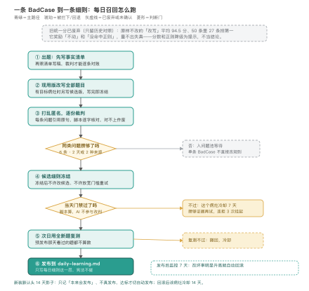

# haohao-eval · 好好说话评测台

## 分数是怎么废掉的

这个技能最早真的合成过一条分数来判好好说话改得好不好：保真系数乘上一个加权式，把通顺和正则残留折成 0 到 100 的一个数。回看 50 条历史材料，它立刻露了馅，原样不改的「改写」平均能拿 94.5 分，高过作者本人和两个竞品，50 条里有 27 条它排第一。它奖励的只是「没动」和「没命中正则」：信息丢没丢、承诺编没编、术语改没改错，这条分量不出来。

废掉它还有第二层理由，文件里诚实记为「循环自证」：这套分的地基是作者一个人标的 50 条标签，作者自己赢了 35 条（70%）；用这批标签拟合出来的权重，自述自洽率只有 24/50（48%），连作者自己的标签都复现不了。单人标注、自评占优、拟合复现不了自己的标签，三个事实合起来说明它是循环论证，不是尺。

为什么还要有一个评测台，作者已经说得很直白：改写质量的好坏是多样的，规则和分数都没法完全定义什么叫好、什么叫坏，只能靠每日人工反馈、标注，把 BadCase 攒成一类一类地迭代改进。分数被降级为提示之后，判断改由逐字核对的裁判协议承担，这就是这个技能现在的形状。

## 那靠什么判：裁判只核对，不打总分

废掉总分之后，判一份改写的顺序是写死的：先认场合、对账事实，再看场合对错，最后看表达。有任何编造、丢信息、程度或术语漂移，直接判「改坏了」；事实没坏但仍有 AI 味、病句、没毛病也动了手，判「没改好」；都没有才算合格。

几条规矩是被上面的翻车逼出来的：每条问题都要引用原句，脚本逐字核对，引用对不上作废；拿不准就判「不确定」并给出争议片段，不硬判；评测时不许改被测版本，候选冻结以后才改写、才判，判完不许回头放宽门槛重试到过为止。正则和新数字扫描只抬旗、不下结论，臆造属于保真维度，正则抓不了，旗标都要裁判逐条确认。

## 怎么让它每天变好：攒够了才动

每日召回的形状：出题先写事实清单（合成题先列 3 到 6 条事实再照清单写稿，裁判才有账对），盲评逐份核对，同一类问题攒够证据才出候选；候选当天过门禁（门禁由脚本算，AI 不参与改判），第二天用全新题复测（防细则靠背句式过关），过了才发布，发布后监控 7 天，改坏率明显升高就自动回滚。流程头 14 天是影子期：只记「本来会发布什么」，不真发布；影子期体检稳定、抽查漏判少，才切到自动发布。一次最多动两条细则、一次只修一类问题；候选被门禁拒了就冷却攒证据，连拒多次挂起不再自动试。

改写作本体的通道也划死了：自动流程只写每日细则这一层，写作技能的宪法层和稳定判据层一个字不许碰；作者的话只改评判标准，不直接改写作技能，技能要变，还是得召回攒够、候选过门禁。

## 人在哪：人工标注是流程的一部分，不是外挂

每天最多问作者 3 条是非题，每条一句原文、一句改写、一个槽位；不回就按保守默认处理，流程不等作者。作者的回答原样存进判例库，以后裁判遇到相似情况会读到；作者随手交代的「感谢信客套别删」这类话，也是原话照抄进判例。给作者看的层也按他的习惯做过两轮收窄：每日记录从一大段段落改成四张飞书表格（今天的数据、新召回、今天记下的回话、待你判断），各种内部词换成「今天照常召回」「你的改动原样保留」这类人话。

作者亲手批改的稿子是最值钱的人为数据：0.4.2 进了首批 13 条手工批改种子，按病灶码、原句、作者动作、作者理由、去场景化的通用规则信号结构化存下（来自一轮真实批改）。0.4.5 发现这 13 条是从修订模式截图转录的，把删改前后并排误读了，全部作废；改按文档历史版本逐字比对重建成 17 条，其中 10 条每天按轮转进题，另 7 条是作者回源或内容取舍，只作边界参考、不出题。同类信号攒够证据、盲评胜出且作者拍板后才进细则。病灶谱本身也是从人评里长出来的：A 到 G 七类来自 50 条人工评语，每日召回又补了手痒、原句不清、AI 味残留三类；0.5.0 按一次 Codex 加载/消融实验补了第四类「正文里自加免责」。

## 它知道自己哪里不行

小样本的边界在门禁里写明，不装成统计检验：干净对照自带只有 5 条，改动比例差 5 个百分点这道闸在这个样本量下噪声远大于信号，它只是防「明显改坏干净稿」的粗闸；裁判体检题池每天抽 9 份，约 17 天后开始重复；目标病灶的符号检验每天可比对的题通常只有 5 到 10 道，p 值波动很大，单天贴线过线不当铁证。样本太薄时，脚本自己把比较结果标成观察项，不进过/不过判定。

单人标签的天花板也认了：这批标签现在只够做启发式冒烟，不足以支撑任何显著性结论。所以备了标注一致率工具，等第二个标注者把同样的题目标第二遍，算 pairwise 一致率和 Cohen kappa，这是扩样的第一步。

数据、凭证和材料不够时，流程停下来，不补结论。跨天状态接不上、进场自检没过、读写权限被拦，就停在这一步，把原始报错记进日报，不绕过、也不手改状态文件；凭证只从环境变量或平台密钥读，不打印、不写进任何文件。真实材料只用作者明确给过的来源，不自动翻私人文档、聊天记录和知识库；碰到个人信息、财务或公司敏感内容，整条不用。命令没跑的步骤在记录里写「没跑」，不凭记忆汇总；材料只有二手信息时，不替原文补一手引语。

## 怎么用、不用

什么时候喊它，分两种。定时召回：定时任务每天自动跑一轮，题目由技能自带的种子、历史回归题、干净对照和作者明确给过的真实材料凑成，不需要当天额外准备稿子。手动起一轮：手里有两份以上改写要比、要和别的工具比、或者想给技能做一次回归，就把原文和每份改写一起交给它，走同一套裁判协议，不发布、不改动现行规则。一轮下来拿到的是逐份问题清单：每条问题带原句引用，按「改坏了 / 没改好 / 合格」分级，能逐条对账；每日另出一份给人看的日报，攒够证据的候选细则才进下一步验证。

手动起一轮时，直接说这类话就行：「把这两版改写对着原文比一下，逐份判，别放在一起比着判」；每日进度也可以问：「今天的召回结果怎么样」。不用先贴命令，也不用报运行编号。

管：每日召回找错攒类、候选验证、门禁发布、监控回滚；一次性比稿、比工具、技能回归（同一套裁判协议，不走发布）。不管：只是写或润色一段中文（那是本体的事）；日常写作绝不打分；自动流程不碰宪法层和作者的个人风格文件；材料只有二手信息时，不新增一手引语、不编造「某人说过」的原话。

一个标明演示例（非真实题，只为说明裁判动作，且场合是前提）：题面设定在「对外礼貌场合」，原文一句「感谢您的来信」，候选改写顺手把客套删成「收到」。裁判对账发现原文的「感谢」信息下落不明，判「改坏了·丢信息」，候选当天被门禁拦下，这条信号进冷却攒证据，不进任何细则。同一个「删客套」换到内部备忘录场合就是对的，所以判法不通用，先认场合再对账。真实题面在 data/cases50.json（50 条历史材料，不许删）。

## 版本取舍（有据）

- 统一分废弃只停在过口头过一次：0.2.0 才把废弃横幅、人话报错、损坏状态停而不删文件这些拆净。
- 0.3.0 还了最大一笔工程债：三千行单文件拆成十三个模块，拆分前后用同一组 fixture 在新旧两棵树上逐命令比对输出和产物哈希，全部一致；同版加了进场自诊断和 9 个对抗测试。
- 测试口径：22 个流程/单元测试 + 11 个对抗测试通过，无跳过（0.5.0 记）。这证明所覆盖的流程与边界行为正确，不是实际改写效果或盲测效果的证明。

## 未确认的细节

1. 第一个让人想建它的具体 case 或时刻、最初立项的时间点。
2. 50 条历史材料是在什么场景、用什么对比方式收集的（文件只存了原文、三版改写和作者意见）。
