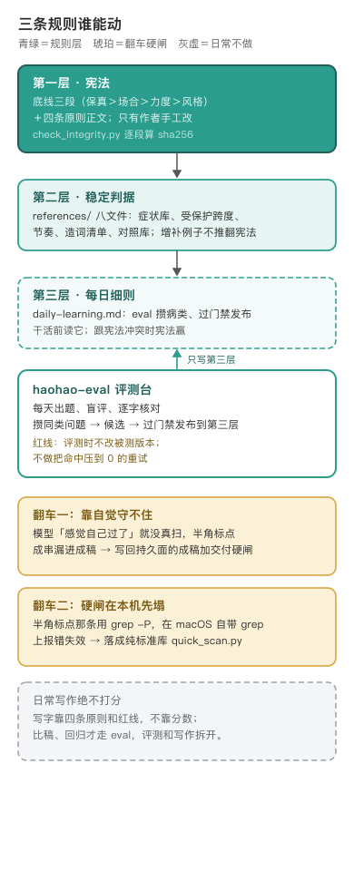

# haohao-shuohua · 好好说话



编辑源：[assets/rule-layers.svg](assets/rule-layers.svg)

---

## AI 味的根，要到语言学层面去找

这个技能干一件事：给任何 AI 产出、最终要交付给人看的中文去 AI 味、加中文味，让它像真人说的。起草文章、模型在开发迭代里给的回答、总结、答复、汇报，都默认从这里过一次〔出处：SKILL.md description、开篇〕。总纲一句话：保事实不动，不添原文没有的信息，去 AI 味，加中文味，不许造词充深刻〔出处：SKILL.md 总纲〕。

动手前没有停在「把语气改口语」，而是把 AI 味追溯到了语言学层面再定规则。作者已发表的标杆长文《为了根除「AI 味」，我翻回了一百年前的语言学》把这件事讲透了，本文不抄它的论证，只说仓库里留下的方法后果〔出处：SKILL.md「标题红线·标杆与反例」把该文标题列为合法钩子样板；作者确认〕。

## 现成的「说人话」工具为什么不能直接用

业界去 AI 味、说人话的工具不少，评测时发现它们为了显得像人，爱往稿子里塞随意的细节和角色口吻，意思跟着就变了，内容也丢了〔出处：SKILL.md「两种活」改写节〕。所以这个技能把「不添信息」钉在最高优先级：改写只动说法，原文没有的数字、原因、承诺、身份，一个字不加；起草时材料里没有的具体，宁可留空问作者〔出处：SKILL.md「保事实」底线〕。50 条历史 BadCase 里翻车最多的两处被单独钉死：专业术语用原词绝不通俗化，绝不做原文没有的承诺、数字、场景、身份〔出处：SKILL.md「保事实」两条钉死的保真红线〕。

## 靠自觉守不住，才长出交付硬闸

第一版通篇是常驻软自律，全靠模型自觉去扫。自觉是能跳过的：模型一旦「感觉自己过了」，扫描就没真跑，半角标点、破折号成串漏进成稿，技能形同虚设〔出处：SKILL.md「交付硬闸」〕。于是对写回持久面的成稿加了一道硬闸：机器能判净的字面毛病（半角标点这类）必须真跑脚本、清到零、命中数贴进修改报告，没跑过不许交；意图要人判的（翻案体、车轱辘、疑似梗）只列建议清单交作者拍板，机器不自动改。实测这类形式检查误报能到九分之八〔出处：SKILL.md「交付硬闸」两层分工〕。

## 硬闸在本机先塌过一次

四条零容忍里，半角标点那条一开始用 `grep -P` 扫，在 macOS 自带的 BSD grep 上直接报 `invalid option -- P`。本就该机器零误报的硬闸，在本机失效〔出处：CHANGELOG.md 1.1.0〕。1.1.0 把它落成纯标准库的 `scripts/quick_scan.py`，自动屏蔽代码块、URL、数字千分位这些例外，配 21 个正反用例（17 条扫描 + 4 条完整性）的测试全绿〔出处：CHANGELOG.md 1.1.0；tests/test_lint.py〕。同版还加了 `check_integrity.py`：对三段宪法底线逐段算 sha256，被手工改动以外的方式碰过就退出非零〔出处：CHANGELOG.md 1.1.0；SKILL.md「规则分层」〕。

## 定位被真实使用纠正过一次

技能最初的定位是中文写作清洗。市场用户实际把它用在开发迭代里的模型回答、答复、汇报、总结上，1.2.0 把定位摆正为「给任何 AI 产出的中文去 AI 味」，写作只是其中一大场景〔出处：CHANGELOG.md 1.2.0；SKILL.md description〕。这一版只改顶部定位表述，四条原则和底线条款一字未动，宪法段哈希不变〔出处：CHANGELOG.md 1.2.0〕。同版把「手别太痒」写进根：「没忍住把好句子也重写了」是第一号翻车原因，看得宽（全篇兜底），动得准（只动该动的）〔出处：SKILL.md 根尺度两条〕。

## 保真规矩被模型写进了正文

「不添信息」靠两条规矩落地：改写的每条信息都要在原文里找到出处，原文缺的具体写进「给作者」提醒。同事在 Codex 上做加载/消融实验时发现，GPT-6 Astra 加载技能后，12 条回答里有 7 条在正文后面跟了「以上仅依据……未做额外核验」这类免责声明，去掉技能后一条都没有；文档列出的 GPT-6.1 Terra 回答，开不开技能都没有这种话〔出处：CHANGELOG.md 1.3.0〕。两个模型在 Codex 里的系统提示词逐字相同，而且明令禁止主动加免责声明，所以毛病出在技能：出处核对本来是写稿人自己的检查，提醒本来该单独写给作者，规矩没写清边界，对技能指令更敏感的模型就把两样都写进了要交出去的正文〔出处：CHANGELOG.md 1.3.0〕。1.3.0 把边界写明：提醒只在原文缺具体、原句有几种读法时写，单起一段；核对结果只进修改报告；正文要能原样交出去。扫描脚本加了一项只报不卡的免责尾巴检查〔出处：SKILL.md「两种活」；scripts/quick_scan.py〕。

## 规则分三层，谁能动写死

方法的形状见上图：宪法层（底线三段＋四条原则）只有作者能手工改；稳定判据层（references/ 八个文件）是宪法的展开，可以增补例子不能推翻；每日细则层（`daily-learning.md`）由评测台攒病类、过门禁发布。冲突以宪法为准，细则让路；评测台一个字都不许碰前两层〔出处：SKILL.md「规则分层与单一事实源」〕。

日常写作绝不打分，写字靠四条原则和红线，不靠分数；评测拆给独立的 haohao-eval，靠每日召回和真实 case 长期纠偏〔出处：SKILL.md「评测 / 打分 · 已拆出去」〕。节奏这条也划死过一次：机器粗筛、人念终审，首选补逗号断句，别急着拆句、更别掰成大白话〔出处：SKILL.md「加中文味」节奏边界〕。

## 今天管什么、不管什么

**管。** 起草或改写一段要交付给人看的中文：保事实、去 AI 味、加中文味、守造词红线；上层写作技能（硬文、畅想、科普）的收尾清洗单向调用它，它不反过来依赖上层〔出处：SKILL.md「使用面」〕。

**不管。**

- 纯翻译外文、代码和接口文档的技术改写，不适用〔出处：SKILL.md description〕。
- 法律、合规、合同场景整体建议不用：法律语言的严谨性要求高于中文自然度，一改就可能改变权利义务〔出处：references/protected-spans.md 法律/合规/合同节〕。
- 个人风格默认关，用户点名才用；风格只改怎么说话，改不动说得对不对，跟保真、场合打架时风格让路〔出处：SKILL.md「个人风格」〕。
- 随手回消息、口语转一段这类不写回持久面的，心里过一遍原则即可，不跑硬闸、不出报告。判据是落不落持久面，不是档位高低〔出处：SKILL.md「力度」硬边界〕。

## 在文体分工里站哪

它是收尾清洗层，不是内容主导层。硬文、畅想、科普这些成稿，骨架和观点归对应文体技能，定稿后交它洗一遍；它不把别的文体改成自己的样子，也不抢从零成稿的主导权〔出处：SKILL.md「不越位」条，cab48e9〕。反方向留了一个出口：行政通知、周报短文这类没有专门文体承接的内容，它可以直接通用起草，不硬套成稿五段全套〔出处：SKILL.md description 尾句，cab48e9〕。一句话：有文体的归文体主导、它收尾；没文体的短文，它直接写。

---

## 怎么跑（人类操作参考）

```bash
python3 scripts/quick_scan.py 稿子.md   # 改前逐字扫：半角标点硬闸 + 破折号/翻案体/元话语/免责尾巴体检
python3 scripts/check_integrity.py       # 宪法段完整性与 sha256 校验
python3 -m unittest tests.test_lint     # 24 个正反用例
```

完整成稿流程、力度三档和修改报告模板在 `references/workflow.md`，症状全谱在 `references/symptom-dictionary.md`。

## 待作者补

1. 这个技能最早的原始版本出处与许可（git 历史从单技能仓迁入，「Adopt」的外部来源无记录）。
2. 「没忍住把好句子也重写了」是哪一批真实返工里认出来的第一号翻车，文件里只留了结论，没留那批 case。
