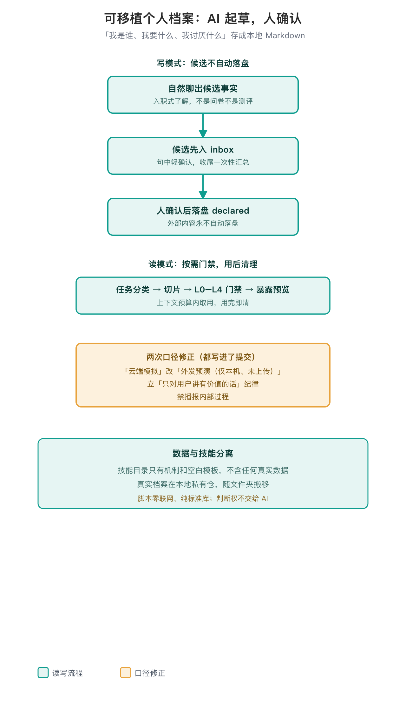

# me-context · 可移植个人 AI 档案

[English](./README.en.md)

> 把「我是谁、我要什么、我讨厌什么」存成本地、可审、带敏感分层的 Markdown 个人档案。AI 起草，人确认；档案给 AI 提供事实与偏好，判断权不交给 AI。

## 为什么需要它

个人档案一旦跟着某个平台或账号体系走，换个环境就要从头再来，可迁移性很受限。这个技能的出发点是把「关于我」这件事从平台绑定里拿出来：存成本地纯文本，随一个文件夹整体搬移，不绑任何一家服务〔出处：SKILL.md·开头；延伸阅读 https://jobyang.cn/writing/me-context-portable-memory/ 〕。



## 两条主轴：写进来要确认，读出去要门禁

**写模式，候选不自动落盘。** 自然聊出的候选事实先入 `inbox/`，句中轻确认、收尾一次性汇总，人确认后才落盘为 `declared`；外部内容永不自动落盘。采集节奏分 T0 建档自然聊 / T1 顺势 / T2 召唤制，这是个人助理的入职了解，不是心理测评、不是发问卷〔出处：references/05-write-protocol.md；SKILL.md〕。

**读模式，按需门禁。** 回答之前先过六步：任务分类 → 切片 → L0–L4 敏感分层门禁 → 暴露预览 → 上下文预算 → 用后清理。敏感层（L2/L3/L4）按受众和预算取用，文件头标了"只在本机用"的，外发也要逐次确认；`--show-l4` 才展开秘密层。脚本退出码是定死的：0 放行、2 待逐次确认、3 阻断、1 参数错；不带 `--emit` 只预演不落正文，解析不出合法层级的文件一律跳过不导出（fail-closed）。

**详略分两层。** 做判断时只带结论层：知道"尿酸偏高"就能决定少吃海鲜。体检数值、历年变化、少数重要决定当时的理由放在过程层 `journal/`，问到具体数值或想复盘时才读，默认不导出〔出处：references/03-storage-schema.md §1.1〕。

## 一个虚构例走一遍（examples/ 是编的，非真人）

仓内 `examples/` 整套是虚构演示人「张三」，他的过敏、尿酸、体检年份都是教学样例，真实健康数据不进公开仓。走一遍：张三随口说「你先认识一下我」→ AI 自然聊，听到「花生过敏」先轻确认、没拍板的进 `inbox/` → 他说「整理下新记忆」时逐条裁决，只有采纳的落盘，过敏这类按 L3 只留本机。后来他问「尿酸高能吃海鲜吗」→ `gate.py --domain health` 先查本机授权四档，没授权连本地都不吐结构化健康；授权通过、要发外部 AI 前再逐次确认。两道门各管一头：本机授权门管该不该读，L3 云门管发不发得出去。

## 几次口径修正是怎么来的

版本记录里能看到几处口径收紧：

- 方向性返工一次：早期误把心理量表（Mini-IPIP）当快速建档档，实测反馈「做成心理测试、跑偏了」，于是量表全部退到非默认附录，性格只收本人自报标签；工程规矩也明确不进个人档案（git 384493f）。
- 本地预览功能的名字从「云端模拟」改成「外发预演（仅本机、未上传）」，把「数据是否上传」的误会从词面消除（git 259f264）。
- 后来立了「只对用户讲有价值的话」的纪律，禁止向用户播报内部过程（git bed752e）。
- 再后来补了健康板块：结构化记录、本机授权门（四档、独立于上云门）、最新/历史/diff 表格化呈现；趋势借实验室参考区间的设计思想但不伪算临床常数（git 8319bfa、ceadec7）。
- 最近一次是分层和隐私补洞：体检数值挪到过程层，做判断只带结论；`audience: local` 从"建议字段"变成外发时真会拦；会默认外发的文件里出现健康、财务细节，lint 会提醒；备份、版本、加密不再由技能代办，交给用户自己。

## 数据与技能分离是硬设计

开源的技能目录里只有机制和空白模板，不含任何真实个人数据；真实档案在另一个本地私有数据仓。脚本零联网、纯标准库，数据自产生、自消费。题库也有纪律：事实/偏好采集题可入仓，心理量表只给官方链接、不进默认流程〔出处：references/01-acquisition-science.md〕。

技能只产出本机文件；备份、版本管理、加密由用户自己决定，技能不调 git、不联网。不建议把明文档案推到远端，哪怕是私有仓库〔出处：references/06-privacy-family.md §6〕。

## 用法（简版）

```bash
python3 scripts/init.py                        # 首次建数据仓
python3 scripts/gate.py --data ~/me-context-data --domain health --audience cloud   # dry-run 看会加载什么
python3 scripts/lint.py --data ~/me-context-data                 # 校验数据仓
python3 scripts/migrate.py --data ~/me-context-data              # 老仓：预演把体检明细挪到过程层
python3 scripts/viz.py --data examples --view all --audience local   # 本地图谱（虚构示例）
```

完整读写协议、模板与议题科学见 `references/01`–`09`。安装方式与宿主降级见 `references/07-host-portability.md`。

## 验证到哪、没验证到哪

- 回归范围：读写门禁、坏文件不导出、未授权不吐健康、敏感串不进导出物、过程层默认不加载不导出、迁移前后指标逐项一致这类文件级行为，自测 522 项断言现场跑过全绿（PASS=522 FAIL=0）；另有外部红队打分表（REVIEW_RUBRIC.md）留可复现反例。这验的是脚本按规则办事，不代表健康解读效果。
- 没验证：对话式访谈质量无盲测；健康解读是生活辅助级，不诊断、不给治疗剂量、不替代医生。

## 边界

粗框架非心理诊断、不做临床、不替代医生/律师/投顾；不做身份认证；记录他人信息请自行取得知情。

## 参考

存储与导出边界见 `SKILL.md` 和随包 `references/`。
