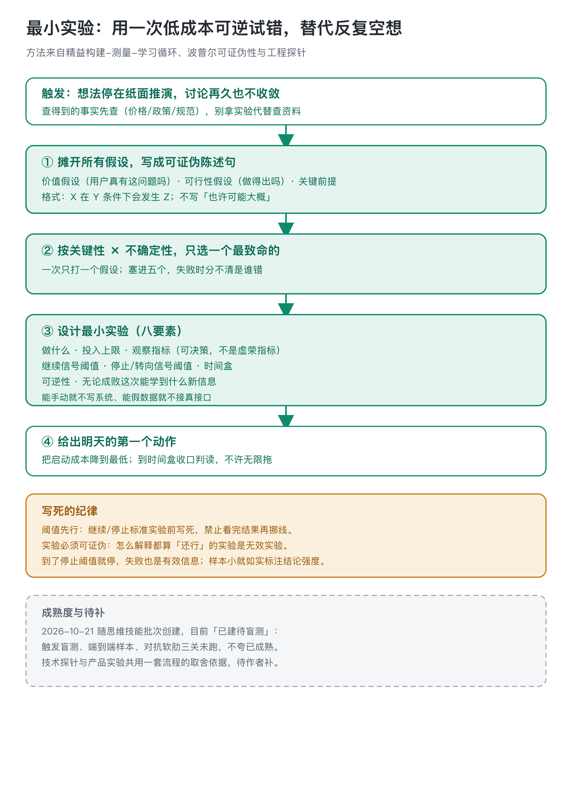

# 最小实验 · minimum-experiment

想法、方案或关键假设停在纸面推演、讨论再久也不收敛时用。挑出最致命的那一个假设，设计一个短周期内可证伪的最小实验，用现实反馈替代空想。

## 纸上推演再多，世界不会给新信息

先把想法背后的假设全部摊开：价值假设（用户真有这个问题吗）、可行性假设（做得出吗）、关键前提（外部条件成立吗）。每条写成可证伪的陈述句：「X 在 Y 条件下会发生 Z」，不写「也许可能大概」。

然后按两条标准排序，只选一个先验：关键性（它不成立整个想法要不要大改）和不确定性（现在有多没把握）。一次只打最致命、最不确定的那个；塞进五个假设，失败时分不清是谁错。

## 八要素里，阈值先行是命脉

设计实验时写清八件事：具体做什么、投入上限、观察指标（可决策，不是看着热闹的虚荣指标）、继续信号阈值、停止或转向信号阈值、时间盒、可逆性、无论成败能学到什么。继续和停止标准必须在实验前写死，看完结果再改线等于没设线。实验本身要小：能手动就不写系统，能假数据就不接真接口。

这个技能的理论底子是精益的构建-测量-学习循环、波普尔的可证伪性和工程里的探针式开发。产品实验（验用户假设）和技术探针（验可行性）共用一套流程；运行态、可编译复现的那类工程验证，仍走工程环境自带的测试流程。

## 一个示意例

> （虚构示意，仅演示流程）想做 newsletter 栏目、纠结两周：摊出价值假设（读者愿留邮箱）、可行性假设（每周能产出）、前提（有话题池）。按关键性×不确定性，可行性心里有数、前提一下午可查，最致命最不确定的是价值假设——它不成立就全免。最小实验：不建站，连发三篇预告挂手动表单；指标=留邮箱人数（不是阅读量）；两周 ≥30 继续、<10 停、满 14 天收口；不建站无撤回成本。明天第一个动作：写第一篇预告发出去。

## 边界与成熟度

- 不做什么：替你定方向（抉择归 steelman-choice）、给想法打分（scorecard）、写完整 PRD（product-brief）；还没形成想法要先扫机会走 opportunity-radar。查得到的事实先查，不用实验代替查资料。
- 到了停止阈值就停或转向，失败也是有效信息；样本小、周期短就如实标注结论强度，不把个例当规律。
- 这个技能 2026 年 10 月 21 日随思维技能批次创建，仓库里标着「已建待盲测」：创建当天做过 32 条触发词路由冒烟（首轮漏召补了三个触发短语后通过），但真实样本端到端、对抗软肋、连续使用验证三关都还没跑，不夸已经在真实项目里磨过。
- 技术探针与产品实验为什么共用一套流程，没有单独记录，待作者补。
