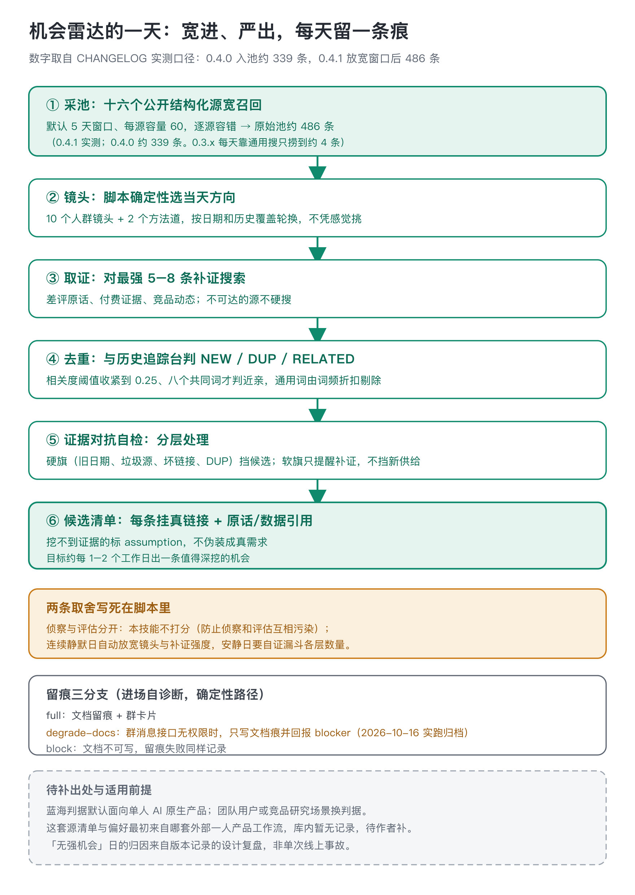
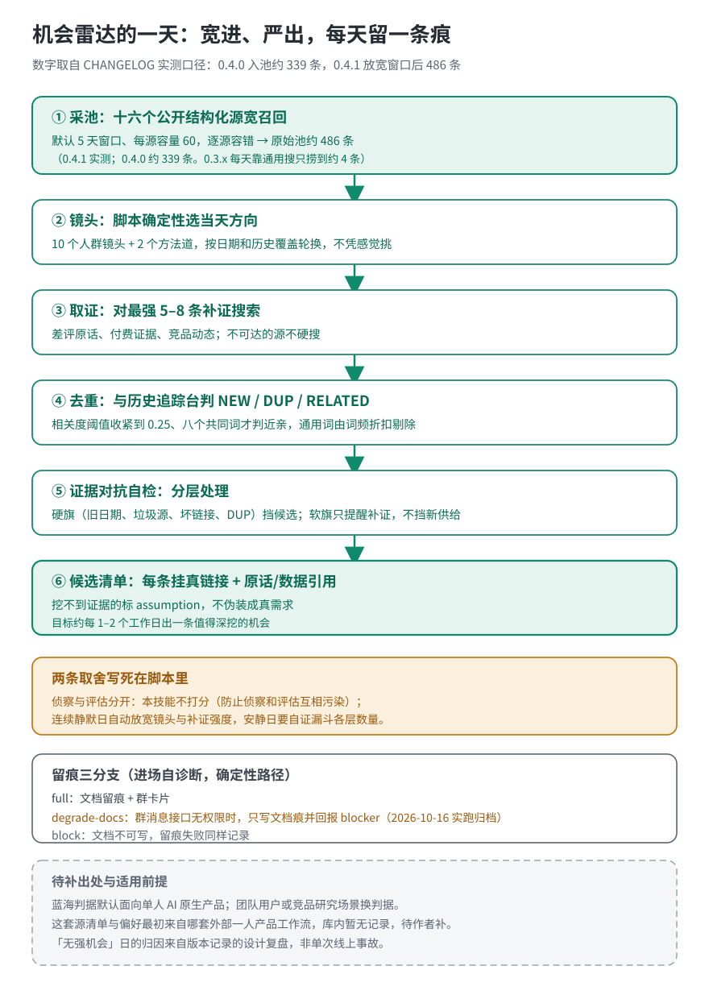

# 机会雷达 · opportunity-radar

一个每天自动跑一轮的产品机会侦察包：从十六个公开结构化源宽口径采池，按当天轮换的垂直镜头挖「正在变热、还没被大量注意」的线索，每条挂上真实来源再交给打分环节。它只负责发现和取证，不判断值不值得做，更不写 PRD。

## 每天只捞四条，漏的是市场还是漏斗

早期版本靠一次通用网页搜索收尾，一天下来大约捞到四条候选。宽进严出的设计复盘把问题归因到漏斗入口太窄：通用搜索词能覆盖的信息源有限，真正的信号藏在 GitHub 新高星、HN 评论许愿、差评原话这些地方。这是复盘口径，不是某一天的实跑记录。

0.4.0 版本把入口改成脚本化批量采集，一次采全十六个源（PH、GitHub Trending 与新高星、Show HN/Ask HN 及其评论、HF Spaces、DEV、V2EX、Lobsters、Reddit RSS、App Store 畅销榜等），实测入池约 339 条；0.4.1 把窗口放宽到默认五天、每源容量加到 60，实测入池 486 条。两次测的都是 collect.py 同口径入池数，不是「每天产出多少可深挖机会」。入池宽了，后面才有「严出」可做。

镜头是采集池之后的第二道闸。每天不凭感觉挑方向，脚本按日期从十个垂直人群镜头加两个方法道里确定性选出当天的 anchor 和补位。比如 2026 年 10 月 23 日这天，脚本算出的 anchor 是电商营销与独立站，补位是中文代服务与手作信号，关键词落在 shopify、amazon seller、独立站、选品、投放、跨境这一组上；先用这组词在当天四百多条池子里筛相关信号，再补定向网页搜。

## 宽进严出，安静日要自证

池子大了之后，筛选端的诚实变成重点。目标定在每一到两个工作日产出一条值得深挖的机会；当池子里有四百八十条却仍然判「无强机会」时，条目里必须写清漏斗每层剩多少（采池数、镜头命中数、去重后数、硬旗后数），证明是筛掉的，而不是没采到。连续两个工作日安静，下一轮自动放宽：镜头扩到相邻垂直、补证搜索加码，并在条目里标注「连续静默日扩源」。

去重和证据对抗都写成了确定性脚本，不靠临场手感。dedup 把每条历史记录和今日候选判成 NEW/DUP/RELATED，跨条目通用词由词频折扣自动剔除，阈值调过一轮：早期按相关度 0.18、四个共同词就算近亲，把正常线索误判成重复；现在收紧到 0.25、八个词。freshness 分层处理证据：旧日期、未来日期、垃圾源、坏链接、DUP 这些硬旗直接挡住候选；缺日期、付费未验证、近亲条目这类软旗只提醒补证，不挡新供给。

## 侦察和评估必须分家

这个技能从设计第一天就不打分。理由是同一个人既找机会又给机会打分，会下意识给自家线索松绑，侦察和评估一旦互相污染，两边的可信度都没了。打分是下游 scorecard 的活，本技能的产出信封里只放证据，不放结论。

立身的一句话是：机会不是想出来的，是取证取出来的。每条候选必须挂真实链接和原话或数据引用；挖不到证据的臆想条目标成 assumption，不许伪装成真需求。

## 怎么开始

一次性扫一轮，直接说一句方向就行，比如「帮我扫扫这个方向有没有产品机会」：给一个领域、一组技能标签或一句方向都可以；不给方向，就按「单人可做的 AI 原生小产品」全域扫。手头已有材料（链接、帖子、附件、一段需求描述）也可以直接贴进来，技能就着材料取证和筛选；环境连不上网时也走这条路，不硬编造来源。十六个采集源都是免登录、免密钥的公开结构化源，不需要用户填什么清单或内部编号。

拿回来的每条候选固定写清六样：领域、来源、证据链接加原话或数据引用、信号强度（强、中、弱）、evidence 标 real 还是 assumption、一个供下游打分沿用的 topic slug。挖不到证据的臆想条目标 assumption，不伪装成真需求。

要改成每天自动跑，第一次只做四件配置：几点跑（默认工作日早上）、结果写到哪个交付文档（默认一份带「每日记录」标题的在线文档）、用谁的身份读写（默认本人）、要不要发消息（默认只写文档，不发群也不发人）。开跑前先过前置自检：技能装好、采集脚本能跑、联网可用；缺技能或没网，先告诉用户缺什么，不建空任务。交付渠道先做就绪检查：目标存在、身份能读能写、标题锚点在、历史条目读得到；登录态失效、文档不可写或凭证缺失，就停下来留痕，不硬跑。日常一轮的采集入口是 `python3 scripts/collect.py --out <工作目录>`，之后镜头轮换、去重、取证对抗由技能按手册走完；定时调度归宿主，技能本身不内置定时任务和凭证。

## 2026 年 10 月 16 日那天的五条候选怎么走完漏斗

这是归档在测试夹具里的一轮完整运行，不是当天新发。五条候选进池：两条是当周新鲜信号（Poke 主动式助手评测、MGX 建站工具烧积分差评），三条是半年前的许愿墙旧愿（戒烟社交问责、自出版版税聚合、笔记转行动）。

第一道取证对抗：三条旧愿的证据日期停在 2026 年 1 月底到 2 月中旬，距运行日已经 238 到 258 天，超过 180 天硬旗线，直接降级 assumption，不立条。剩下两条新鲜信号通过这一关。

第二道去重：这两条新鲜信号和当天运行记录本身、以及 9 月 28 日、10 月 12 日的历史条目比对，五条全部命中已 triage 过的近亲方向，脚本返回「今天没有新方向」。

两道关卡走完，结果是一条「无强机会」留痕。那天池子有四百八十条，最后零条强机会——筛掉的，不是没采到。

## 一次真实运行教给我们的事

2026 年 10 月 16 日跑完一整轮，产物归档在测试夹具里。那天文档留痕成功了，群卡片却因为群消息接口没有权限发不出去（飞书错误 230002，bot 不在群或 im scope 缺失）。这次失败直接长成了进场自诊断分支：开跑前先探测宿主环境，文档可写且群可发走 full（文档留痕加群卡片）；群不可发走 degrade-docs，只写文档痕并回报 blocker，不硬发；文档不可写走 block。三个分支是脚本里写死的确定性路径，不是出问题时现场发挥。

反过来，如果采集脚本那天十六个源全部拉空，留痕写「当天任务未完成」，不写「没有机会」——采不到和筛掉是两回事，静默把失败当结论是这个技能明确禁止的。

无论成功、无机会还是失败，追踪台每天都必须留一条，这是这个技能对「可复盘」的最低要求。

## 验证到哪一步，没到哪一步

仓里有三十条单元测试，覆盖去重、取证对抗、镜头轮换、进场分支、分页和三包交接，2026 年 10 月 23 日复跑全部通过；去重和取证对抗脚本对 2026 年 10 月 16 日那轮归档的复现也在回归里。

但要如实说清楚：486 是单次入池的原始信号数，不是「产出了多少值得做的机会」。10 月 16 日就是四百八十条池子里零条强机会的安静日。目前没有跑效果盲测，也没有长期统计「每几个工作日真出一条可深挖机会」——那个目标是写在设计里的节奏要求，不是已经被数据证实的指标。dedup 的阈值（0.25/8 词）是由小样本 fixture 校准的，不是统计显著；真实连续运行积累后由数据说话调整。

## 交接与边界

产出按冻结信封格式落盘（schema、节点、时间、产地字段齐全），自包含、不绑定特定运行环境：把整个目录拷到别的 AI 环境就能跑，只需要「能联网搜」这一项能力；没有联网能力时降级为用户贴材料，技能就着材料做取证和筛选，不硬编造。

- 这个技能做什么：定向扫源、补证搜索、判信号强度、出结构化候选清单。
- 不做什么：改代码、编造证据、只抄热榜不挖缺口、自己打分、写 PRD、做设计。
- 信号分档和蓝海判据默认面向单人 AI 原生产品；团队用户或做竞品研究时，按参考文档里的换判据走，不套单人尺子。
- 这套源清单和单人产品偏好最初来自哪一套外部工作流，仓库里没有记录，出处待作者补。

想接着评估某条候选，交给 scorecard；要把选定方向写成需求和计划，交给 product-brief。
