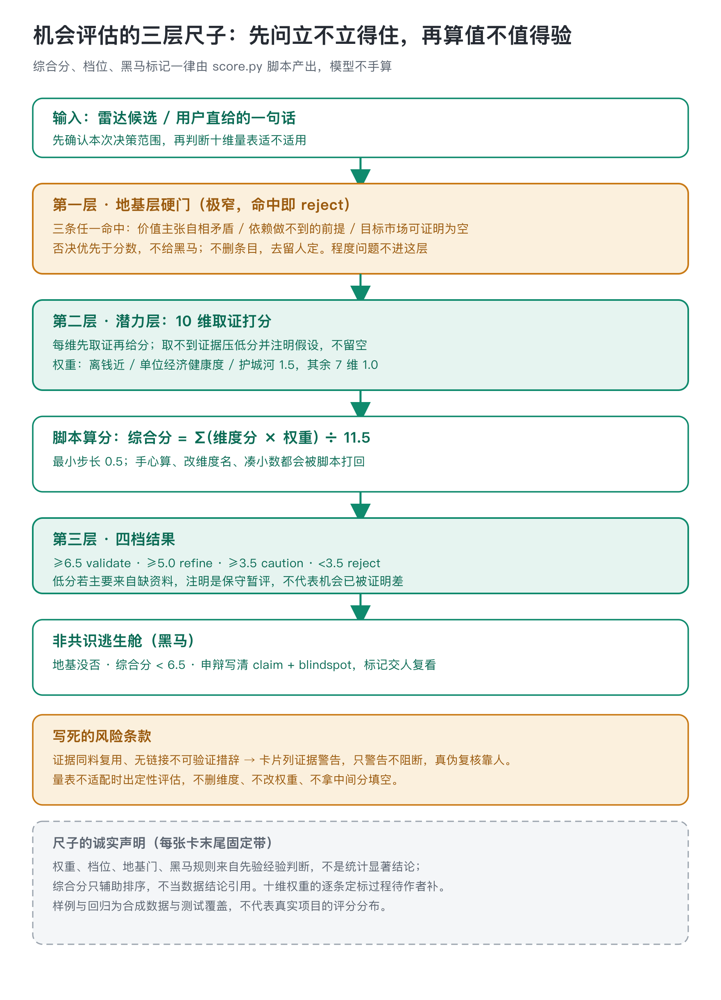
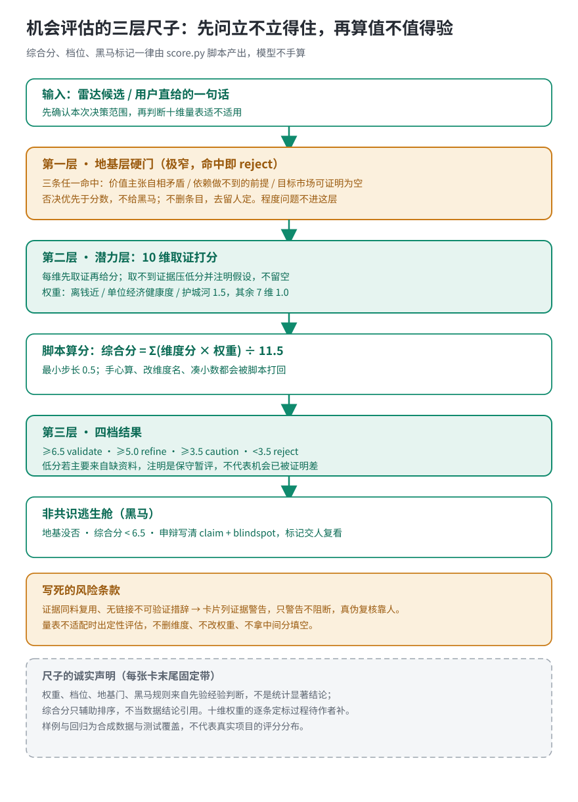

# 机会评估 · opportunity-scorecard

把一个机会（雷达捞回来的候选，或用户直接给出的一句话）转成当前可执行的投入建议：值不值得去验、该补哪份证据、先试哪一步。它不发现机会，也不写 PRD，只管排序，最后拍板的是人。



## 一张卡分三层，顺序不能颠倒

第一层是地基层硬门，只问这个命题本身立不立得住：价值主张自相矛盾、依赖做不到的前提、目标市场可证明为空，三条命中任何一条直接 reject。它故意做得很窄：「一个人扛不动」「要牌照」「变现绕远」这类程度问题不进这层，留到潜力层扣分。

第二层是潜力层十维取证打分：痛点强度、离钱近、单位经济健康度、一人可交付、自然分发、护城河、市场趋势、可验证性、时机、AI-native 契合度。离钱近、单位经济、护城河三维权重 1.5，其余七维 1.0；综合分等于各维分数乘权重之和除以 11.5，落在四档里：6.5 以上 validate，5.0 到 6.5 refine，3.5 到 5.0 caution，3.5 以下 reject。每维先取证再给分，取不到真证据的维度写清「暂无公开证据，属假设」并压低分，不留空。

第三层是非共识逃生舱：地基没被否、综合分又低于 6.5、但申辩写清了一个可被证伪的判断和「别人为什么没看到」，标记成黑马交人复看。



这套结构要解决的张力写在立身句里：既守地板，又不扼杀天花板。逻辑不成立的机会救不活；被低估、踩中时机的黑马也别被机械分一票否掉。

## AI 干语义活，脚本干确定性活

逐维判证据、写申辩，是 AI 的活；综合分、档位、黑马标记这三样，一律由 score.py 脚本产出，模型手算直接打回。理由是这三个数是下游机器读的接口：人手算会漂移，而且模型给自己写的分再算一遍，等于让考生自己登分。打分最小步长锁死在 0.5，出现 6.75 这类分数说明有人在凑数，脚本同样打回。

证据链也过一遍结构检查：同一条料在多个维度反复用、证据只写「有报道称」却不给链接，卡片末尾会列出证据警告。脚本只抓结构异常，不判断证据真伪，真伪复核是人来做。十维证据全部没有可验证链接时，frontmatter 自动带 `evidence_lock: all_unverifiable`，结论行强制加一句「不可 clean 引用」——这是 0.3.1 加的，防止全是传闻的卡被 clean 引用。

## 一把先验的尺子，先把丑话说在前面

权重和档位来自先验经验判断，不是从市场数据里回归出来的。这一点不藏：每张卡末尾固定带一段尺子置信度声明，写明这些规则来自经验、非统计显著，综合分只辅助排序，别当数据结论引用。低分如果主要来自缺资料，交付时要说明这是保守暂评，不代表机会已被证明差，补证或低成本实验完全可以翻盘。

十维量表也不是万能的。用户的组织、产品约束和默认个人产品视角明显不符时，不硬套量表，转成一份定性评估，写已知证据、前提是否成立、关键未知和下一步验证条件，不出综合分。量表不适配时删维度、改权重、拿中间分填空，都被明令禁止。

## 跑一个看看（样例目录是合成数据，不是市场建议）

样例目录六个 JSON 全部明示是合成测试输入，证据栏写的都是「假设：占位验证用」。两个边界样例：

黑马样例（十维全 5.0，申辩有形状）：

```bash
python3 scripts/score.py --input examples/scoring.dark-horse.json --stdout
```

实跑结果：`composite_score: 5.00`、`verdict: refine`、`dark_horse: true`、`evidence_lock: all_unverifiable`。机械分没到 6.5 的 validate 线，但申辩写了可证伪的判断和信息差，强制交人复看；同时因为证据全是占位假设，自动锁上「不可 clean 引用」。

地基门样例（命题自相矛盾，十维分数都不低）：

```bash
python3 scripts/score.py --input examples/scoring.foundation-reject.json --stdout
```

实跑结果：`composite_score: 7.11`、`verdict: reject`、`dark_horse: false`。7.11 的加权分也救不回来——地基门一票否决。

## 与相邻技能的分工

- 发现机会（捞候选）是 opportunity-radar 的活；评估完选定方向，交给 product-brief 写需求与计划。
- 用户在两个都说得通的选项之间犹豫，那是 steelman-choice 的活（把每边重建到最强再决断）；只有一个想法要排序投入级别，才走本技能。
- 核查某条说法真伪走 claim-check；关键事实缺失需要外部检索先走 outside-view。

## 验证到哪一步

仓库里 18 条回归测试全部通过（`python3 -m unittest discover -s tests -v`），覆盖：slug 与冻结交接包规则一致、0.5 步长、占位词表超集、错误信封形状、三个基础样例的确定性输出、出卡能过冻结版交接校验、卡片含「非统计显著」声明、六个对抗用例不崩溃且警告可见。

这些测试证明的是脚本契约——输入坏成什么样脚本会拒、输出长什么样。它们不证明另外三件事：十维权重预测真实结果的效度（没有「哪些 validate 后来真成了」的回测）、档位阈值 6.5/5.0/3.5 的校准（是先验拍的）、不同打分人之间的一致性（没有盲测）。样例目录六个 JSON 全是合成数据，不能当市场建议引用。

## 边界与待补

- 做什么：取证、判地基门、逐维打分、写申辩、交脚本出卡。
- 不做什么：发现机会（雷达的活）、写 PRD/设计/编码、把命中硬门的条目擅自删掉（只标注，去留人定）。
- 十个维度和权重最初怎么定的，记录里只写了「面向个人产品的先验经验」，没有逐条定标过程；待作者补这组权重的来历。
