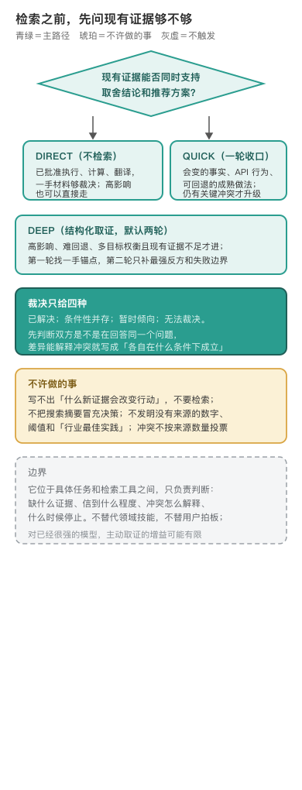

# outside-view · 兼听

编辑源：[assets/gate-narrow.svg](assets/gate-narrow.svg)

---

## 它只负责判断，不负责拿回材料

这个技能坐在具体任务和搜索、RAG、知识库之间〔出处：SKILL.md 定位〕。底层工具负责把材料拿回来，它负责三件事：当前是不是缺会改变行动的外部信息，该找哪类证据、信到什么程度，冲突怎么解释、什么时候停止。它不替代领域技能，不替用户拍板，也不把搜索摘要冒充决策〔出处：SKILL.md 定位〕。它来自产品链的取证一环，最早在个人工作目录里先导（9 月 25 日的目录时间戳是那条链上最早的），9 月 27 日随 curated product workflow skills 导入本仓〔出处：git 0d21d7a；personal-harness 先导目录〕。

它的最高优先级只有一条：先看现有证据够不够，不许跳步〔出处：SKILL.md 最高优先级〕。现有输入、官方原文、本地代码、测试、日志能不能同时支持取舍结论和推荐方案？够，就直接 DIRECT，任务重要、规模大都不能推翻这个判断。写不出「什么新证据会改变行动」，就不要检索。这是它和「凡事先搜一圈」最大的分野。

## 三档路由，裁决只给四种

检索分三档〔出处：SKILL.md 路由〕。DIRECT 不检索，直接执行、计算、用现有材料，高影响任务也可以是 DIRECT，六个可比历史项目足以否定当前工期估算时，就基于现有数据决策，不为「显得全面」继续搜索。QUICK 做一轮有边界的一手核验，管会变的事实、规范、可回退的成熟做法，一轮后收口。DEEP 做结构化外部取证，默认最多两轮：第一轮找一手锚点和相似参照系，第二轮只补最强反方、失败边界和关键缺口。

冲突裁决有两条硬规矩〔出处：SKILL.md 裁决冲突〕。先判断双方是不是真在回答同一个问题：对象、版本、场景、指标一致吗？差异能解释冲突，就写成「各自在什么条件下成立」，不再深搜。真正互斥时，现场结果通常高于泛化经验，当前官方行为通常高于旧教程，官方声明只能证明官方口径。最终只给四种裁决：已解决、条件性并存、暂时倾向、无法裁决。禁止发明没有来源的数字、阈值和「行业最佳实践」〔出处：SKILL.md 停止〕。

**走一遍（演示）。**决定「五人团队是否三个月内全面迁微服务」：五栏写清待支持决定、暂定判断（风险高先不动）、已有直接证据（单体三年无事故）、会改变行动的未知项（同类小团队微化后交付周期）、什么发现会推翻判断（多个可比案例八周完成无回退，失败集中在二十人以上团队）。第一轮找官方迁移指南与真实复盘，第二轮只补失败复盘；新结果都转引同一篇博客就停。裁决落「条件性并存」：渐进可试，全量不可行〔出处：references/examples.md 路由表〕。

## 边界是诚实写出来的

这个技能没有 CHANGELOG，版本停在 0.1.0〔出处：frontmatter〕。它适合的是技术选型、大型计划、高影响或难回退决策；纯执行、已有直接证据和简单问题不触发〔出处：SKILL.md 定位〕。高风险冲突无法裁决时，它明确说该转向本地实验、专家或可回退试点，不用更多低质量网页填满上下文〔出处：SKILL.md 裁决冲突〕。

**不管。** 已经批准的执行任务；数学计算、忠实摘要、翻译改写；本地代码日志能直接回答的问题〔出处：SKILL.md DIRECT 适用情况〕。

## 它实际测到哪一步（不是效果证明）

「对强模型增益可能有限」这句没有跨模型对照。先导期它从 19 KB 长协议瘦到 7.6 KB 薄版，可核理由是试测里计划检索从 8/15 降到 5/15〔出处：personal-harness 先导 evals/benchmark-results.md〕。同期受控试测：触发 20 条两次全对、路由 15 条三次全对、一个开放任务盲评薄版胜无技能基线；但只用了一个不暴露型号的前沿端点、触发是显式分类而非生产加载、同模型族自评——只算协议跑对没跑对的证据，不算跨模型效果。这句低增益判断是试测观察到过度检索被抑制加作者先验，没有对照过具体模型。

---

## 怎么跑（人类操作参考）

检索前在内部写清五栏：待支持的决定、暂定判断、已有直接证据、会改变行动的未知项、什么发现会推翻当前判断；填不出第四栏就退回 DIRECT〔出处：SKILL.md 检索前〕。路由拿不准读 `references/examples.md`，审计方法依据或难解证据冲突读 `references/methods.md`〔出处：SKILL.md References〕。
