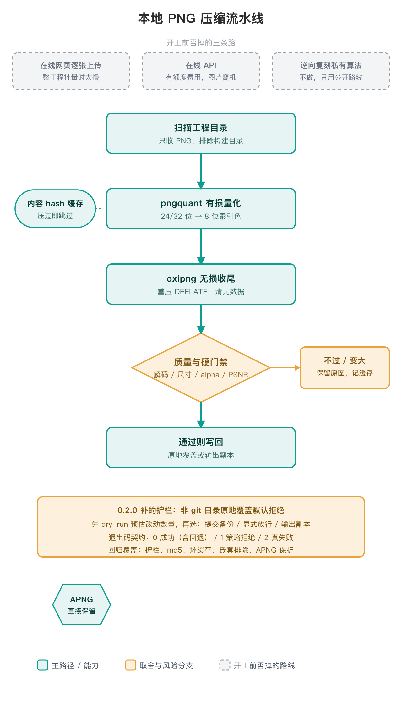

# PNG Compress

> 把 TinyPNG 式的 PNG 压缩，做成本地、可批量、可重复执行的工程能力。

## 技术路线

采用本地工具完成PNG量化与无损优化，支持批量处理和重复运行。核心操作、参数与回退规则见 `SKILL.md` 及随包脚本，不依赖外部技术方案或特定平台。

## 为什么做它

起因是给 App 工程的 PNG 做一次批量压缩。作者确认：最初就是想在本机复刻出一个 TinyPNG 那样的压缩能力。TinyPNG 单张好用，但整工程批量、反复增量处理时，网页上传太慢，API 有额度和费用，图片还必须离开本机。

结论是「技术平权」：TinyPNG 赢在调参，不在算法；公开开源组件配自己的工程化，能打到同档，但必须拿自己项目的素材做 A/B 验证，不能默认平权无条件成立。作者确认：这套开源工具组合是 AI 调研后约一小时成形的，调研候选与对比记录未留档，见文末待补。

## 技术路线一图流（细节指路原文）



- **两个工具，各管一件事，顺序不可反**：`pngquant` 有损量化砍颜色（省大头）→ `oxipng` 无损重编码抠 DEFLATE（省小头）。为什么谁也替不了谁，原文有对照表。
- **三条证据链证明这条路线对**：TinyPNG 官方自述原理 = 量化+删元数据；pngquant 作者本人盖章 TinyPNG 就是 pngquant 的在线界面；QQ 音乐实测默认参数 TinyPNG 高 10-12%、quality 90 反超。出处与外链全部在原文，本文不重复抄录。

## 工程化护栏：流水线出生就定，防呆是后来补的

流水线形状在首个提交就定型：pngquant 量化 → oxipng 收尾 → 解码/尺寸/alpha/质量门禁 → 通过写回、失败保留原图。真正敢交给自动化跑的，是 0.2.0（2026-10-16）补的防呆。下面每处是诊断中发现、并由回归测试覆盖的风险类型，不等于每一处都来自一次具体生产事故：

- **原地覆盖最初没有护栏。** 0.2.0 改为非 git 工作树默认拒绝原地覆盖（exit 1），先 dry-run 预估改动数量，再给三选一：先提交/备份、`--allow-non-git` 显式放行、`--output-dir` 输出副本。
- **目录排除最初按名字任意层级一刀切。** 会误杀 `Resources/build_icons/` 这类嵌套同名合法资源。0.2.0 改成只在工程顶层直接子目录命中时排除，另给 `--exclude NAME` 在任意层级追加。
- **坏图旧版每次运行都刷一遍报错；坏缓存 JSON 旧版直接崩。** 0.2.0 把解码失败的图 hash 持久化、下次默认跳过（`--retry-errors` 重检）；坏缓存警告后改名 `.bak` 按空缓存重建。
- **退出码被定成契约。** 全成功（含门禁回退、已知坏图跳过）exit 0；参数/路径/护栏拒绝 exit 1；有图真失败 exit 2，门禁回退不计失败。

这些由 10 项回归测试守着（护栏拒绝/放行、md5 不变、坏缓存不崩、退出码、坏图二次跳过、嵌套排除、APNG 保护），跑测试在 `/tmp` 临时目录造素材，不碰用户文件。

## 用法

依赖：`pngquant`、`oxipng`、Python 3；Pillow 供默认质量门禁（Linux 无 Pillow 时见下），numpy 可选、装上后启用 SSIM。

```bash
brew install pngquant oxipng          # Ubuntu: apt-get install pngquant + cargo install oxipng
python3 -m pip install Pillow numpy
```

```bash
./compress.sh /path/to/App            # git 工作树内正式压缩（原地覆盖）
./compress.sh /path/to/App --dry-run  # 只预估收益，不改文件、不写缓存
./compress.sh /path/to/App -j 8       # 指定并行数
python3 compress_images.py /path/to/proj --output-dir /tmp/out   # 副本模式，原图零改动
python3 compress_images.py /path/to/proj --allow-non-git          # 非 git 目录，确认已备份后显式放行
```

缓存 `.png_compress_cache.json` 建议提交进仓库：团队和 CI 跑同一份增量记录，压过的图秒级跳过。作为技能使用时直接说「帮我压一下这个工程里的 PNG」，Agent 会先确认目标目录再调脚本。完整参数、门禁阈值、可调常量表以 `SKILL.md` 为准，这里不重复抄。

## 边界与不适用

- **有损压缩。** 自动门禁只拦坏图/尺寸变了/alpha 丢了/灾难性劣化，「糊不糊」有主观性；交付前人工抽检 AppIcon、启动图、大面积渐变、半透明阴影毛玻璃、带 ICC/Display P3 配置的素材。
- **Linux 无 Pillow 时双门禁整体失效**：Linux 没有 macOS `sips` 兜底，Pillow 缺失会让硬门禁和质量门禁同时失效，需 `pip install Pillow`，或同时加 `--no-hard-gate --no-quality-gate` 才能跑通（只加 `--no-quality-gate` 会让每张图都报解码失败）。
- 不读 `.xcodeproj`/Scheme/Target，只接收一个目录递归找 PNG；默认排除 `.git`、`Pods`、`Carthage`、`build`、`DerivedData`、`node_modules`、`.build`、`fastlane`。
- 不适用：JPG/WebP 等非 PNG 格式、单张图片精修调色、要肉眼控制画质的设计稿导出。

## 许可证与合规

- 仓库代码 MIT。
- **`pngquant` / `libimagequant` 是 GPL v3**：按 [pngquant.org](https://pngquant.org/) 的表述（"Both are available under the GPL or a commercial license"），嵌入或分发该工具/库时，按 GPL v3 开源义务分发（含开源对应代码）或另行购买商业许可，二者择一；闭源/专有集成不接受 GPL 义务时，才涉及商业许可路径。我们的用法是构建阶段调用它处理图片，构建期使用本身一般不会把 GPL 义务传递给它产出的 PNG；但「是否分发该工具、以什么形态分发」是另一个独立的许可证判断，具体集成方式请法务确认，这里不下法律结论。
- `oxipng` 是独立第三方项目，许可证以其仓库 LICENSE 为准。

## 待补

- 调研阶段对比过哪些候选组件、凭什么判断 pngquant + oxipng 组合更好（AI 约一小时调研成形，无留档）。
- 真实工程的实测压缩率对照（SKILL.md 输出示例里的 45.2MB→12.8MB 是演示数字，不是实测记录）。

## 参考资料

- 项目页：https://jobyang.cn/projects/png-compress/
