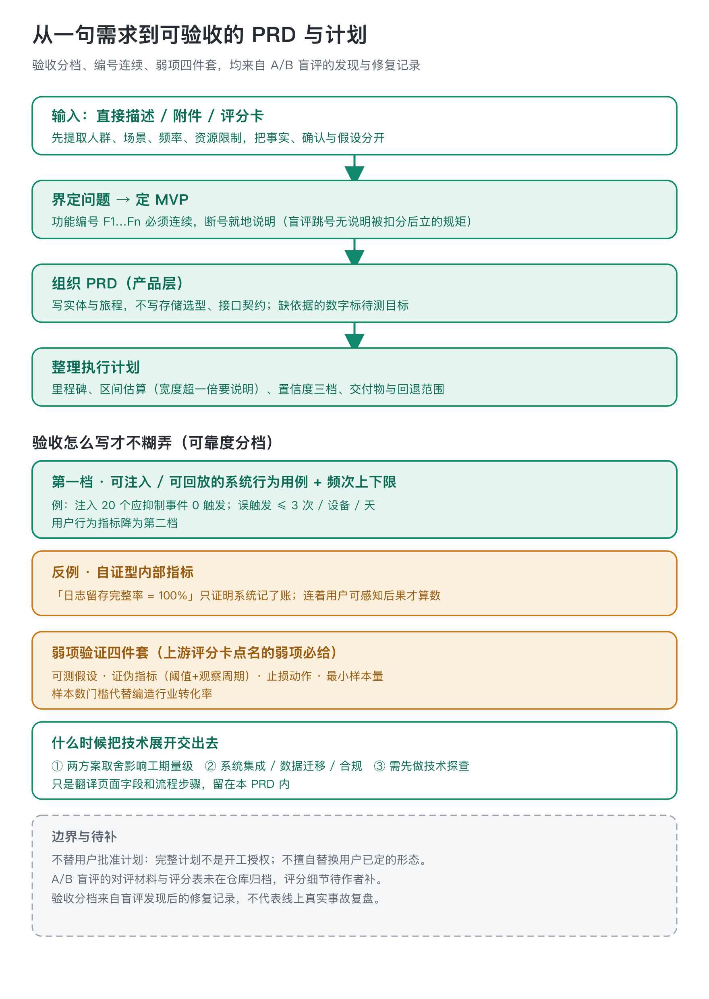
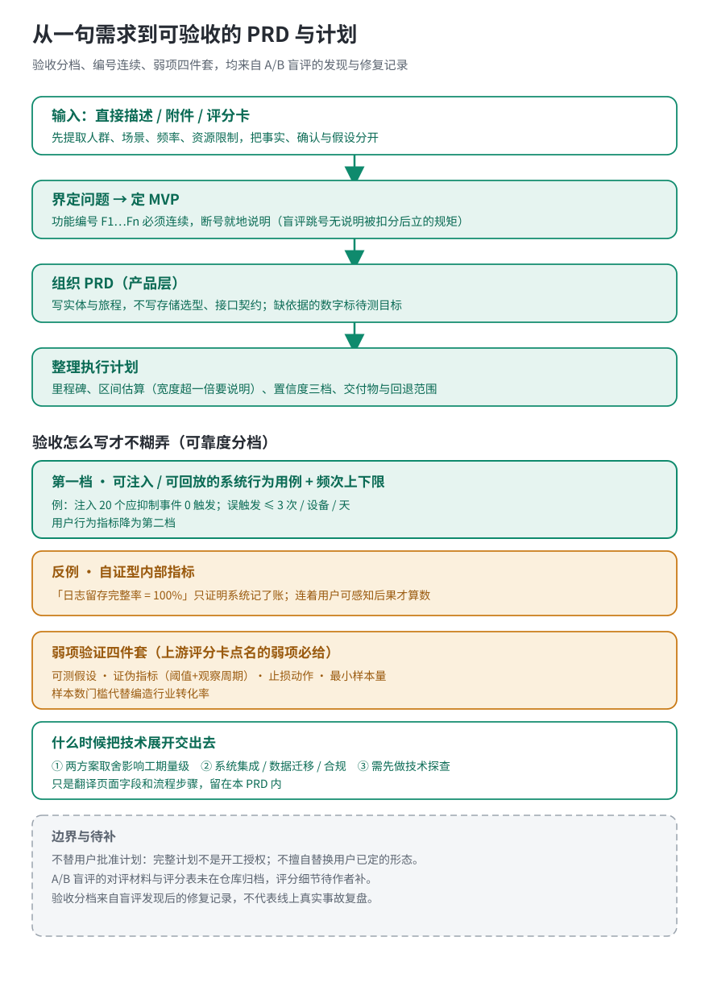

# 产品需求与计划 · product-brief

把一句需求（或一张机会评分卡）写成两份能验收的东西：一份 PRD，一份执行计划。它不打分、不编码，也不替用户批准计划。

## 什么时候喊它

手头有一句需求、一份访谈或附件、一张机会评分卡，要整理成 PRD 和执行计划，或者评审前发现验收写不下去、要补里程碑和估算时调用。独立使用不要求先跑雷达或评分卡；已经有上游评分卡就接着用。

## 拿到两份什么

一份 PRD：问题、目标人群、用户旅程、连续编号的功能与验收、平台取舍、未决项。一份执行计划：里程碑、依赖、估算区间与置信度、弱项四件套、回退范围。两份用同一个主题，计划里的功能都能回到 PRD；写完都是待人审状态，完整计划不是开工授权。

## 开口怎么说

「帮我把这个想法整理成 PRD 和计划，先定最小范围和验收，周期没依据的地方标待估。」用户已经定了平台，比如已经定 Web，沿用这个决定，不擅自换成别的形态。

## 验收怎么写才不糊弄

这个技能的规矩大半来自一轮 A/B 盲评的失分沉淀。盲评时新版 PRD 在验收写法上吃了亏，回来后把验收按可靠度分了档：第一档是可注入、可回放的系统行为用例，必须带频次上下限，比如注入 50 个应触发用例要全部通过、20 个应抑制事件要 0 触发，误触发不超过每设备每天 3 次。这组数字是盲评后定下的验收样例口径，不是生产环境的全量实测覆盖；用户行为指标降为第二档；「日志留存完整率等于 100%」这类自证型内部指标立成了反例，它只证明系统记了账，连着用户可感知后果才算数。

功能编号也在那次盲评里挨了扣分：新版从 F1 跳到 F3、F5 没作任何说明，评审不知道是漏写还是跳号。现在规矩写进模板：F1 到 Fn 必须连续，断号就地说明原因，说不清就按漏号处理。

## 上游的弱项，计划里必须给交代

评分卡点名的弱项（比如护城河得分低），计划阶段不能绕过去，要落实成弱项验证四件套：把弱项翻成可测假设、给证伪指标和观察周期、写清证伪之后退到什么形态、定最小样本量。样本量用门槛数说话，不编行业转化率；这类数字没有出处时宁可标待测。

估算同样有要求：区间必须有宽度，宽度超过一倍要说明理由；置信度分高、中、低三档，给了低置信度就要写「用什么动作把它变成中置信度」。

下面是构造出来的演示，数字不代表行业真实基准，只看填写密度。假设上游评分卡给护城河 5/10，判断产品容易被通用聊天壳吞掉：

- **可测假设**：护城河是用户在 app 里积累的个人语境词表和周期-情绪回看，通用产品抄不走这份个人数据。
- **证伪指标**：个性化周报打开率，连续 4 周 ≥ 35% 算成立，< 15% 算证伪；阈值为演示设定，不是行业基准。
- **止损动作**：证伪后砍掉个性化回看，退回轻量记录工具形态，只留核心记录 F1、F2，不投流。
- **最小样本量**：落地页 4 周内 ≥ 100 个目标访客、≥ 30 个邮箱订阅才够判；不够就延长观察，不编转化率。

完整模板与空白骨架见 `templates/prd.md`、`templates/plan.md`。

## 什么时候把技术展开交出去

PRD 只写到产品层：有哪些实体、用户旅程怎么走，不写存储选型和接口契约。出现下面三种情况才把技术展开交给 engineering-docs：两个技术方案的取舍影响工期量级；涉及系统间集成、数据迁移或合规约束；不先做一轮技术探查就算不出工期。只是把需求翻译成页面字段和流程步骤，留在本技能的 PRD 里。

## 这套规矩过过对照实验吗

早期用同一宿主做过 6 个无技能／启用技能对照：4 个开发案例，无技能均分 19.625、初版 19.875、定向修正后 20.000；2 个留出案例三组全部打平 20.000。这组分数说明两件事：规则能补上明确缺口，但在强模型本来就写得完整的任务上，不会稳定产生可见增益；而且评测以模拟任务为主、分数接近上限，并没有证明按这套流程写出的产品本身值得做。它和后面那轮验收写法盲评是两回事——盲评改的是验收怎么写，这里量的是整套技能有没有用。填好的弱项四件套长什么样，见 `templates/plan.md` 里「护城河 5/10」那份完整示例（假设、证伪指标、止损动作、最小样本量都填好了），写计划时照着那个密度写。

## 材料不够时的兜底

- 缺输入：先完成能独立推进的部分，只追问会改变实现范围的关键歧义；缺依据的规则列成未决项或给出建议，不替用户拍板。
- 无出处数字：收益、周期、流量标待测目标；工期写不出依据时注明「待技术方案后估算」，不用模糊小数假装精确；样本量没有出处宁可标待测，不编行业转化率。
- 结构校验：缺章节会被校验退回，回到模板补齐；校验通过只说明结构合规，不代表范围合理，也不代表已经批准。
- 示例口径：示例值不冒充真实调研、真实工期或用户确认；缺外部资料时不伪造行业共识，也不因此阻塞本地成文。

## 边界与待补

- 做什么：界定问题、定 MVP、给平台建议、组织 PRD 与计划、沿核心旅程补输入规则验收。
- 不做什么：打分、编码、发布；不擅自替换用户已决定的 Web/移动端形态；缺依据的收益和工期数字标成待测目标。
- 完整计划不是开工授权。计划写完是待人审状态，用户的批准另算。
- 版本口径有两处对不上：SKILL.md 自称本包版本 0.3.1，`references/handoff.md` 写「本轮版本 0.3.0（2026-10-16）」，CHANGELOG 最新条目是 0.3.2。三处标记对不上，以 CHANGELOG 的条目记录为准；这是文档口径差异，核心流程不受影响，待作者统一。
- 那轮 A/B 盲评的对评材料和评分表没有在仓库归档，具体评分细节待作者补。

雷达发现机会、scorecard 排完序之后接这里；要做界面设计，交给 style-compass。
