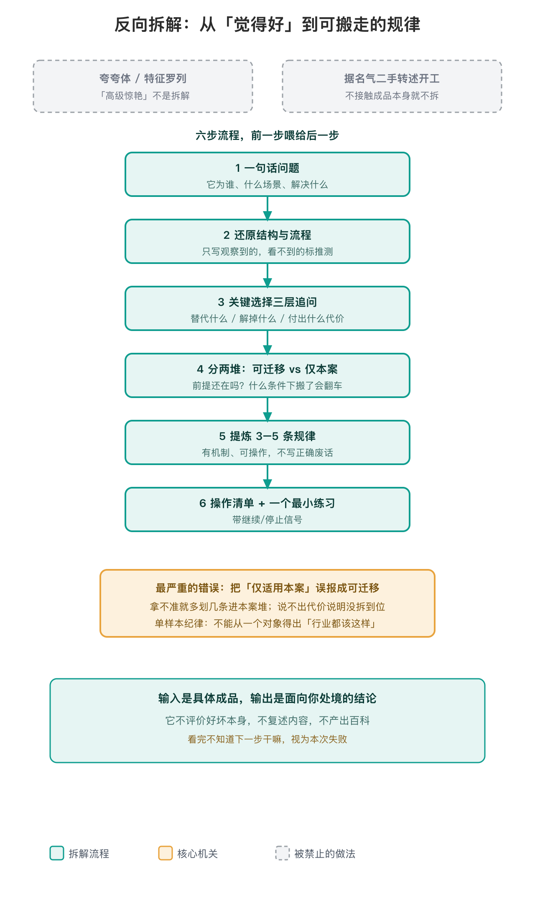

# 反向拆解

[English](./README.en.md)

> 拿到一个优秀成品，不能停在「觉得好」。要带走两样东西：能搬走的规律，和这周就能照做的第一步。

## 它是干什么的

输入是一个已经存在的具体成品——UI 界面、App、代码模块、方案文档、Prompt、流程看板都行；输出是面向你自己处境的可迁移结论。它不评价好坏本身，不复述成品内容，只回答一个问题：**「我想做的事，能从它身上搬什么、怎么搬、什么情况下搬了会翻车。」**

## 为什么要把「觉得好」变成流程

「觉得好」不产出可执行东西，只坍缩成两种变形：夸夸体（「高级、惊艳」）或特征罗列（列十个页面元素）。这个技能是一套强制流程：把「觉得好」还原成结构与关键选择，再把每个选择分成「可迁移」和「只适合它」，最后落成动作。

核心在第三步的三层追问：这个选择替代了什么更朴素的做法、朴素做法会在什么场景出问题、这个选择额外付出了什么代价。只说得出好处说不出代价，说明没拆到位。最严重的错误是把「仅适用本案」误报成「可迁移」——拿不准就多划几条进本案堆。同时坚持单样本纪律：一个对象只能证明「它这样做有效」，不能推出「行业都该这样」。

### 示意走查（非真实案例）

以 Netflix 电视端首页为例（例子来自 SKILL.md 自带的写法对比）：

- 问题：遥控器用户怎么快速找到下一部想看的片
- 关键选择：每屏只留一个大焦点
- 三层追问：替代了并列多按钮；遥控器没有 hover，并列按钮会成倍增加焦点移动成本；代价是次要操作被收进二级入口
- 可迁移：方向键导航的界面每屏只留一个主动作
- 仅本案：千人千面定制封面依赖 Netflix 的 A/B 实验和版权物料库

## 它不抢谁的活

讲透概念走 feynman-explainer；判断论证成不成立走批判性阅读；为产品想法找证据走 opportunity-radar；技术选型走 outside-view；拆完要写自己的新方案，交 product-brief / style-compass。它只负责「拆」这一段。

## 创建之后的两次调整

- **初始化（253b3ef）**：六步流程+四类对象清单+红线+自检表一次写完。
- **去具名引用（3286538）**：diff 显示把三处对具体平台技能名的引用（`doubao-critical-reading-companion`、`iloop`、`video-reader`）换成了通用描述，去掉了对特定宿主的硬绑定。
- **补可感知信号（dcac278）**：diff 显示补了开头宣告语和收口自检两句；commit message 提到同期跑过 32 条 query 的路由盲测，但仓内无测试脚本或 query 清单可独立复核。

## 现在的状态

新技能（2026-10-19 创建）。验证三关：

- 路由触发：commit message 记载一轮 32 条 query 盲测通过，但无可复核工件。
- 拆解质量：未测。仓内无真实拆解案例库。
- 可移植：代码上去掉了平台硬引用，但未在非豆包环境实测。

按「新技能、待盲测」对待。

## 用法

说「这个页面/App/方案不错，拆一下我们能学什么」即可。流程固定六步；没有明确搬迁落点时降级为「成立前提分析 + 若要借鉴先做什么」；动态交互类对象要实际运行或录屏取证。四类对象（UI/代码/文档/Prompt）的专项检查维度见 `references/teardown-checklists.md`。

## 待补

- 第一批用真实成品拆出来的案例：什么对象、拆出哪几条规律、照做后灵不灵。
- 路由盲测的 query 清单和测试脚本（当前只有 commit message 数字，不可复核）。
