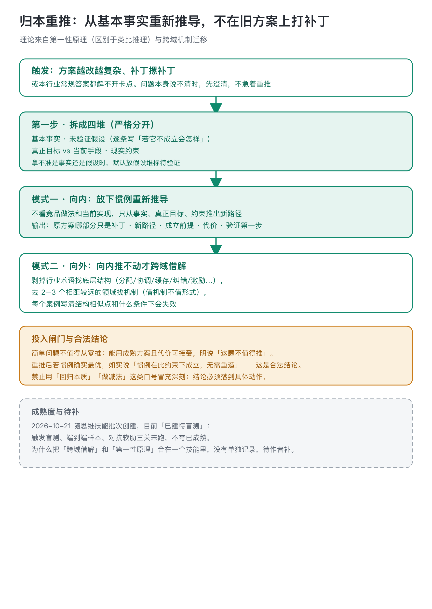
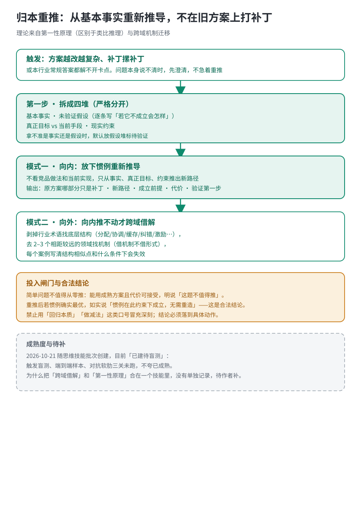

# 归本重推 · root-rethink

现有方案陷入打补丁、路径依赖，或本行业常规做法解不开卡点时用。把问题拆回基本事实、未验证假设、真正目标和现实约束，从根上重新推一条路；向内推不动时，换跨域借解。

## 第一性原理不是口号集合

方法来自第一性原理，不沿用「大家都这么做」的类比结论，而是拆到不能再拆、必须接受的基本事实。这个技能把输入拆成严格分开的四堆：已确认的基本事实、从没验证过的习惯性假设（逐条写「若它不成立会怎样」）、真正目标与当前手段、现实约束。拿不准是事实还是假设时，默认放假设堆。

推导时暂时不看行业惯例、竞品做法和当前实现，只从事实、目标、约束出发。输出必须包含：原方案里只在修补表面的部分、新路径每一步由哪条事实推出、新路径成立的前提、它牺牲了什么代价，以及成本最低的验证第一步。「回归本质」「做减法」这类口号零价值，结论要落到具体动作。

现在卡住的方案，朴素做法是继续打补丁：旧假设不动，只在上面加规则、加参数、加分支、加审批。它的失败信号有三个：补丁越加越多，新问题都长在同一条没验证过的假设上；团队说不清当前方案里哪几条是事实、哪几条是习惯；每修一处都要解释这次为什么不算破坏原来的设计。四堆逐项把假设挑出来标「待验证」，事实与假设分堆之后，新路径才不会继续建立在旧假设上，这是它和继续打补丁的区别。

## 向内推不动，就去远领域借机制

先向内推，推不动才进第二招。切换信号是：四堆拆完，约束在本领域内已经没有可行路径，资源、结构或规则锁死，本领域现有的机制都试过、都失效，而卡点的底层矛盾仍然没被解决。这时才剥术语去远领域找机制；向内还能推出路径时，不借。

如果内部推导走到死路，进入模式二：剥掉行业术语，回答三问：底层结构是什么（分配、协调、缓存、纠错、激励这类抽象类别）、核心矛盾是什么、普通解法为什么失效。然后去两三个相距较远的领域找机制，借的是机制不是表面形式。判别动作：先写清那个远领域遇到的问题、用了什么机制、与本问题的结构相似点，哪些能迁移、什么前提一变就失效；只在名字、形式、界面上像、结构对不上，直接弃。形似神不似的类比不算答案。

这个技能有投入闸门：简单问题不值得从零推。能用成熟方案且代价可接受，明说「这题不值得推」。重推后发现惯例其实最优，如实给出「惯例在此约束下成立，无需重造」，这是合法结论，不是失败。

用户带着卡点来，先请对方交出三样东西：当前方案是什么、最近三个补丁分别改了什么、真正想达成的结果是什么。材料到齐再分四堆；说不清目标的，先澄清，不进入重推。

## 走一遍：三个示意场景

下面三个例子是**示意场景**，用来展示这套流程长什么样，不是这个技能真实处理过的 case。这个技能 2026-10-21 才建，还没有归档的端到端真实样例。

**示意一 · 推送疲劳（向内重推）**。
场景：推送系统越做越复杂，加了人群分层、AB 实验、智能时机，但 7 日留存连续两个季度不涨。
- 基本事实：用户不点开推送，是因为通知栏被淹了，不是因为推送不够个性化。
- 未验证假设：「多推 = 多触达 = 多留存」——这条从来没被验证过。
- 真正目标：留存，不是打开率。
- 现实约束：团队两个人维护。
- 从事实推：如果问题是通知栏被淹，那加推送频次是在加重问题。新路径：把每用户每日推送上限砍到一条，多出来的排队，而不是多开通道。代价是错过一些时效通知的机会。验证第一步：选一个城市砍一周，看留存和取关率。

**示意二 · 推送疲劳（向外借解）**。
如果内部推不动（比如产品坚持要多发），剥术语：这是个「有限注意力通道上的流量分配」问题。去远领域找机制：网络路由的 token bucket——每个桶有固定容量，超过的请求排队而不是冲过去。翻译成推送：每个用户一个桶，每天一桶容量，多推的进队列，按剩余空间慢慢发。失效条件：验证码、快递到达这种有严格时效的推送不能排队，必须走独立通道。

**示意三 · 什么时候别用它（投入闸门）**。
场景：老板问「这个按钮用蓝还是绿」。这题不值得从零推——直接查设计规范，不是所有问题都配得上第一性原理。重推后如果发现「惯例在这个约束下其实最优」，那也是合法结论，不是失败。这技能的成本不低，简单问题明说「这题不用推」。

## 边界与成熟度

- 不做什么：两个现成选项怎么选（steelman-choice）、核一条说法真伪（claim-check）、读优秀成品学做法（reverse-teardown）、代码级 bug 的根因排查。
- 重推完要落成 PRD 走 product-brief；要低成本先试，接 minimum-experiment。
- 改稿前先看全文骨架再动手，走 sansi-erhouxing；要把一个概念讲透给别人听，走 feynman-explainer；交付前清洗中文 AI 味，走 haohao-shuohua。这三个环节不在本技能范围内。
- 这个技能是方法论型，验证它不依赖代码测试：按 SKILL-QUALITY-CARD 列的体感标准，需要拿真实卡点跑端到端样例、再做一次对抗复核，把过程和结论留成记录。仓里目前还没有这样的归档样例——README 创建时自述「触发盲测、端到端样本、对抗软肋三关未跑」指的就是这件事，不是缺脚本。
- 为什么把「第一性原理」和「跨域借解」合在一个技能里，没有单独记录，待作者补。
