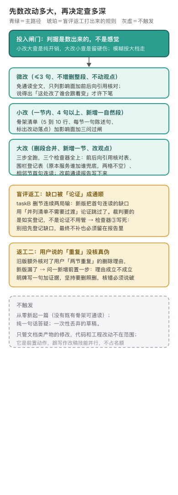

# sansi-erhouxing · 三思而后行

编辑源：[assets/gates-narrow.svg](assets/gates-narrow.svg)

---

## 补丁摞补丁，是「顺手改一下」的连锁反应

这个技能管一件事：改任何已经成形的文档之前，先看整体再动手〔出处：SKILL.md 开篇〕。它是前置动作，跟写作改稿技能并行，不占名额。那些技能管怎么写好，它管动笔之前先看骨架。它是软约束，不阻断交付，只挡在「要动手改」这个动作前面〔出处：SKILL.md 范围说明〕。

它要挡的反模式都很眼熟：「先改上再说，以后统一整理」是补丁摞补丁的入口；「小问题快速改一下」连着改永远不查全局；「只改这一处，不动其他的」不看引用核对表就不知道要不要动其他〔出处：SKILL.md §6〕。它的底子是三条业界经典：Shotgun Surgery（改一处连带多处）、Chesterton's Fence（拆之前先搞清它为什么在）、Outline-First（骨架先立）〔出处：references/prior-art.md〕。这三条的起源动机仓库没有直接记载，最早的提交只说要加这个技能〔出处：git 0b6d05f〕，作者当初是被哪次改稿伤了才立这个规矩，见文末待补。

## 投入闸门是一次诊断后补的，不是天生就有

最早的版本没有成本概念：一字一句级的微调也强制走三步通读〔出处：CHANGELOG.md 0.2.0 原诊断 P1〕。通读全文为改一个错别字，投入和问题大小完全错位。0.2.0 补了投入闸门：改动 ≤3 句、不增删整段、不动观点，免通读，只列影响面加引用核对；小改出骨架清单；大改全跑〔出处：SKILL.md §0〕。判据全部是数得出来的，判不准按大档走。小改大查是纯开销，大改小查是留硬伤。

同一次诊断还补了两件「正确的废话」问题：原「通读骨架」没有产物、没有格式，读完就完；原三问对有经验的人来说每条都对，但没有任何东西能检查你做没做〔出处：CHANGELOG.md 0.2.0 P1/P2〕。修法是把每条原则配一个能照做的动作：骨架清单硬规定 5 到 10 行、每节一句陈述句、用箭头标出改动落点；前后向引用核对表对着文档真查；围栏登记表写「这段原本服务谁、删了谁兜底」，两格有一格空就不许删〔出处：SKILL.md §2〕。

## 两条规则是盲评返工打出来的

0.2.1 是 A/B 盲评的返工记录，而且是删节任务连续两局输打出来的〔出处：CHANGELOG.md 0.2.1〕。第一局输在连贯判断：新版把「改动节和前后节首句连读有缺口」这件事，用「并列清单本来就不需要过渡」论证跳过了；旧版如实登记「这里断、暂不补」。裁判要的是如实登记，不是论证不用管。所以检查器③被改写死：读着别扭必须先登记一句缺口，登记之后再决定补不补，即使最终不补，这条登记也必须留在报告里；禁止把别扭论证成通顺〔出处：SKILL.md 问三〕。第二局输在理由核对：旧版额外核对了用户「两节重复」这个删除理由的真伪，新版漏了。问一因此加了前置一步：用户说「重复/没用」要删时，先对着文档核一遍，结论明牌写一句成立、不成立或部分成立加一句证据；结论不影响执行，坚持要删照删，但理由核错必须说破〔出处：SKILL.md 问一〕。

## 今天管什么、不管什么

**管。** 改已成形的文章、调研、方案、技能文档；评审意见指出某处问题准备直接冲上去改时；「润色一下」「精简一下」「通篇优化」都先看骨架〔出处：SKILL.md §1〕。

**不管。** 从零新起一篇，没有既有骨架可通读；纯一句话答疑；一次性丢弃的草稿。代码和工程改动不在范围〔出处：SKILL.md §1、范围说明〕。

---

## 怎么跑（人类操作参考）

拿不准本次改动最小检查集时读 `references/check-routing.md`；通篇优化或新写大改读 `references/doc-scope.md`；需要跟人解释这套流程凭什么，读 `references/prior-art.md`〔出处：SKILL.md §9〕。

## 两处提取时的取舍，交代一下

**源头是四条，不是三条。** 母文里「业界怎么讲这件事」列了四条：Shotgun Surgery、Chesterton's Fence、Kent Beck「Make the change easy, then make the easy change」（2012 推文）、Outline-First。落成技能时，问二的背书从 Kent Beck 换成了 Band-Aid 反模式——现行问二「修法风险比原问题大吗」确实更贴 Band-Aid；Kent Beck 那条「先重构让改动变容易再改」本来面向代码结构，对文档场景用处不大，未吸收〔出处：母文第三节 vs 现 references/prior-art.md〕。若作者本意是漏收而非取舍，应回补 prior-art.md。

**范围从代码+文档收窄成了纯文档。** 母文开场就是代码事故：上一 commit 删的兜底、review 让加回来、bug 复现；载体表六行里两行是代码（代码单点修复、代码新增功能），重档含生产代码 MR。提取成技能时收窄为只管文档类产物，代码/工程改动交给专门的验证流程〔出处：母文「通读整体」表 vs SKILL.md 范围说明、首版 0b6d05f description 的 DO NOT USE WHEN〕。

改前通读报告的真实样子，母文「一次实战：三思而后行修好好说话」一节有完整一场：另一个 AI review 报了 6 个问题，三思跑一遍后 5 处动刀、1 处豁免（description 不砍回、不塞 scan.sh、正则补进 rhythm-check.md），一次跑通没打补丁〔出处：母文实战节〕。技能内的骨架清单样例见 SKILL.md 第一步填好的示例。

## 待作者补

1. 立这个技能的那次真实改稿事故：是哪篇文档、补丁摞到什么程度，它才被立成规矩的（仓库只留了要防的反模式，没留出事现场）。
2. A/B 盲评 taskB 两连输的题目原文还在吗。
3. Kent Beck 那条是有意不吸收还是漏收。
4. 版本号 0.2.0/0.2.1 无 git tag 锚点、CHANGELOG.md 晚于变更入库才出现——谱系目前只能信 CHANGELOG 叙述。
5. 判档靠自数句数无独立复核：「改观点」若伪装成「调措辞」可滑入微改道；检查器②③的关键措辞也没有 keeper 回归夹具（keeper 现在只钉路由归属和「不吞文体」字符串）。
