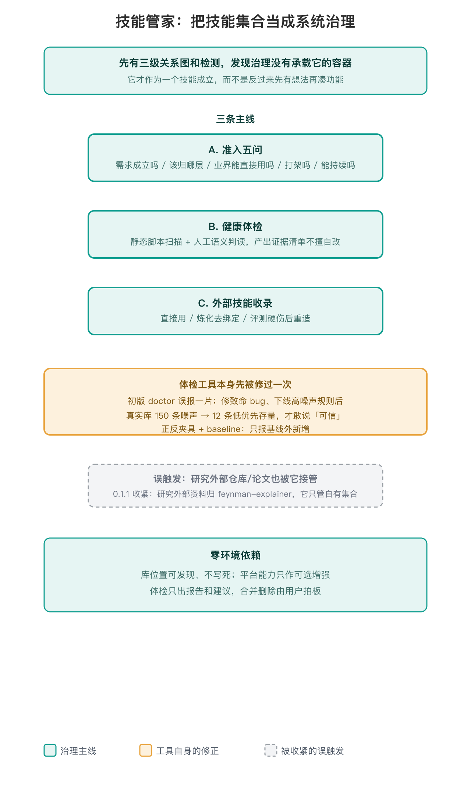

# 技能管家

> 站在整个技能库的视角回答四件事：要不要加新技能、加了放哪跟谁配合、现有集合健不健康、外部技能怎么收。

## 它是怎么成为一个技能的

作者确认：它不是先想做个「技能管家」再凑功能的。更早之前已经先有了一套三级关系图和日常检测；时间一长发现，判断「该不该新增一个技能、两个技能会不会打架」这类治理动作，散在各处、没有一个承载它们的容器。这个缺口补着补着，才凝成这个技能。



## 三条主线

- **A. 准入五问**（全过才建，任一问答否就不做，并给出已有的正确承接方）：
  1. 需求成立吗：高频反复的痛，或低频高重要且长期解决不了，要能举出真实场景；「看着不错」「以后用得上」「听起来高级」是灵感不是需求，不建。
  2. 归因到哪一层：模型能力、Harness 常驻规则、工具脚本、技能方法层；只有归技能层且现有技能接不住才继续。
  3. 现成方案能不能直接用：先找现成，评测证实有硬伤才自研，不没评测就重造。
  4. 值得独立且不打架吗：一句话唯一性；放进流向图看会不会抢触发、规则冲突、结论矛盾，同一件事就合并。
  5. 能持续吗：定成功判据，预留评测和召回回路。
- **B. 健康体检**：静态项由脚本带规则 ID 扫：frontmatter/命名、description 路由信号、broken reference、围栏闭合、正文平台硬绑定、超长/孤儿/空壳/疑似密钥，外加 C003 覆盖真空、C001 悬空交接；语义项（退出条件、有限重试、可观察触发、选项默认、规则矛盾、真实撞车、覆盖真空是否成立）不写正则，靠人工用真实 query 判断；动态项（真实触发率、漏触、读取顺序、端到端成功率）归 Harness，本技能不做。产出「问题 → 证据（文件：字段）→ 建议动作」，只报告不改文件。
- **C. 外部技能收录**：三档都要记录理由。直接用：质量够、无绑定、不撞，登记或引用，不复制；炼化：内核好但有平台绑定或风格不合，保留方法、剥掉宿主专属引用、改成中性降级，炼完再过第 4、5 问；重造：评测证实硬伤才重造，先写清根因再自建。

## 体检工具自己先被修过一次

初版 `library_doctor.py` 跑出来误报一片——规则太宽，真实库里报出 150 条噪声，根本没法用。后来修掉 stale SKILL.md 致命 bug、引用只扫正文、孤儿改全库传递引用、下线高噪声规则，真实库降到 12 条低优先存量，又配上正反夹具和 baseline（只报基线外新增）。这只说明**静态检测规则本身**经过了噪声压缩和夹具验证；规则矛盾、真实撞车这类语义项仍靠人工用真实 query 判读，有没有误判还要等真实使用检验〔出处：git 65586b9；git c5d695a〕。

这条「12 条」是 65586b9 当时的低优先存量，随后在 c100230 / c5d695a 修库中清零，现在 `baseline.json` 是空基线——日常只让新增问题冒头。本轮（HEAD cab48e9）实跑 doctor 扫 26 个技能，全量仅 1 条 LOW（cuihuo P002「飞书文档」软引用），属空基线后正常冒头的基线外提醒，不是新故障。要强调：这些测试只验证静态规则文本与夹具命中，**不证明真实会话召回/路由**——语义撞车与触发率仍待真实使用检验。

准入走查示意（非真实案例）：候选「会议纪要 → 思维导图」，第 1 问「以后用得上、非高频痛」不成立，挡下；承接方是现成的思维导图工具或脚本。真实五问范例见 `references/admission-gate.md`，不在 README 展开。

doctor 静态层输入输出例：

```bash
python3 scripts/library_doctor.py <技能库目录> --baseline baseline.json
```

```text
[LOW  P002] 平台弱引用待确认     cuihuo
        证据: 飞书文档
        建议: 确认是软依赖：写明「需要时才用，缺失则降级到通用方式」
```

仅静态报告；语义项另列人工清单，动态项归 Harness。

## 边界的几次收紧

- **不替你写单个技能的正文**，那是 skill-creator 类技能的活；管家只管库级把关，结论交它落地。
- **不执行同步分发**，那是库的同步脚本干的；体检只出报告和建议，合并删除由用户拍板。
- **研究外部资料不归它**（0.1.1 收紧）：去读、clone、解读某个 GitHub 仓库或论文，哪怕研究对象本身就是「技能怎么写」，也归 feynman-explainer 的技术调研。管家只在动作对象是「你自己这套已安装技能集合」时启用〔出处：CHANGELOG 0.1.1〕。
- **零环境依赖**：库位置可发现、不写死；平台能力只作可选增强。

## 用法

```bash
python3 scripts/library_doctor.py <技能库目录>                 # 全量静态扫描
python3 scripts/library_doctor.py <目录> --baseline baseline.json   # 只报基线外新增
python3 scripts/test_doctor.py                                # 先验证体检本身有效
```

作为技能使用时直接说「我要不要为这个做个新技能」「给技能库做个体检」「这个外部技能要不要收进来」。完整判据见 `references/admission-gate.md` 和 `references/health-check.md`。

## 待补

- baseline.json 里还残留少量本机绝对路径引用，尚未完全去路径化（已知缺口）。
