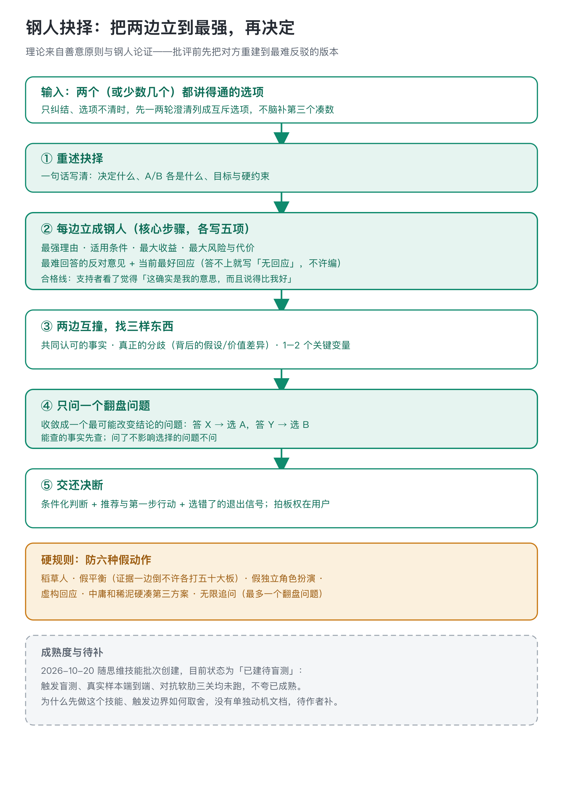

# 钢人抉择 · steelman-choice

两个选项都说得通、迟迟拍不了板时用。先把每一边重建到它最强、最难被反驳的样子，再找真正的分歧和一个能翻盘的事实，最后把决断交还用户。

## 它治的是哪种犹豫

人在两个选项前犹豫，常见的假动作是把倾向方的优点和反方的弱点摆在一起，自以为权衡过了；或者两边各说一句好处，凭感觉选。这个技能的方法来自善意原则和钢人论证：批评或放弃一个选项前，先写出它最强、最合理的版本。

钢人有合格线：写出来的 A 方最强版本，要让真正支持 A 的人看了觉得「这确实是我的意思，而且说得比我好」。写完五项：最强理由、适用条件、最大收益、最大风险与代价、最难回答的反对意见加当前最好回应。写完再让两边互撞，找三样东西：两边其实不吵的共同事实、背后真正的分歧、一两个最可能改变结论的关键变量。

## 一个翻盘问题，然后交人

还缺什么信息，收敛成一个最可能翻盘的问题，写清映射：答案为 X 选 A，为 Y 选 B。能查的事实先查，不用纯对话拖。

收口给的是条件化判断：在什么前提下推荐哪个，附第一步行动和选错了的退出信号。事实层面的分歧归这个技能，价值取舍和拍板权在用户。

## 走一遍（示意）

示意案例：tech lead 纠结「本季度花两周重构现有模块 vs 继续堆新功能」。重述时把两次线上事故和对外承诺两个功能写进硬约束。给重构派立钢人：两次事故同边界、拖着是每天付利息；最难反驳是「也许只是偶发」，回应是去翻 postmortem 看根因是否同处一边界，不同就写无回应。给堆功能派立钢人：对外承诺是外部事实、延期代价大于内部利息；最难反驳是「技术债到期不挑时间」，回应是先加监控压事故半径再堆功能，做不到这个条件就别选裸 B。互撞后真正分歧不是重不重构，是两周时间盒该还技术债还是守业务窗口；关键变量只有一个：新功能改动碰不碰那个事故边界。翻盘问题就是去和新功能负责人对一次技术方案，答「碰」选重构、答「不碰」选带监控的堆功能。查完发现两边都要碰，说明原来 A/B 二分错了，回第一步重述。

## 边界与成熟度

- 不做什么：替用户拍板、伪造「请三位专家发言」式角色扮演、硬凑 A+B 第三方案、证据一边倒时各打五十大板、一次以上的翻盘追问。
- 其他分工：手里一个想法多维打分走 scorecard；一条说法验真走 claim-check；缺外部事实先调 outside-view；从零重推新路走 root-rethink。本技能只在两个已成形选项都讲得通、用户在 A/B 间犹豫时启用。
- 这个技能 2026 年 10 月 20 日随思维技能批次创建。已跑过一轮 32 条 query 路由冒烟测试（补触发词后 32/32、负例零误触发），只证明路由正确，不证明端到端质量。发布门槛三关（正式触发盲测≥85%、真实样本端到端、对抗软肋）都还没跑，五维评分任一低于 8 不算真正发布。
- 为什么先做这个技能、触发边界怎么定的，没有单独的动机文档，待作者补。
