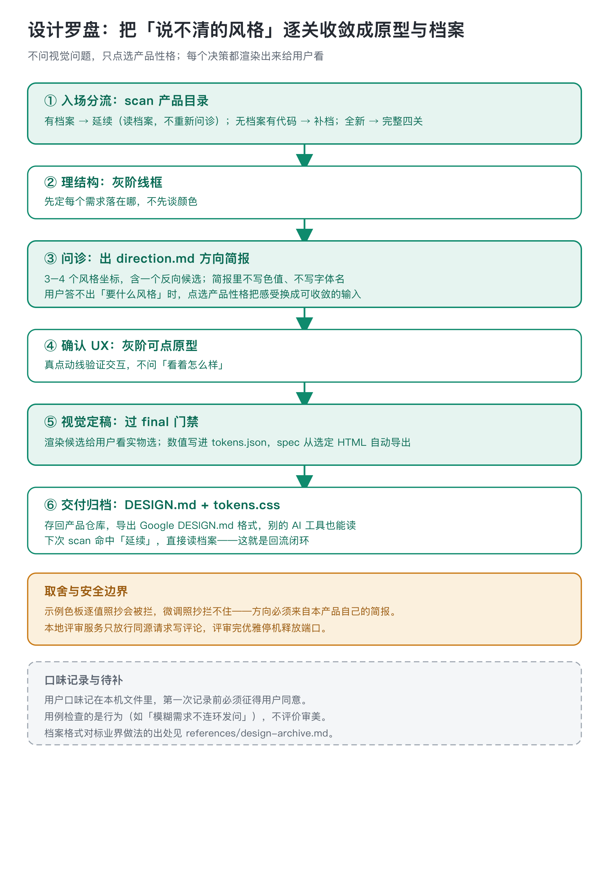
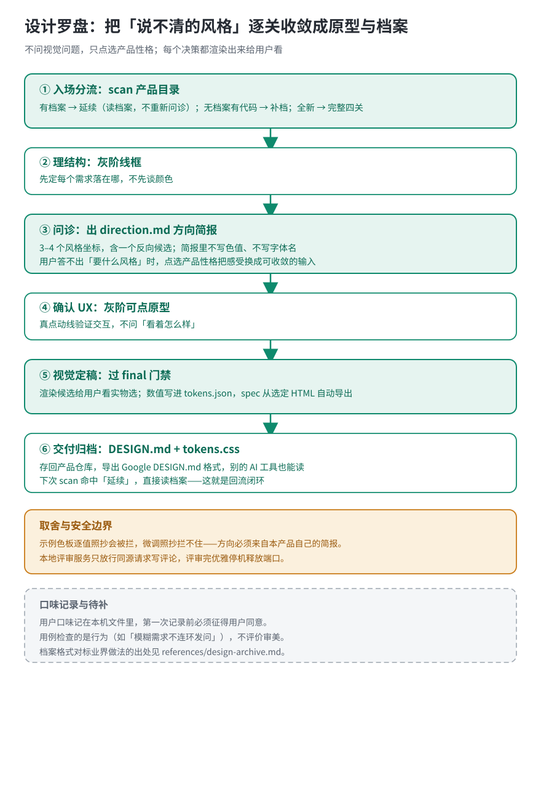

# 设计罗盘 · style-compass

给有代码能力、缺设计经验的人做产品界面：从一句需求走到可点原型、设计 tokens 和开发规格。每一关都把视觉渲染出来给用户看、给用户玩，不让人在文字里想象风格。

## AI 做不出好设计，问题往往不在审美

做界面时最常见的死循环是：技能问「你想要什么风格」，用户答「好看点」，于是双方都卡住。这个技能的判断是，用户不是没审美，是给不出具体输入：「好看」在脑子里是一团感受，不是色值和字体。流程的任务就是把这团感受一步步换成具体决策：问诊不问视觉问题，只让用户点选产品性格和目标感受，产出一份方向简报（三到四个风格坐标，含一个反向候选），简报里刻意不写色值、不写字体名；视觉候选全部渲染出来，用户看实物选，不写空对空的形容词。

## 四关一步不让

入场先扫产品目录：有设计档案就判「延续」，直接读档案和最近三条决策，不重新问诊；没有档案但有界面代码，先把现有界面的颜色字体提取成 tokens 草稿补档；全新产品才走完整四关。

之后依次是：理结构（灰阶线框，先定每个需求落在哪）、问诊（出方向简报）、确认 UX（灰阶可点原型，真点动线，验证交互不问「看着怎么样」）、视觉定稿（过 final 门禁才叫定稿，数值写进 tokens.json）。spec 从选定的 HTML 自动导出，数值以 tokens.json 为唯一事实源，不两头手写。

评审现有页面不进四关，走专门的审计路线。

## 设计档案是给下一个页面省时间

每次从零开始有三个代价：同产品新旧页面对不上、每次重新问一遍、写代码的工具不知道这个产品的设计。这个技能把设计上下文存成产品仓库里的文件：DESIGN.md 给所有 AI 工具读，tokens.json 存数值，方向简报和决策记录留痕。这是 Google Stitch、Replit、Figma Make、Lovable 各自在做的事，这里直接导出 Google DESIGN.md 格式。

评审环节有一个本地工作台：起服务、评论写进本地文件、外壳被项目改坏时校验失败。4.3.0 版本补了一条安全修复：写接口只放行同源请求，恶意网页没法往本地评审数据里写假评论；服务评审完优雅停机释放端口。另一条诚实标注：示例色板逐值照抄会被规则拦住，但微调过的照抄拦不住，方向必须来自本产品自己的方向简报。

## 边界与待补

- 做什么：界面结构、交互、视觉方向、设计档案、现有页面评审。
- 不做什么：需求发现和需求正确性（上游的事）、纯落地页和通用创意出图、一次性页面。
- 用户口味记在本机文件里，第一次记录前必须征得同意。
- 用例检查的是行为（比如「模糊需求不连环发问」），不评价审美；设计档案格式对标业界做法的出处，写在 references/design-archive.md 里，随版本维护。

## 拿一条行为用例走一遍

输入就是那句最典型的「帮我做个记账 App 的界面，要好看点」（evals id=1，不是真实用户反馈，是技能自检用例）。第一步先跑入场分流：产品目录里没有 DESIGN.md、也没有现成界面代码，判「新产品」，走完整流程。接着最多四个点选问题——给谁用、主要在上面做什么、用多久、有没有必须保留的品牌色——一个字不问颜色、字体、圆角；用户说「不知道」也不连环追问，由技能根据已有材料起草简报。

简报写进 design/direction.md：三四根产品性格滑杆、三五个目标感受词（可靠、高效、有条理）、两条「X 但不 Y」（专业但不冰冷、高效但不拥挤），外加「像什么／不像什么」的具体关系。简报里不出现任何色值和字体名。然后技能从 style-library 里挑三四个风格坐标，其中一个必须标 contrarian：它反的是第一直觉，不是需求——深色安静检索台不能塞进一个目标感受是「年轻、轻松」的简报里。挑完先跑 diverge 检查，每对候选至少在三个维度上不同；三版都是浅底蓝主色无衬线，检查会拦下，回去改方向卡，不直接渲染。候选全部渲染成真实 HTML 页面，过 direction 门禁后才给用户看；用户在页面上点选，不写「现代简约」这种形容词。选定后过 final 门禁，数值写进 tokens.json；规格从选定的 HTML 自动导出，不两头手写。最后把这次给了哪些候选、选了哪个、为什么否掉其他的，记进 decisions.md（本机口味记录需先征得同意才追加）。下次开工再 scan 这个产品目录，命中「延续」就直接读档案，不再问一遍。

## 什么时候不走这里

这个节点不接三类活。需求发现和需求正确性不在这——上游 product-brief 把要做什么、为谁做、核心旅程定完，再接这里做界面。纯落地页和通用创意出图走 creative-design，不走这里。一次性、不留设计档案的页面直接用 html skill；这里出的是带阶段契约、门禁记录和可复用 tokens 的设计档案，下次开工能续上，不是一张看完就扔的稿。真正的视觉验收仍需要在宿主浏览器里渲染——脚本只查确定性的底线（中文字体回退、行高、lang、动效、默认长相），不判断好不好看；缺渲染环境时如实标「未验收」，不拿静态截图当交互完成。

上游 product-brief 定好需求和旅程之后接这里。
