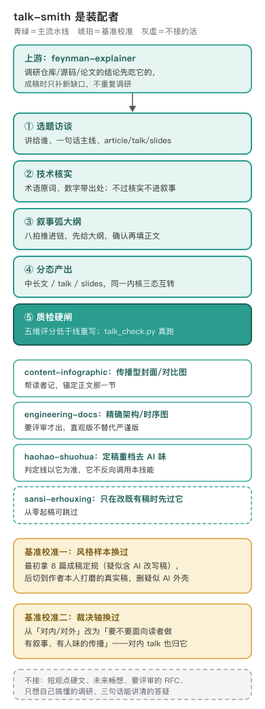

# talk-smith · 面向读者的技术分享锻造



编辑源：[assets/assembly.svg](assets/assembly.svg)

---

## 把「我看过的好分享」拆成可迁移的动作

这个技能的唯一目标：把一个技术主题做成别人愿意读、听完能转述、明天能搬走用的分享，技术准确和叙事、人味同时在线〔出处：SKILL.md 开篇〕。它来自作者个人看到的技术分享怎么写：动手时先从 12 篇本人文章（必读 8 篇加交叉验证 4 篇）里只提炼「任何技术分享都能复用的结构动作」，固化成 references 里的叙事弧与中文写法规则，把「别人学了会别扭」的偶然特征单列出来不进规则〔出处：CHANGELOG.md 0.1.0 来源节；`talk-smith-work/style-bones.md` 样本说明；作者确认〕。

方法上借过两个开源项目的思路，只借思想不拷贝文本：五维评分加低于阈值重写，借自 stop-slop（MIT），按中文技术分享重定为钩子、准确、叙事弧、节奏、可转述五维；五步流水线骨架借自 content-research-writer（Apache-2.0）的大纲、引用、逐节反馈管线〔出处：CHANGELOG.md 0.1.0 开源借鉴节〕。

## 风格基准换过一次，因为旧样本掺了 AI 稿

最初定规用的 8 篇博客成稿，frontmatter 均标 public-rewrite，事后看疑似含 AI 改写稿。0.2.0（10-17）把风格基准整个切到「作者本人多次打磨的真实分享稿」，据此重校语气层和结构层〔出处：CHANGELOG.md 0.2.0〕。被证伪删掉的典型规则：通俗版与进阶版的双轨配色排版、结尾对仗金句加速记口诀的强制、针对外部文章的评论体拆台；从真实稿里新增入规的：TL;DR 卡片开头、埋一个主线词、设问推进、幽默剂量硬规则（每 2000 到 3000 字一处、全文 8 到 10 处封顶、严肃事故复盘归零）〔出处：CHANGELOG.md 0.2.0〕。同版立隐私红线：私人梗只抽象成规则，不引用任何原句，技能包不含内部业务事实、平台名、具体数字或文档链接〔出处：CHANGELOG.md 0.2.0〕。

## 边界是拿 8 道易混请求实测出来的，不是想出来的

技能写完后做了一轮边界对抗评审：拿 8 道最容易判错的请求逐条路由，实测它和 feynman、cuihuo、tangshan、engineering-docs 真不打架，8 题里 5 题干净〔出处：`talk-smith-work/boundary-test.md`〕。发现两处落缝：800 字观点文夹在 cuihuo 的 ≤120 字手记和本技能的 2000 字下限之间；对内技术分享夹在「内部内容归 engineering-docs」和「talk 形态归本技能」之间。0.1.1 把负向路由挪进 description 前 50 个汉字、补全 cuihuo 字数行〔出处：CHANGELOG.md 0.1.1；boundary-test.md 落缝节〕。之后裁决轴又校准过一次（0.2.1）：从「对内还是对外」改成「要不要面向读者做一次有叙事、有人味的传播」，对内技术 talk、复盘、slides 一样归它，只想把东西调研清楚的内部研判稿归上游的 feynman〔出处：CHANGELOG.md 0.2.1；SKILL.md §0〕。

盲评是两轮一次性比稿，分数只排当对单稿高下，不是可复跑的现行质量分。10-16 首轮（五维五十分制，不预测身份）：Mamba 中长文 X 47 对 Y 39（X 胜），Agent/Skill/MCP talk 分镜 X 36 对 Y 48（Y 胜，talk 态当时没踩准）；10-17 换真实稿基准后重测风格贴合度（百分制）：复刻 TL;DR 卡片加诚实拆台的 X 86 对 Y 63〔出处：`talk-smith-work/ab/blind/verdict.md`、`v020/ab/blind/style-verdict.md`〕。

## 机器闸也修过两个真缺陷

质检硬闸的 `talk_check.py` 不是一次写对的：文体提示原来用裸字「层、参数、梯度」当「有进阶层机制」的信号，满字数的纯观点文自然出现这些字，一条 WARN 都不出；半角标点检查原来没真做 mask，代码块和 URL 里的半角会被误报。0.1.2 把前者换成复杂度公式、拉丁术语加注释这类有信息量的信号，把后者改成先 mask 成等长空格再扫，各配正反回归〔出处：CHANGELOG.md 0.1.2〕。测试随版本从 6 个一路加到 24 个，每次修完老用例保持绿〔出处：CHANGELOG.md 0.1.1 至 0.2.0〕。

## 今天的形状：装配者，不是万能工厂

方法形状见上图。技术核实先于叙事（术语保留原词、数字带出处，不过核实不进叙事）；开头禁寒暄导语，默认 TL;DR 卡片；结尾默认三条平实启示，不写对仗警句；幽默按剂量放，只服务理解或拉近距离〔出处：SKILL.md 第二步、第三步、§3〕。定稿交 haohao-shuohua 重档去 AI 味，判定线以它为准；成稿要搬进在线文档、语雀、公众号这类平台时，平台技能只搬运承载，选题和分镜不由平台主导〔出处：CHANGELOG.md 0.2.2；SKILL.md §1〕。

**不管什么。** 短观点硬文走 cuihuo，面向未来的畅想走 tangshan-style，要评审拍板的 RFC 走 engineering-docs，只想自己搞懂的调研走 feynman-explainer，三句话能讲清的答疑直接答、不启用本技能〔出处：SKILL.md §0 边界表〕。

边界在 0.2.1 之后还动过一次：一份提示词调研成稿在干净新会话里漏路由、被文档技能裸写，促成 cab48e9 把分界钉死为「是不是讲给别人听的分享或经验叙事」。对外发布的研究报告、机制解读、选型研判归 feynman，严肃无幽默的分享、复盘、工程实践仍归本技能〔出处：`git show 95f1cdf`、`cab48e9`〕。

---

## 怎么跑（人类操作参考）

```bash
python3 scripts/talk_check.py 稿子.md --state article   # 硬约束扫到净：禁导语/字数/半角标点
python3 -m unittest tests.test_talk_check                # 24 个用例
```

五维评分由人完成，不是脚本跑：开头与开场、技术准确、叙事弧、节奏与密度、可转述与收口各 0 到 10 分，满分 50，每维须附稿中证据句；总分低于 38 整篇重写，任一维低于 4 该项必改，技术准确维低于 6 不许交付。低分回到对应步骤改，不必整篇推倒。

`talk_check.py` 只扫字面硬约束：退出码为 1 的必修项是前三段禁导语、残留 TODO 待补等未核实标记、未闭合代码围栏、中文夹半角标点；其余提示均为 WARN，退出 0，交人复核，不拦交付。幽默分寸脚本不判。

成稿模板在 `references/templates-article.md`、`templates-talk.md`、`templates-slides.md`，五维评分线在 `references/qc-checklist.md`。

## 待作者补

1. 0.2.0 切基准时，「疑似含 AI 改写稿」这个判断是怎么认出来的，文件里只留了结论，没留判定信号。
