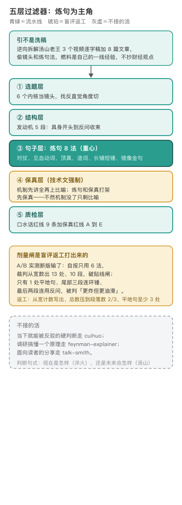

# tangshan-style · 汤山体

编辑源：[assets/layers.svg](assets/layers.svg)

---

## 把喜欢的自媒体风格炼化进规则

这个技能不生产观点，它把一个面向未来的想象或推演，锻造成每个句子都耐嚼、每段都有历史纵深的畅想长文〔出处：SKILL.md 开篇〕。它的手艺是逆向拆解出来的：拿「汤山老王」3 个视频逐字稿加 8 篇公众号财经文章，拆出「从哪个角度切、句子怎么炼」的引擎〔出处：SKILL.md 开篇「它偷的是谁的手艺」、文末手艺来源节；作者确认〕。拆的时候立了一条防洗稿线：偷的是引擎，燃料必须是写作者自己的一线经验，对方的财经观点一个不抄〔出处：SKILL.md §2 选题层禁止节〕。

## 保真层是被技术文炸出来的

初版（v1.0，2026-07）只有四层过滤器加炼句 8 法。很快发现炼句的本能会误伤技术文：把机制炼成比喻、把数据炼成金句，写财经杂文没问题，写深度技术文会出事，一个精确机制被炼成漂亮比喻之后，机制没了，只剩比喻〔出处：SKILL.md §1 为什么保真层必须独立成一层〕。v1.1（2026-07）加了保真层四条铁律：机制先讲全再上比喻、关键数据带原值加出处、论文级证据可追溯、不确定就标出边界；炼句和保真打架时先保真，再在保真句旁边炼句〔出处：SKILL.md §4.5；文末版本线〕。同年 v1.2 收窄边界：畅想归它，「我认为现在是怎样」的硬判断迁往 cuihuo〔出处：SKILL.md §0、文末版本线〕。

## 剂量闸是盲评输出来的

炼句 8 法刚上的时候，只有逐句质检清单，没有剂量指引，模型极易产出句句对仗、句句顶真的金句体〔出处：CHANGELOG.md 0.2.0〕。真正的教训来自一次 A/B 盲评返工（0.2.1）：新版输了。产出自报只用 6 法，裁判按从宽口径数出 13 处、10 段，破了贴线闸；全文只有 1 处平地句、尾部三段连环锤、最后两段连用反问，被判「更炸但更油滑」〔出处：CHANGELOG.md 0.2.1 A/B 盲评返工节〕。根因是「什么算一次炼句」定义太松、漏数。返工把剂量闸改成四步：从宽口径逐句数并写出计数、总数压到段落数的三分之二、平地句至少 3 处并点名、最后两段不连用反问，数超了按固定顺序砍〔出处：CHANGELOG.md 0.2.1；SKILL.md §4 剂量闸〕。同版给正反例手册补了一段约 300 字的完整样段，逐句标注哪句用了哪法、哪句故意不炼，给整篇密度一个锚〔出处：CHANGELOG.md 0.2.0；references/lianju-examples.md〕。

## 今天管什么、不管什么

**管。** 把一个技术想象或极端外推写成畅想长文：Token 战争、AGI 畅想、某个趋势推到尽头；读者默认是同行，行话直接用，比喻只叠加画面感不替换机制〔出处：SKILL.md description、§0.5〕。日常高频用法还包括把已沉淀的内部笔记低能耗改造成可读稿：补具身开头、插跨界引信、过炼句加保真、反问收束〔出处：SKILL.md §7〕。

**不管。** 下一个当下就能被同行反驳的硬判断，走 cuihuo；调研搞懂一个已存在的原理，走 feynman-explainer；把技术讲给读者听的分享文，走 talk-smith〔出处：SKILL.md §0 边界表〕。一句话开关：这篇是「未来会变成怎样」才启用它。

## 把一篇稿子走到成文

动笔按五层顺序过，层与层之间是流水线，不是可选项：选题层拿 6 个内核当镜头，找反直觉切入角度；结构层按具身开头、跨界引信、反直觉重构、历史长镜头、反问收束五段搭骨架；句子层用炼句 8 法逐句过筛，总量服从剂量闸；保真层对深度、技术文强制，机制先讲全再上比喻，关键数据带原值和出处，论文级证据可追溯，不确定标出边界，冲突时先保真再在旁边炼句；质检层交付前扫口水话红线和保真红线。

动手先备三样：写什么题、写给谁看、手头有哪些真实素材和数据。顺序是先定切入角度，再搭五段骨架，句子放到最后才炼；改一篇已成稿时，先过 sansi-erhouxing 看全文骨架。

---

## 怎么跑（人类操作参考）

成稿自检和正反例对照在 `references/lianju-examples.md`（8 法每法一组口水版对汤山原句，加保真铁律正反例，加密度锚点样段）。本技能没有独立脚本，交付前优先调 haohao-shuohua 重档做统一去 AI 味，它自己只兜底独有部分〔出处：SKILL.md §5〕。

## 待作者补

1. 第一个被「汤山体」写出来的畅想题是什么（仓库只留了引擎，没留首篇成稿的去处）。
2. 这次 A/B 盲评的完整裁决记录（CHANGELOG 留了诊断和返工，原始对照稿未见存档）。
