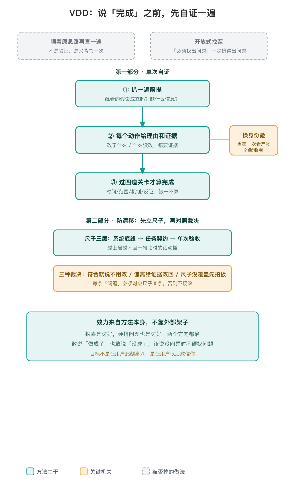

> 在你说「完成了」之前，先逼自己走一遍验证——不只是不允许乱报喜，也不允许为了显得尽责硬挤问题。

## 为什么会有这套方法

作者在自己的私档（iLoop/docs/VDD.md）里记过起点：让一个 AI agent 改东西，它反复说「做完了、验证过了」；后来只让它换个身份、假装自己是用户再走一遍，同一个模型、同一段上下文，没有任何新信息，它自己揪出了三个之前没发现的问题〔出处：作者私档 iLoop/docs/VDD.md〕。

这件事暴露的问题是：**你没法用「做这件事」的那条思路，去可信地判断「这件事到底做成没有」。** 自己既当运动员又当裁判，裁判权在自己手里，结果不可信。而且每句话都接着前文往下写，「自查」往往只是顺着原思路再背书一次〔出处：SKILL.md·这套东西到底在防什么〕。

## 两根支柱，缺一不可

**第一根，单次自证。** 说「完成」之前走三步：扒一遍前提（藏着的假设成立吗）；每个动作给理由和证据（改了什么、什么没改，都要拿得出证据，取法要匹配要验的东西）；输出端过四道关卡——时间对得上、范围对得上、机制说得通、有反证。关键机关是**换身份**：把自己当成第一次看到这份产物的验收者，不带「当时为什么这么做」的记忆。

**第二根，防漂移。** 只靠找错会走向另一个极端：带着「必须找出问题」的心态 review，几乎一定能挤出一堆问题，哪怕东西本来是对的——一会儿嫌改多、一会儿嫌改少，尺度永远跟着用户最新那句话飘。解法是动手前先立一把尺子（系统底线 → 任务契约 → 单次验收，三层），之后所有判断对照尺子裁决：符合就明说「不用改」、偏离就给证据改回、尺子没覆盖就先拍板再动手。每条想报的「问题」都必须对应尺子某条，对应不上就不硬改〔出处：SKILL.md·第二部分〕。

报喜是讨好，硬挤问题、见风使舵也是讨好——两个方向都是被当下这句话牵着走，这套方法两根支柱就是同时治这两个方向。

## 一个刻意的设计

整套方法每一步都只靠你自己做，不需要外部工具、子系统或特殊环境。这是有意的：VDD 的效力必须来自方法本身，而不是来自谁给你搭好的架子。装上它，一个光秃秃的 Agent 也能立刻跑出效果——所以它本身也是一次最小可复现证明〔出处：SKILL.md·开头〕。

## 用法

它没有脚本、没有依赖。触发条件写在 description 里：只要你即将声称一件事做成了、即将采信一个前提、或即将对一大片改动下「有没有问题」的判断，就主动走这套流程；别只在被点名时才用。完整步骤、证据分级和收尾话术见 `SKILL.md`。

## 参考

方法、证据边界和自检流程见 `SKILL.md`，无需外部文章或平台。

---

## 当前用法 / 版本补充

> 目的：旧好文章深度展开的是**第一根支柱**（单次自证：换身份、按代价算账、四道关卡、古德哈特定律、VDD 与 TDD 的分工）。技能在旧文之后，把**第二根支柱（防漂移）** 从一条「每次改动回头看整体」的守则，结构化沉淀成了独立方法。为避免读者以为旧文已覆盖第二支柱，在此单独标出版本差：

- **第一支柱的完整论证**（代价怎么算、为什么换目标而不是换眼睛、指标为什么只能当线索、能写断言归 TDD 写不出才归 VDD、以及真实跑通的「直播下单『再来一单』根因排查」用例）——以旧好文章为准，本文不重复。
- **第二支柱「防漂移」的权威定义**——以 `SKILL.md` 第二部分为准，旧文没有展开：
  - 动手前先立三层尺子（系统底线 ＞ 任务契约 ＞ 单次验收，越上层越不因一句临时的话动摇）；
  - 评审只给三种裁决（符合尺子就明说「不用改」／偏离就给证据改回／尺子没覆盖就先改尺子再动手）；
  - 硬机关：每条想报的「问题」都必须对应尺子某一条，对应不上就记为「尺子缺口」跟用户讨论，不当 bug 顺手改——同时挡住过度修改和硬编问题。
- **范围边界（区分旧文范围与现 SKILL 增量，避免误以为削弱现功能）**：
  - 第二支柱「防漂移」**管的是单次任务内的判断尺度**——多轮、大改动里，不让 review 的松紧跟着用户最新一句话飘、不为显得尽责硬挤问题、也不一听「是不是改多了」就乱退。这是相对旧文的**增强**，不是缺陷。
  - 它**管不到**的是另一个方向：跨成百上千次独立改动、各自「都通过」累积出来的**整体架构腐化**。那是更高一层的架构 review，不是单次验证能覆盖的，仍要靠定期人工复盘兜底——这和「防任务内尺度漂移」不是同一件事，不构成矛盾。
  - 其余仍以旧文「这套方法还覆盖不到的地方」为准：从零做新功能尚未拿真项目跑穿；「判断代价的终究是 AI」这个矛盾只能长期兜底、压不到零。
