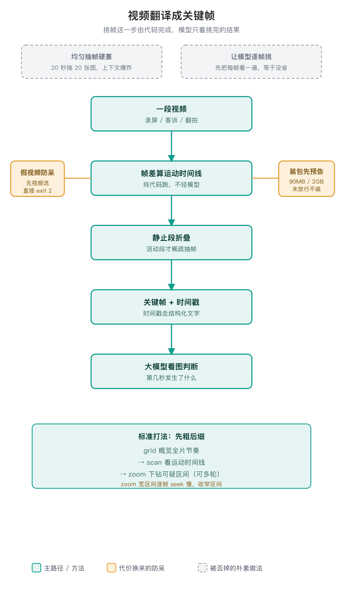

# Video Reader

> 给看不了视频的大模型，配一副「看视频的眼镜」：把视频翻译成带时间戳的关键帧和运动时间线。

## 为什么需要它

手上一段视频：同事甩来的 App 滑动 bug 录屏、用户客诉、随手翻拍的操作过程，想让大模型说清「第几秒发生了什么」。但大模型只能看图，看不了视频。这个缺口最初就是反复出现在排查 App 交互问题的场景里〔出处：README.zh-CN.md·为什么需要它〕。

## 核心判断：抽帧这步可以搬到外面自己做



大模型里有一部分只能接收图片。外置抽帧正好补上这个缺口：把视频翻译成带时间戳的图片序列，这类模型就能说出「第几秒发生了什么」。部分原生视频方案内部也会对视频采样帧再处理，但这不等于它们的视频能力等同于外置抽帧，本技能也没有把自己和原生方案做过对照评测〔出处：README.zh-CN.md·核心洞察〕。

两种朴素做法被否掉：均匀抽帧硬塞，20 秒视频抽 20 张图全塞给模型，又贵又花眼；让模型逐帧挑关键帧，先把每帧看一遍才知道哪帧重要，等于没省。落地的解法是纯代码用帧差挑帧：画面没变就折叠静止段，画面在变就在活动段稀疏抽帧。这一步在 CPU 上跑、不经过模型，模型只看挑完的结果，省不省取决于宿主怎么给图片计费〔出处：README.zh-CN.md·它是怎么工作的〕。

## 每一处防呆，都对应一次静默翻车

流水线第一版就能跑，但直接交给 Agent 跑会在暗处出错。0.2.0（CHANGELOG 记为 2026-10-16）补了几处防呆。下面写的是诊断中发现、并由回归测试覆盖的风险；它能证明这是一类真会出错的错法，不等于每处都来自一次具体生产事故：

- **假视频曾被当成「全静止视频」静默成功。** PNG 改名 mp4 这类文件能被打开、但没有可解码视频流，旧版直接 exit 0。0.2.0 改为校验 frame_count、宽高、时长，不合格就 exit 2 报人话错——别把垃圾文件当分析结论〔出处：CHANGELOG 0.2.0·P1-2；SKILL.md·假视频防呆〕。
- **依赖曾被静默安装。** 首次缺 cv2/numpy（约 90MB）、transcribe 缺 whisper（含 torch 约 2GB），旧版后台 pip 直接装。0.2.0 加装包闸门：未显式放行就打印体量预告和手动命令，分别 exit 3 / exit 4〔出处：CHANGELOG 0.2.0·P1-3；SKILL.md·装包闸门〕。
- **帧目录曾失控。** zoom 宽区间 × 高 density 会静默产出数千帧。0.2.0 加 `--max-frames`（默认 300）截断告警、退出时提示可清理目录、`--cleanup` 只删自动临时目录，`--outdir` 指定的位置绝不误删〔出处：CHANGELOG 0.2.0·P1-1；SKILL.md·帧目录治理〕。
- **性能曾被文档含糊带过。** zoom/grid 是逐帧随机 seek，长视频宽区间会明显变慢；0.2.0 把这条如实写进文档，请收窄区间，不要对长片一次性高密度抽帧〔出处：CHANGELOG 0.2.0·P2-1；README.zh-CN.md·命令参考〕。

这些行为由 9 项回归测试守着（真视频用 ffmpeg testsrc 生成、伪造后缀样本同测）〔出处：CHANGELOG 0.2.0·新增；tests/test_video_reader.py〕。

## 几处选择和代价

- **时间戳走结构化文字，不烧进画面。** 让模型认画面里烧的字，可能糊、可能挡、可能读错；时间戳放在文件名和返回数据里逐帧对应，减少 OCR 误读。微小文字看不清时，靠 zoom 收窄区间补细节。
- **喂给模型的帧压到宽 900、JPEG 质量 70。** 这是成本和细节的取舍：缩小减少传输和处理量，代价是极小字号可能看不清，需要时再对那段单独 zoom。
- **翻拍视频用缩小 + 模糊 + 分块算帧差**，吸收噪点和轻微抖动；但手指位置这类细节只能定性看方向。
- **工具里不写业务逻辑。** 它不懂「卡顿」「面板」「跟手」是什么，只产帧和时间线，判断交给上层模型。这样今天能查交互，明天能查任何「想让模型看个视频」的场景。
- **不依赖屏幕录制小白点。** 很多视频是真实客诉或随手翻拍，有就当福利，没有也能干活。
〔出处：README.zh-CN.md·设计取舍〕

## 今天的边界

- 查交互逻辑（滑动、手势、状态切换、页面跳转）是它的主场；**查帧率/卡顿不是它**——卡顿信号在「帧之间隔了多久」，抽帧会把时间抹平，查性能请走日志/Perfetto〔出处：SKILL.md·边界；README.zh-CN.md·边界与已知限制〕。
- 不知道用户操作意图时只做客观复述，不瞎猜对错。
- 平台上传限制可用改后缀或压 zip 绕过，但仅限用户自有、有权处置且平台规则允许的内容；拿到文件先过假视频校验〔出处：SKILL.md·上传被拦怎么办〕。

## 在排查流程里怎么被用

标准打法是先粗后细：长视频先 `grid` 概览全片节奏 → `scan` 看运动时间线 → `zoom` 下钻可疑段，可多轮。关键是先读文字时间线，再决定看哪段帧——很多时候时间线本身就够定位方向。画面看不出、需要听旁白或报错语音时，加 `transcribe` 把语音时间轴和画面运动时间线对齐。

## 用法（人类操作）

依赖：Python 3 + `opencv-python-headless` + `numpy`（OpenCV 自带解码，不依赖系统 ffmpeg）；`transcribe` 另需 ffmpeg + openai-whisper（可选）。

```bash
pip install --user opencv-python-headless numpy
python3 scripts/video_frames.py scan your_video.mp4
python3 scripts/video_frames.py grid your_video.mp4
python3 scripts/video_frames.py zoom your_video.mp4 --start 10 --end 12 --density 8
```

退出码契约：0 成功；2 打不开或不是视频文件（含能打开但无视频流的假文件）；3 缺 cv2/numpy 且未放行自动安装；4 transcribe 缺 ffmpeg/whisper 或跳过转写（软能力，不影响 scan/zoom）。

作为技能使用时直接说「帮我看看这个视频讲了啥」。四个子命令的逐参数、输出 JSON 结构与退出码定义以 `README.zh-CN.md` 和 `SKILL.md` 为准，这里不重复抄。

## 待补

- 这个技能最早是在哪个具体排查场景里被逼出来的（旧独立仓库已归档，仓内只有迁移说明，没有创建时的现场记录）。
- 真实排查案例的留存：拆过哪些视频、定位出什么问题，目前没有案例库。

## 参考

- 项目页：https://jobyang.cn/projects/video-reader/ 。
- 完整命令参考：`README.zh-CN.md`；运行契约：`SKILL.md`；仓库 MIT 许可。
